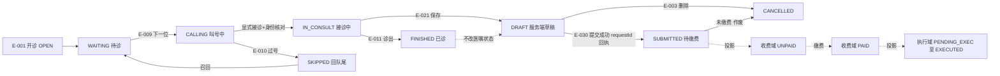
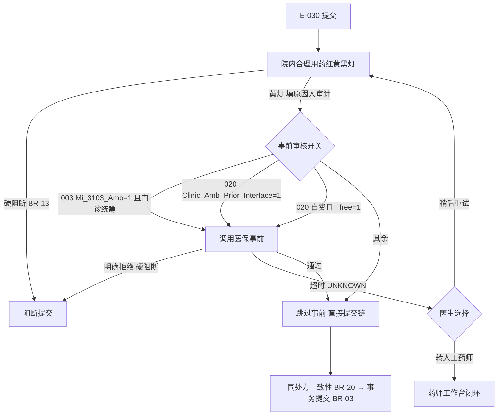
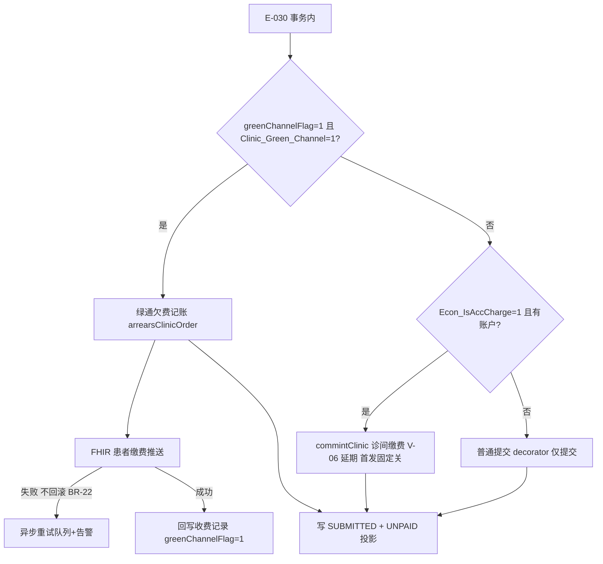
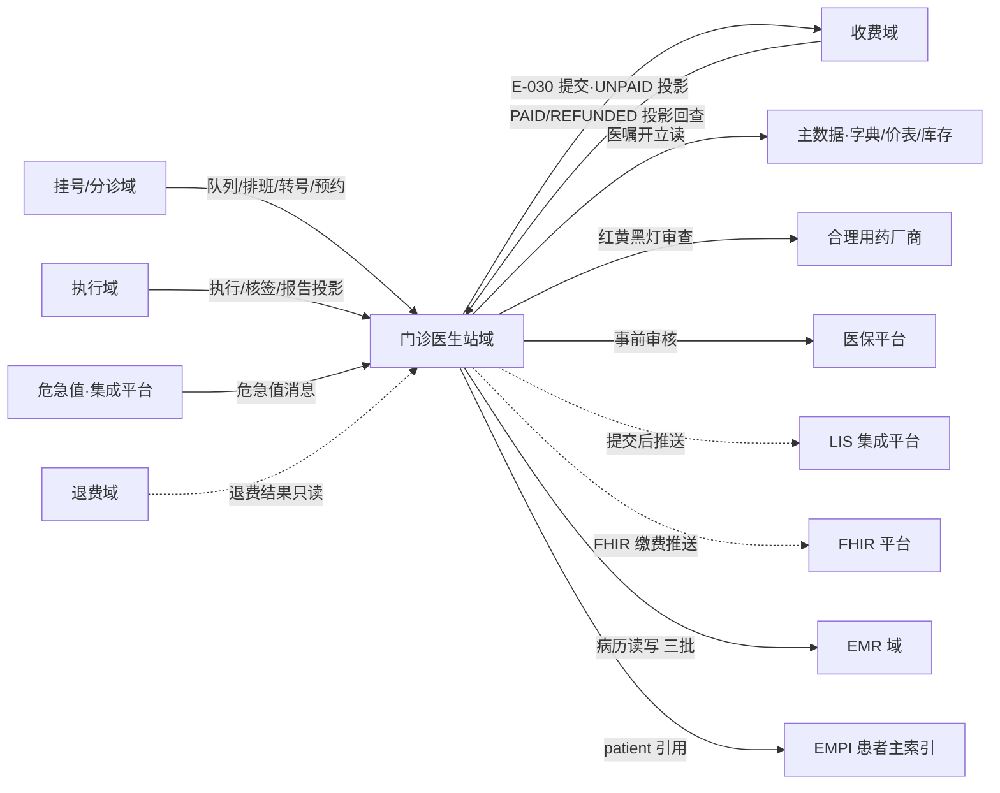
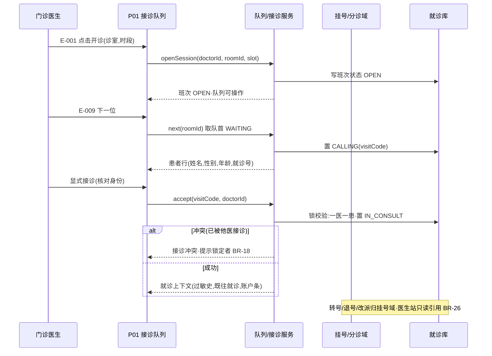
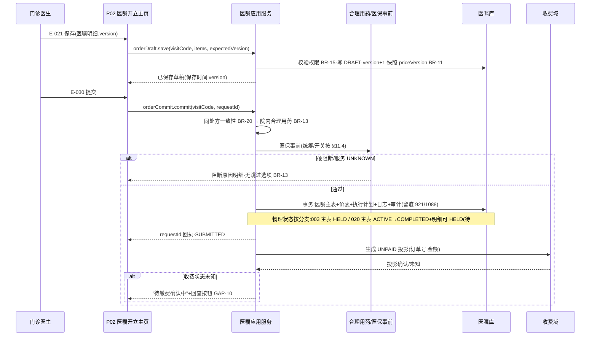
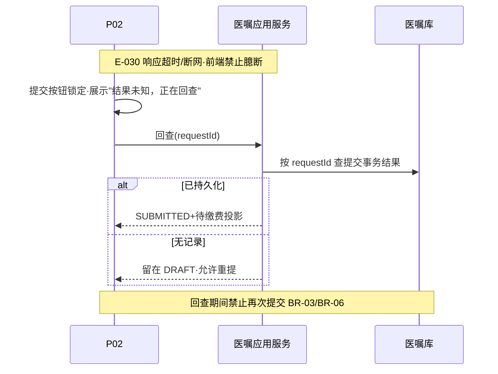
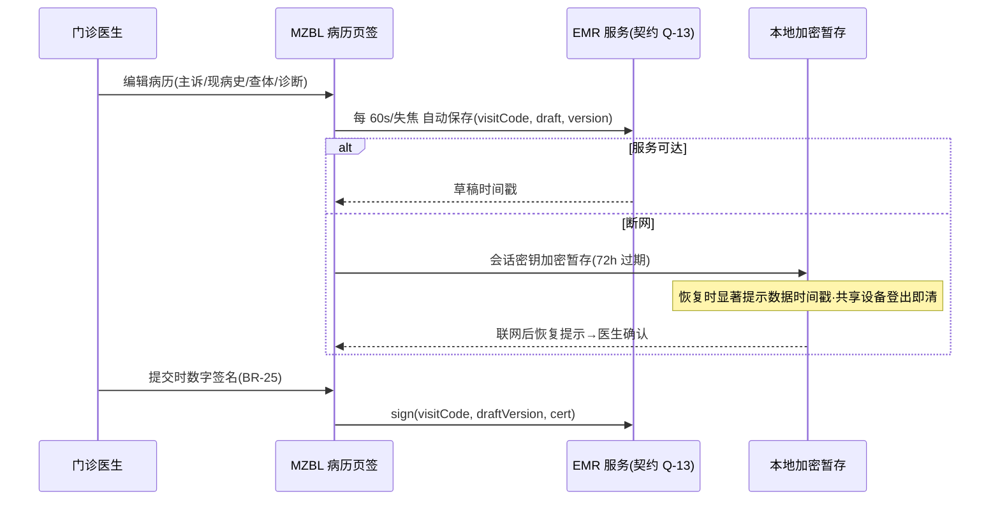
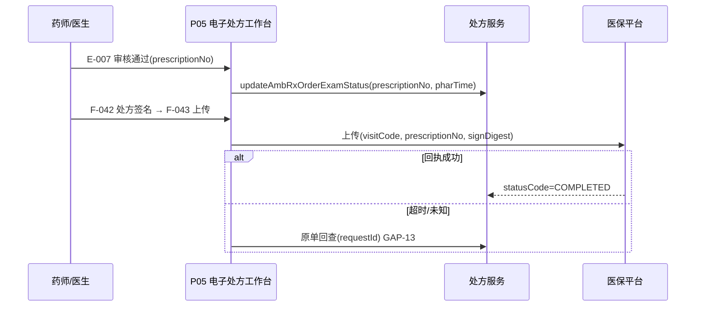

# 门诊医生站产品需求·全量版

> **本文是什么**：门诊医生站的唯一评审与交付文档（PRD-003 v0.2 全量版），自包含产品需求、页面交互、动作、状态机、业务规则、开关参数、领域数据与接口、技术集成与验收矩阵。业务口径最高依据为裁决书 PD-OPD-ADJ-20261013-01 v1.1；mh 套件（00～05）为本文的维护源，裁决升版时回写本文。
> **效力分层**（沿用裁决书）：◆ PM 裁决立即生效；◇ Owner 签字项签字前维持现状（禁写）；○ 技术出证项产出物归技术 Owner。
> **证据标记**：`VERIFIED`=源码可定位（含 文件:行号）；`INFERRED`=跨材料推断；`PROPOSED`=本文或裁决建议（V2 参考实现一律 PROPOSED，不冒充事实）；`UNKNOWN`=须责任人确认并登记 Q-xx。任何 UNKNOWN 不得由 Agent 补成默认业务规则；不生成假 requestId 回执、假 Token、假诊断编码、假价格（红线 4）。
> **编号纪律**：不新造功能/事件/规则编号；canonical 沿用既有登记；本文新增仅 UJ / AC 挂靠锚点 / SM / AH 四类。编号断链、术语漂移、静态 mock 充当验收均属评审缺陷。

**文档地图**：产品读 §1–§5、§9、§17–§19；前端读 §6–§8、§11、§14；后端读 §8、§10–§13、§15；测试/实施读 §9–§11、§13、§18。

## 1. 愿景与问题

### 1.1 问题陈述

门诊医生站要在一次接诊内完成队列管理、病历、诊断、多类别医嘱开立（01～08）、三重校验（合理用药/医保事前/医嘱权限）与提交联动。两代旧产品已承载这些业务，但物理实现冲突：003 提交后主表写 `HELD`（`AmbCpoeServiceImpl` L763-765，VERIFIED）；020 待缴费分支主表写 `ACTIVE→COMPLETED` 且材料费明细另写 `HELD`（`AmbCpoeSyntheticServiceImpl` L1739-1756，VERIFIED），服务端另按绿通/账户/普通三分支分派（同文件 L4344-4393，VERIFIED）。直接统一任一套都会把历史实现错误固化成产品规则。旧产品还缺：提交回执与超时回查、并发（乐观锁）控制、诊断修订版本、操作者/接诊医生双审计、病历断网恢复。

### 1.2 产品目标（可验收）

1. **结果正确**：提交成功的唯一定义是服务端事务持久化成功并返回 requestId 回执；超时一律原单回查，禁止前端臆断成功或失败（GAP-03/04）。
2. **状态真实**：医嘱域仅 DRAFT/SUBMITTED/CANCELLED 三态；"待缴费"是 SUBMITTED 的展示名，不是第三种状态；域外状态只读投影、不本地推算（GAP-02）。
3. **安全可控**：`checkCommitReadiness().permitted` 在 #36 签字前恒为 `false`，真实临床写接口保持关闭；每个写操作由服务端按操作级权限表逐个鉴权（总裁决一、GAP-09）。
4. **继承完整**：003（21 按钮）与 020（28 按钮）已存在的能力逐项映射（F-001～F-057，§4.11/§12.3），旧功能不因页面合并或两套实现冲突而静默删除。
5. **可恢复**：保存（E-021）与提交（E-030）幂等、乐观锁并发受控、草稿分层边界明确（GAP-04）。

### 1.3 成功信号

上线后按 §17 SM 建基线；V-01～V-15 按 GAP-17 定义出双签证据（临床安全项另须院方临床业务负责人签署）逐项关闭。静态 mock 与 A0 L1 E2E 不作为业务验收证据（红线 3）。

### 1.4 范围边界与批次

一期七能力域：接诊工作视图（P-003）、诊断管理、医嘱开立、智能辅助、门诊病历（三批）、回看与延伸、政策类扩展（二批）。演进三分法：**兼容项**（保持旧业务结果与责任边界）、**优化项**（不改结果只改操作/提示/可见性）、**补齐项**（补状态、审计、复核与恢复能力）。

| 批次 | 范围（裁决书第六节） | 放行门禁 |
| --- | --- | --- |
| 一批·临床核心 | GAP-02/03/05/09 + ADD-01/02/03（状态机、接诊状态机、权限矩阵、首批 OpenAPI 需求单） | #36 院方签字 + ehr-auth token scope 出证；未签前只做只读页/组件/契约测试/前端状态建模 |
| 二批·真实保存提交 | GAP-04/06/07/08/10 + V-09 双通道（E-021/E-030 接真实端口） | 一批已放行 + DDL/幂等/回查契约出证 + 合理用药分级签字 + 字典价表库存读接口就绪 |
| 三批·工作台完整度 | GAP-11～17（P-003/P-004 节点补建、五页签真实契约、病历生命周期）+ V-01～15 逐项 L2 验收 | 二批已放行 + 各域 Owner 契约齐备 |

## 2. 术语表

全文逐字使用本表词汇；新增领域名词须在同一轮加入本表；出现同义词视为缺陷。

| 术语 | 定义 | 依据 |
| --- | --- | --- |
| 医嘱域三态 | DRAFT / SUBMITTED / CANCELLED，医生站自持；"待缴费"是 SUBMITTED 的展示名而非第三态 | GAP-02 ◆ |
| 本地编辑层 | 未保存（未过 E-021）的编辑内容；切患者/切上下文即丢，不承诺恢复 | GAP-04 / ADD-05 |
| 服务端 DRAFT | E-021 持久化草稿，乐观锁 version，跨终端可取 | GAP-04 |
| requestId 回执 | E-030 提交成功唯一定义 = 事务持久化成功并返回 requestId | GAP-03/04 |
| 原单回查 | 超时/结果未知后按原业务单号查询，禁止再次提交 | GAP-03 |
| 只读投影 | 收费/执行/就诊域状态在医生站的只读展示，不本地推算 | GAP-02 |
| 红黄黑灯 | 合理用药分级：红/黑=阻断（黑须药师复核），黄=警告+原因说明 | V-03 / GAP-08 |
| 医保事前 | 门诊统筹且 `Mi_3103_Amb=1` 触发的事前审核；返回 UNKNOWN 不通过不提交 | V-04 |
| 绿通 | `greenChannelFlag=1` 且 `Clinic_Green_Channel=1` 欠费记账；FHIR 失败不回滚记账，进异步重试+告警 | V-05 |
| 双通道 | `CLINIC_DUAL_CHANNEL=1` 才显示的药品开立上传（020 继承） | V-09 / GAP-13 |
| 电子处方 | 003 国标 3.0 电子处方链：药师审核（E-007）+ 医保平台回执 | GAP-13 |
| 双签 | 执行域核签=双账号必须不同人员；300 秒自首次核签成功起算，仅同一签字人免重复 | V-10 / GAP-12 |
| #36 | 003/020 物理映射表签字材料；签字前物理映射不进生产代码 | 总裁决一 ◇ |
| permitted | `checkCommitReadiness().permitted`，#36 签字前恒为 `false` | 总裁决一 |
| 开诊（OPEN/CLOSED） | 诊室班次状态，仅为队列操作前提，与患者队列状态分离 | GAP-05 v1.1 ◇ |
| 过号（SKIPPED） | 旧 PASSED 统一映射 SKIPPED，回队尾、可召回；V2 枚举不出现 PASSED | GAP-05 / ADD-01 |
| 显式接诊（IN_CONSULT） | 医生主动点击接诊并核对姓名/性别/年龄/就诊号后进入；锁定"一医生同时接诊 1 人、一患者同时段一医生" | P0-02 / ADD-02/03 |
| 诊出（FINISHED） | 就诊域终态投影；不改变任何医嘱状态 | P0-09 / E-011 |
| 主诊断 | 恰好一条；从 ICD 字典录入，自由文本不算诊断 | GAP-06/19 |
| 四量 | 疗程=用药天数；给药次数=频次×疗程；总剂量=单次剂量×给药次数；发药总量=按规格换算+包装向上取整 | GAP-07 v1.1 |
| priceVersion | 医嘱价格快照版本；价表变更不回写已保存草稿 | GAP-02/07 |
| 危急值闭环 | 020 checkandsave 语义（E-017）；003 弹窗提示为降级形态 | F-055 |
| P-002 / P-003 | 诊中业务工作台 / 接诊工作视图（未接诊队列管理），两者并存不合并 | GAP-11 |

## 3. 角色与用户旅程

### 3.1 角色（权限按操作拆分、不捆绑；服务端逐操作鉴权）

| 角色 | 关键权限边界 | 依据 |
| --- | --- | --- |
| 门诊医生 | 接诊 + 病历 + 诊断（不要求处方权）+ 西药/成药/诊疗医嘱开立 | ADD-03 |
| 中草药医生 | +中草药处方权（`canChineseHerbFlag`；权威来源=人事授权域 token scope） | V-07 / BR-15 |
| 特殊药授权医生 | +麻醉/精神类（红处方）授权 | 角色清单 |
| 工作组成员 | 队列只读；不获得任何临床写权限 | ADD-03 |
| 药师 | 黑灯处方复核专属通道 | GAP-08 ◇ |
| 执行护士/医技 | 执行域工作台（核签/皮试/配液），非本包角色 | GAP-12 |
| 分诊护士 | 候诊队列改派/停诊改派（挂号/分诊域细则 ○ 出证） | GAP-11 |

登录医生站 ≠ 有处方权：处方权是独立授权，由 token scope 携带；前端隐藏入口只是 UX，不作为安全边界（GAP-09）。

### 3.2 用户旅程

| 编号 | 旅程（Persona · 主链 · 边界） | Realizes |
| --- | --- | --- |
| UJ-1 | 门诊医生开诊（OPEN）→ 点"下一位"取队首 WAITING 置 CALLING 并叫号 → 显式接诊核对身份进 IN_CONSULT。边界：过号置 SKIPPED 回队尾可召回；顶栏统计=待诊（WAITING+CALLING）/接诊中/已诊 三段（ADD-01） | F-046 |
| UJ-2 | 接诊后书写门诊病历（自动保存 60s/失焦）并从 ICD 字典录入诊断，主诊断恰好一条。边界：无诊断可存草稿但禁提交（GAP-19 急诊例外） | F-047 / F-021 |
| UJ-3 | 按类别 01～08 开立医嘱，随时保存服务端 DRAFT；完成后一键提交整方并取得 requestId 回执。边界：超时/断网→"结果未知，正在回查"，提交按钮锁定 | F-006 族 / E-021 / E-030 |
| UJ-4 | 系统（+药师）在开立与提交前给出红黄黑灯与医保事前结论；硬阻断不可提交，黑灯转药师复核。边界：校验服务异常→"稍后重试/转人工药师"，无"跳过审核继续提交" | F-004 / F-055 |
| UJ-5 | SUBMITTED 默认生成 UNPAID 投影 → 患者缴费 → PAID 投影；发现开错走作废重开（未缴费）或退费域（已缴费）。边界：收费状态未知→"待缴费确认中"+回查按钮 | GAP-10 / V-11 |
| UJ-6 | 在执行回看页签只读查看执行状态与 LIS/PACS 报告，诊出 FINISHED 收尾。边界：诊出不改医嘱状态，未提交 DRAFT 触发归档提示（保留/丢弃须医生确认）；无 05 检查医嘱不得预约检查（V-12） | F-048 族 / E-011 |
| UJ-7 | （二批）电子处方链=药师审核（E-007）+医保平台回执；双通道按开关上传。边界：回执失败走原单回查 | GAP-13 |

## 4. 功能需求

每块固定四段：**声明**（谁能做什么、受什么约束）→ **归属**（canonical F / 事件 / 裁决 / 批次 / 安全）→ **可测后果**（AC-Fxxx.n 一行一条，可直接转测试用例）→ **证据**。安全关键的块以 ✳ 标注，不可降级验收。

### 4.1 接诊工作视图（P-003）✳

**声明**：门诊医生 can 在本科室排班范围内开诊、叫号、显式接诊、过号与诊出，各动作受接诊状态机与按钮权限矩阵门禁。
**归属**：F-046；E-001 开诊 / E-009 下一位·叫号 / E-010 过号 / E-011 诊出；GAP-05、GAP-11（按钮 6+5=11）；批次 一批；安全 ✳（身份核对）。

- AC-F046.1 不处于开诊（OPEN）状态时，叫号/接诊被拒绝并给出原因（P0-01）。
- AC-F046.2 "下一位"=取队首 WAITING 置 CALLING；"叫号"=重播呼叫、不改状态。
- AC-F046.3 过号置 SKIPPED 回队尾，可召回。
- AC-F046.4 点击患者行仅查看、不自动接诊；显式接诊后满足"一医生同时接诊 1 人、一患者同时段一医生"，冲突由服务端拒绝（P0-02 / ADD-02）。
- AC-F046.5 生产环境禁止默认打开患者；演示环境自动选中须显示"演示数据"标识（ADD-02）。
- AC-F046.6 顶栏统计按"待诊（WAITING+CALLING）/接诊中/已诊"三段，候诊列表含 CALLING 行（ADD-01）。
- AC-F046.7 诊间挂号预约（二批评估）、诊间预约/转号管理/挂号（归挂号/预约域）、医生下屏在出证前不放开，仅保留入口位（GAP-11 / Q-12）。

**证据**：020 `AmbPatientListView` + REST `amb/regist/list/today`（`AmbRegQuerySimplePatientEXCommand.java:74`，VERIFIED）；003 无医生站内队列页面（Q-01）；叫号本体实现类不在源码（Q-08，○ 挂号/分诊 Owner 出证）。接诊状态机待挂号/分诊/就诊 Owner 会签（◇）。

### 4.2 诊断管理 ✳

**声明**：接诊医生 can 从 ICD-10 / ICD-9-CM-3 字典为本人接诊的就诊录入与修订诊断，主诊断恰好一条；无诊断可存草稿但不可提交。
**归属**：F-021；E-002；GAP-06/GAP-19；批次 一批（字典二批接真实接口）；安全 ✳（临床依据）。

- AC-F021.1 自由文本不得作为正式诊断（P0-03）。
- AC-F021.2 无诊断可保存草稿，提交被阻止；急诊例外仅限 `EMERGENCY_PEND_DX` 启用院区（默认关）且 `visitType=EMERGENCY`：提交打标 `pendingDiagnosis=true` 并生成待补任务，接诊医生本人 24h 内补录，逾期锁定该就诊新增提交并升级科主任/质控；无诊断提交全部单独入审计（GAP-19 v1.1）。
- AC-F021.3 诊断修订为新增版本、不改历史（补齐项）。
- AC-F021.4 诊断录入/更新不要求处方权，但须为该患者 IN_CONSULT 锁定者（ADD-03）。

**证据**：003 `CLINIC_DIAGNOSIS` / 020 `CLINIC_AMB_DIAGNOSIS`（VERIFIED，物理差异进 #36 底稿）；003 诊断区 `orderDiagnosFormView`、020 `AmbDiagnosDialogCommand`（继承矩阵 F-021 行）。

### 4.3 医嘱开立与草稿 ✳

**声明**：有相应处方权分级授权的医生 can 按类别 01～08（西药/中成药/中草药/处置/检查/检验/手术/输血）开立医嘱并随时保存服务端草稿，草稿跨终端可取。
**归属**：F-006/F-007/F-008/F-009/F-010/F-014/F-016/F-017/F-018/F-019/F-020/F-051/F-052/F-053；E-012 新开 / E-013 并组插入 / E-021 保存 / E-003 删除 / E-014 加费 / E-015 组套保存；GAP-04/GAP-07；批次 一批（真实端口二批）；安全 ✳。

- AC-F016.1 保存（E-021）=服务端持久化 DRAFT + 乐观锁 version；重复保存不产生重复草稿。
- AC-F016.2 本地编辑层（未保存内容）切患者=确认后丢弃、切工作组/院区=丢弃、会话结束=丢弃；不承诺恢复（ADD-05）。
- AC-F016.3 类别超出 01～08 的开立被拒绝；新增类别须主数据委员会裁决，禁止开发期自行扩枚举（GAP-07/GAP-20）。
- AC-F016.4 中草药开立要求 `canChineseHerbFlag`，无权拒绝并提示「当前医生没有中草药权限」（V-07 / BR-15 / F-018，020 文案 VERIFIED）。
- AC-F016.5 医嘱权限过滤按 020 表驱动语义在开立/组套/复制/复用历史四处生效（V-08 / BR-23 / F-051）。
- AC-F016.6 四量由系统分别计算校验（定义见术语表；GAP-07 v1.1）。
- AC-F016.7 价格按 priceVersion 快照；价表变更不回写已保存草稿（GAP-02/07）。
- AC-F016.8 已提交及之后状态的医嘱拦截修改，提示语义对应 BR-04（003 拦截文案「您选择的医嘱状态为不可修改！」，COMPLETED/NORMAL/BACK，VERIFIED）。

**证据**：F-001～F-020 均有 Command 级 VERIFIED（§12.3 F_ID 对照）；库存为药房域只读（GAP-07）。

### 4.4 提交与回执 ✳

**声明**：医生 can 一键提交整方医嘱并取得唯一回执；提交成功的唯一定义是服务端事务持久化成功并返回 requestId；超时/未知一律原单回查。
**归属**：F-006/F-028；E-030；GAP-02/GAP-03/GAP-04（裁决核心）；批次 二批（真实端口）；安全 ✳（本包最高风险动作）。

- AC-F006.1 提交按固定顺序校验：同处方一致性 → 合理用药 → 医保事前；顺序不可配置颠倒（P0-06 / BR-14）。
- AC-F006.2 成功=事务持久化 + requestId 回执；同一提交的重复请求返回原结果（幂等，BR-06）。
- AC-F006.3 超时/断网展示"结果未知，正在回查"并锁定提交按钮；禁止前端臆断成功或失败（P0-06 / BR-03）。
- AC-F006.4 提交成功后医嘱为 SUBMITTED（展示名"待缴费"）；003 `HELD` 与 020 `ACTIVE→COMPLETED` 两套物理写法由服务端适配层吸收，#36 签字前物理映射不进生产代码（GAP-02；VERIFIED：`AmbCpoeServiceImpl` L763-765 / `AmbCpoeSyntheticServiceImpl` L1739-1756）。
- AC-F006.5 `checkCommitReadiness().permitted` 在 #36 签字前恒为 `false`，真实临床写接口保持关闭（总裁决一 ◇）。
- AC-F006.6 020 提交三分支语义进适配层：绿通欠费记账=V-05 继承（FHIR 失败不回滚，异步重试+告警）、账户分支=V-06 延期首发固定关、普通分支为默认（VERIFIED：L4344-4393）。
- AC-F006.7 LIS（`lisSendAmbOrder`）与 FHIR（`sendAmbFhirOrderInfo`）提交后触发；失败重试/去重/回查=网关责任，医生站不阻塞、不重发（V-15）。
- AC-F006.8 过敏权威来源=LIS/EMR 过敏史记录；存在未核实的严重过敏（如青霉素类）时提交对应抗生素处方按硬阻断处理（ADD-04）。

### 4.5 智能辅助校验 ✳

**声明**：系统 shall 在开立与提交前给出合理用药红黄黑灯与医保事前结论；硬阻断未解除时不可提交。
**归属**：F-004/F-005/F-025/F-055；GAP-08；批次 一批分级 / 二批医保事前；安全 ✳（患者安全）。

- AC-F004.1 红/黑灯=阻断，黑灯须药师复核（◇ 待药师负责人+医保办签字）；黄灯=警告+原因说明后可继续，说明与规则版本一并入审计；`limitConformFlag` 回写保留（V-03 / BR-13）。
- AC-F004.2 过敏史冲突、黑灯、医保明确拒绝为硬阻断；校验服务异常提供"稍后重试/转人工药师"，不存在"跳过审核继续提交"（GAP-08 / P0-05）。
- AC-F004.3 医保事前=门诊统筹+`Mi_3103_Amb=1`（003）或 `Clinic_Amb_Prior_Interface=1`（020，自费另受 `_free` 控制）；返回 UNKNOWN 按硬阻断处理，不通过不提交（V-04）。
- AC-F055.1 危急值答复闭环采用 020 checkandsave 语义（E-017，经集成平台）；003 弹窗提示作为降级形态保留（F-055）。
- AC-F025.1 知识库/处方集入口按参数开关显示，缺参提示原文（020 `Clinic_RationalDrugUse_KnowledgeBase` / `..._PrescriptionSetManagement`）。

**证据**：警示灯 `ClinicOrderRationlDrugLampCommand.java:51-74`、危急值 `CheckAndSaveCriticalValueCommand.java:27-52`（VERIFIED）；事前开关读取点 003 `AmbCpoeHomePageController.java:511-513`、020 `AmbOrderUtil.java:4421-4425`（VERIFIED）；现场取值 Q-06。

### 4.6 已提交医嘱更正与收费联动 ✳

**声明**：医生 can 对已提交医嘱走作废重开（未缴费）或退费域（已缴费）；禁止直接修改 SUBMITTED 医嘱；收费状态为只读投影。
**归属**：F-008 / E-003；GAP-10；V-11；BR-04；批次 一批；安全 ✳（账务一致）。

- AC-F008.1 未缴费：作废（CANCELLED）后重开；已缴费：引导退费域，医生站只读展示退费结果（BR-04）。
- AC-F008.2 SUBMITTED 默认生成 UNPAID 投影；收费失败/余额不足时医嘱保持 SUBMITTED 展示"待缴费"，不回滚医生操作（GAP-10）。
- AC-F008.3 "提交成功但收费状态未知"展示"待缴费确认中"+回查按钮（GAP-10）。
- AC-F008.4 收费域解锁与对账契约以 PRD-001 SUM-08 / AC-OPF-05b 为准（跨域引用，不登记归属）。

### 4.7 执行回看、报告与诊出

**声明**：医生 can 只读查看执行状态、LIS/PACS 报告与就诊历史，并完成诊出收尾。
**归属**：F-048/F-049/F-050/F-035/F-036；GAP-14；V-12；批次 三批；安全 —（只读）。

- AC-F048.1 执行与报告只读；跨院调阅（F-023）随报告域三批。
- AC-F036.1 无 05 检查医嘱时预约入口不可用并提示「请先开立检查医嘱，在进行预约操作！！！」（V-12 / F-036 / BR-24）。
- AC-F035.1 诊出（E-011）置 FINISHED 只影响就诊投影，不改变任何医嘱状态；未提交 DRAFT 触发归档提示，保留/丢弃须医生确认（P0-09 / BR-19）。
- AC-F050.1 住院申请（ZYSQ，020 独有）随住院域写接口三批开放，作为 PRD-002 的门诊侧入口。

**证据**：历史查询 `AmbQueryAllOrderHistoryCommand.java:32-59`、`/clinic/imp/cpoe/query/history`（003）与 `/patient/query/history`（020）路径差异 → 三批统一 OpenAPI（VERIFIED）。

### 4.8 门诊病历（三批）✳

**声明**：接诊医生 can 在服务端内嵌编辑器书写、签名、修订与归档门诊病历；断网暂存加密保留 72 小时。
**归属**：F-047；E-018；GAP-15；Q-13（EMR 契约）；批次 三批；安全 ✳。

- AC-F047.1 生命周期按裁决执行：自动保存（60s/失焦）→ 草稿；签名=提交时数字签名；修订=新增版本不改历史；归档=诊出后 24h（可配置，默认 24h）；回滚=管理员专属（GAP-15 ◆，技术契约 ○ EMR Owner）。
- AC-F047.2 断网暂存=本地加密存储（会话密钥）+ 72 小时过期自动清除 + 恢复时显著提示数据时间戳 + 共享设备登出即清（GAP-15 v1.1）。
- AC-F047.3 边界声明（VERIFIED，2026-10-14 源码复核）：两代旧系统门诊病历均为**外部 EMR 集成**——003 `Runtime.exec` 拉起外部进程（`AMB_EMR_URL`+约 15 参数，`ClinicAmbMedRecordController.java:113-145`）；020 嘉和 EMR 窗体内嵌 Swing 页签（JHOUTMR XML 24+ 字段经 `AmbEmrUtil.sendMessage`，回读 `/api/sql/cqtnzy/emrView/query` 4 字段，CA 加签 `Clinic_IsCACheck` 桩 `ITFS_CA`）。V2 编辑器/自动保存/签名/修订是**新建能力**（GAP-15），旧系统真实继承物是上述集成机制；外拉进程模式废弃，AMB_EMR_URL 参数废弃。
- AC-F047.4 020 内嵌组件 restView 整段注释，加载/保存链路未核实（Q-09），不得作为 V2 行为依据。

### 4.9 电子处方与双通道（二批）✳

**声明**：有权限的医生 can 在二批使用医保电子处方链（003 继承）与双通道开立上传（020 继承）；两者并存、互不替代。
**归属**：F-003/F-038～F-045/F-034；E-006～E-008 / E-022 / E-007；GAP-13；批次 二批；安全 ✳。

- AC-F038.1 电子处方链=药师审核（E-007，记录 pharTime）+ 医保平台回执；回执失败走原单回查（F-040/F-043 VERIFIED：`updateAmbRxOrderExamStatus` / `rxOrderUpload` 成功置 statusCode=COMPLETED）。
- AC-F034.1 双通道入口仅 `CLINIC_DUAL_CHANNEL=1` 时显示（V-09）；上传回执契约与失败语义由医保域 Owner 出证（Q-11 ○）。
- AC-F041.1 预核验/签名/上传协议待医保本地接口出证（Q-14 ○；40 列含 signDigest/signCertSn/signCertDn，VERIFIED）。
- AC-F003.1 `CircularAmbOrderModel` 定位（互联网循环处方 vs 医保电子处方编辑器）待核（Q-02）；循环/外购处方延期（GAP-13）。

### 4.10 权限、审计与安全（横切）✳

**声明**：系统 shall 对每个写操作按操作级权限表服务端逐个鉴权，并记录操作者/接诊医生双审计；能进页面≠能临床操作。
**归属**：GAP-09；BR-15/BR-16/BR-17/BR-18/BR-23；ADD-02/ADD-03；V-14；批次 一批；验收落在 §18 A 矩阵 + GAP-09 门禁。

- 前端隐藏入口仅为 UX；仅信任 token 静态 scope 声明的写操作被服务端拒绝（GAP-09 v1.1 ⑦）。
- 操作分级：接诊=执业医师+本科室排班（BR-16/BR-18）；诊断编辑=执业医师+本人接诊（不要求处方权）；医嘱编辑=+处方权分级；均须为该患者 IN_CONSULT 锁定者（ADD-03）。
- 代签 V2 全程禁止；代开（委托开立）延后且启用时须显式委托授权记录（委托人/受托人/时限/范围）（BR-17）。
- 审计双记录：operator + attendingDoctor，另记 IP、时间、requestId（GAP-09 / V-14，承接需求 921/1088）；无诊断提交单独入审计（GAP-19）。
- 工作组成员只读，不获任何临床写权限（ADD-03）。
- 演示转正式按三维度渐进：1 个试点院区 → 试点科室持证医生 → 功能分批（读→诊断→医嘱）；每批三方会签（产品经理+院方业务 Owner+技术 Owner）并配独立回滚开关（ADD-06 ◇）。

### 4.11 其余继承功能批次视图

F-001～F-057 中未在 4.1～4.10 展开的条目，按**全量继承**原则逐项映射进 §12.3 F_ID 全量对照；任何不一致都有裁决编号与回退方案（P0-11，V-01～V-15）。

| 批次 | 继承组（canonical） | 姿态与依据 |
| --- | --- | --- |
| 一批（继承即用/兼容） | F-005/F-011/F-020/F-027/F-029/F-056（刷新/设置/插入/组套登记/互斥展示配置）；F-013/F-037（评价患者，开关控制显隐+现场配置提醒） | 兼容项；`CLinic_AmbPatCard` 类院区策略默认关（V-13） |
| 二批 | F-022/F-024/F-054（诊疗管理族：慢病/诊疗号/无效诊疗，020 独有继承）；F-026（AI 辅助保留 UI 位，不绑定厂商，开放批次待裁决） | F-054 数据域承接；GAP-11/14 精神，不单独放行 |
| 三批 | F-002（检验互认只读调阅）、F-012（医保手术补录）、F-023（跨院调阅）、F-031/F-057（导诊单/申请单/处方签打印，统一打印平台契约） | GAP-14 |
| 待批次登记 | F-001（后补时间，继承并纳入审计增强）、F-030（转号，跨域引用挂号域） | GAP-16；登记动作归 PD 维护方 |

## 5. 003/020 差异与采纳决议

两代旧产品对同一事情做法不同的，全部进本表给采纳结论，**禁止静默择一**（全量继承铁律）。

| 功能点 | 003 行为 | 020 行为 | 采纳结论 |
| --- | --- | --- | --- |
| 工作台组织 | 主页即医生站（患者条在页顶 patBorderPane） | 壳 AmbDoctorStationView（左患者列表 21% + 五页签枚举 YZKL/BGCK/MZBL/JZLS/ZYSQ 懒加载，`AmbDoctorStationController.java:115-119` VERIFIED） | 采纳 020 壳+页签形态；003 主页 21 按钮全部映射进 P02（F-001～F-020 逐项继承） |
| 客户端框架 | Spring（EventCommand + CpoeBaseController，659 行 Controller） | Guice（HipContextManager + FXController，1326 行 Controller） | 技术实现差异，无业务语义；V2 统一前端框架，不继承任一 Command 分发机制 |
| 接口风格 | 细粒度：`clinic/amb/order/` 按类别拆分（20 映射根）+ `clinic/amb/cpoe`（15+ 方法） | 聚合：`clinic/amb/cpoe` 单聚合 44 方法 + dualchannel 等 8 Controller | 采纳 GAP-03：V2 分三批 OpenAPI、按域聚合；两套旧路径仅作 Legacy 对照，不得自猜路径 |
| 提交后状态 | 主表写 `HELD`（`AmbCpoeServiceImpl` L763-765 VERIFIED）+ 医嘱日志"医嘱提交" | 待缴费分支主表 `ACTIVE→COMPLETED` + 日志"医嘱待缴费"，材料费明细另写 `HELD`（`AmbCpoeSyntheticServiceImpl` L1739-1756 VERIFIED） | 采纳 GAP-02：V2 只见业务状态 SUBMITTED；两套物理写法由服务端适配层吸收，映射表待 #36 签字（§11.2） |
| 诊间结算联动 | 无（松耦合，收费员按 HELD 收费） | 提交返回含"诊间结算"→ 弹 ambRcptOrderCommand（V-06） | 采纳 V-06 延期：V2 首发不做，保留入口位（GAP-10） |
| 医保事前审核开关 | `Mi_3103_Amb=1` 且门诊统筹才调用（`AmbCpoeHomePageController.java:511-513` VERIFIED） | `Clinic_Amb_Prior_Interface`（默认 1，`DictSwitchEnum.java:80`）+ 自费补充 `Clinic_Amb_Prior_Interface_free`（默认 0，:81） | 差异进统一事前域适配层，两现场键保留映射（§11 开关表；现场取值 Q-06） |
| 提交三分支 | 无三分支；仅账户类 cdAccuratelyCharge / 院内体检 examinedChargeForHospital（`AmbCpoeServiceImpl` VERIFIED） | 绿通（greenChannelFlag=1 且 Clinic_Green_Channel=1）欠费记账 / 账户（Econ_IsAccCharge=1）commintClinic / 普通 decorator（L4344-4393 VERIFIED） | 采纳 020 三分支语义进 V2 适配层（绿通=V-05 继承；账户=V-06 延期）；003 两特例作为账户分支子形态 |
| 诊断数据表 | CLINIC_DIAGNOSIS（003 mapper VERIFIED） | CLINIC_AMB_DIAGNOSIS（HIP-DIAG-ROOT `ClinicAmbDiagnosisMapper.xml` VERIFIED） | V2 统一 Diagnosis 实体；两表为物理差异，#36 底稿登记 |
| 病历承载 | 进程外拉 EMR 进程（AMB_EMR_URL，14 参数拼接） | 页签内嵌 ClinicAmbMedRecord（链路未核实 Q-09） | 采纳 GAP-15：V2 服务端内嵌 + 生命周期规则；三批随 EMR 契约（Q-13） |
| 叫号通道 | 医生站内无叫号页面（Q-01） | 本地叫号 AmbPatientCallView（client-local-clinic-cqtnzy）+ 分诊 REST；叫号本体实现类不在源码（Q-08） | 采纳 GAP-05：V2 接诊状态机自持，叫号物理通道按院区适配；PASSED 统一映射 SKIPPED |
| 医嘱权限 | 服务端端点存在（`clinic/amb/cpoe/query/order/limit`），前端过滤链路未见 | ORDER_USER_LIMIT 表驱动四处生效（V-08 继承） | 采纳 020 表驱动语义（BR-23）；003 端点作为服务端过滤证据补充 |
| AI 辅助 | JHAiUtil 双击回填（初始化 VERIFIED） | ambAIOrderCommand 独立按钮（F-026） | 差异；V2 保留 UI 位、不绑定厂商，随三批工作台完整度一并评估（GAP-11/14 精神，不单独放行） |
| 评价患者 | `Patad_EvaluatePatient=1` 显隐 + 黑名单理由弹窗 | 失信人员提醒（需求 0198） | 继承两形态：开关控制显隐（Common）+ 提醒内容按现场配置（§11 参数表） |
| 慢病/诊疗号 | 无 | clinic_amb_treatment + Amb_Query_Patient_EX 开关过滤 | 020 独有继承（F-054）；003 无此业务，不补造 |
| 危急值 | 初始化弹窗提示（开关控制） | checkandsave 闭环（E-017） | 采纳 020 闭环语义；003 提示作为降级形态保留 |
| 执行承载 | 独立模块 OP-AMB（AmbOrderExecView 等） | client-clinic nurse/drug 包（AmbClinicExecView 等） | 采纳 GAP-12：执行整体归执行域工作台，医生站只读回看（本包不含 P-004） |
| 电子处方 vs 双通道 | 国标 3.0 电子处方工作台（F-038～F-045） | 双通道开立与上传（F-034） | 两者并存、各自继承，均二批（GAP-13）；互不替代 |

证据身份：旧源码快照 git `99753aa844237286d9b7c87f561d6103d31bda77`（E:\old\yy，含 003/020 两项目）；16 个 VERIFIED 源码快照 SRC 编号（L003_/L020_ 前缀）见 analyzer/call-analysis-source-evidence.json；未审查全仓或生产配置，代码知识图谱保留在旧工作区不随交付复制。

## 6. 页面与交互规格

页面范围：**P01** 工作台壳与接诊队列视图、**P02** 医嘱开立主页、**P03** 类别明细开立弹窗组、**P04** 病历与回看页签组、**P05** 医保电子处方工作台。003 主页平铺与 020 壳+页签两代组织统一为本套页面，业务能力不因页面合并而丢失（§5 行 1）。

### 6.1 通用元素规则

- 只读区一律禁用输入；收费（UNPAID/PAID/REFUNDED）、执行（PENDING_EXEC/EXECUTED）、就诊（IN_CONSULT/FINISHED）投影只读展示并标注数据归属域，禁止本地推算（BR-01）。
- 状态标识："待缴费"= SUBMITTED 展示名；UNKNOWN/结果未知一律明确标识并给出回查入口，禁止伪装成功或失败（BR-03）。
- 草稿分层标识：本地编辑层显示"未保存修改"；服务端 DRAFT 显示"已保存草稿 + 保存时间 + version"（BR-02）。
- 回车即查/即存：搜索下拉回车检索字典；数量/剂量框回车提交行编辑。
- 金额与价格：页面展示实时价，计费依据保存时快照价（priceVersion，BR-11）；价格变化标识 PRICE_STALE。
- 按钮可见性受配置控制、可用性受状态控制，双重控制分离（§7.3）；前端隐藏入口只是 UX，不是安全边界（BR-15）。
- 统一加载/失败/超时/重试/取消行为（GAP-03）：读操作 30s 超时可自动重试 1 次；写操作禁止自动重试，超时走"结果未知→原单回查"；全部错误经 ADR-0008 反馈门面提示，401 统一回登录。
- 演示环境（A0 DEMO 数据）允许自动选中患者，但页面须显示"演示数据"标识；生产环境禁止（ADD-02）。

### 6.2 P01 工作台壳与接诊队列视图

P01 是主入口：顶栏 + 左侧患者列表 + 右侧业务页签容器（020 形态继承，五页签枚举 VERIFIED）。接诊队列视图（P-003 语义）承载开诊/叫号/过号/接诊操作，随三批补建节点（GAP-11）。

| 区域 | 元素 | 数据来源/绑定 | 关键展示要求 | 现场 |
|---|---|---|---|---|
| 顶栏统计区 | 待诊 / 接诊中 / 已诊 三段计数 | 队列投影（WAITING+CALLING / IN_CONSULT / FINISHED，ADD-01） | CALLING 计入"待诊"；三段口径全站唯一 | Common |
| 开诊区 | 医生开诊/停诊按钮、诊室与时段标识 | E-001 开诊登记（班次 OPEN/CLOSED） | 未开诊时叫号/接诊禁用并提示先开诊（GAP-05） | Common |
| 患者列表区 | 待诊/急诊/已诊/体检/慢病分组列表；行=姓名/性别/年龄/就诊号/候诊时长 | 就诊域投影（020 `amb/regist/list/today` VERIFIED；003 无站内页面 Q-01） | 点击行=查看详情不自动接诊（BR-18）；分组过滤受 Clinic_Triage_NoSchedule/CLINIC_YOURMENU 裁剪 | 差异 |
| 队列操作区 | 下一位/叫号/过号/召回/切换诊室/刷卡读卡 | E-009/E-010/E-001 | 6 按钮首发（GAP-11）；诊间挂号预约（二批评估）、诊间预约（归预约域）、转号管理（归挂号域）、挂号（归挂号域）、医生下屏——5 项延后保留 UI 位 | 差异 |
| 接诊确认框 | 姓名/性别/年龄/就诊号核对 + 接诊按钮 | 显式接诊动作（IN_CONSULT 锁定） | 核对信息逐项展示；冲突提示接诊锁定者 | Common |
| 患者上下文条 | 账户余额/已结算/参考总额/待结算条、过敏史横幅、就诊信息 | 就诊/收费域只读投影 + LIS/EMR 过敏史 | 过敏史权威来源=LIS/EMR 记录；"待核实"为分诊临时标记，核验责任=接诊医生（ADD-04） | Common |
| 页签容器 | 医嘱开立/报告查看/门诊病历/就诊历史/住院申请 | `AmbDoctorStationBusinessEnum` 懒加载语义继承 | 页签懒加载；切患者时业务面板清空重挂（M_openVisit 语义 PROPOSED） | 020 形态继承 |

### 6.3 P02 医嘱开立主页（YZKL）

P02 承载 003 AmbHomePage 21 按钮 + 020 AmbHomePage 28 按钮的全部能力（F-001～F-037）。

| 区域 | 元素 | 数据来源/绑定 | 关键展示要求 | 现场 |
|---|---|---|---|---|
| 诊断行 | 诊断展示 + 诊断录入按钮（F1） | E-002 诊断（恰好 1 主诊断，BR-07）；020 显隐受 CLINIC_AMBDIAGNOSISOFBUTTON | 无诊断允许开立/存草稿，提交时硬校验（GAP-06/19）；诊断区编辑权不要求处方权（BR-16） | 差异 |
| 开立条件行 | 系统类别下拉（01～08，BR-09）+ 医嘱名称搜索下拉 | 字典/价表/库存读接口（主数据 Owner 出证） | 下拉列：名称/规格/剂型/库存/执行科室/价格/生产厂家/医保编码；停用项禁选、缺货警告（BR-12） | Common |
| 开立明细表单区 | 当前类别明细编辑（默认西药）；详见 P03 | 本地编辑层 → E-021 保存服务端 DRAFT | 四量分别计算校验（BR-10）；"未保存修改"标识 | Common |
| 医嘱列表区 | 医嘱行（状态/类别/内容/价格）；右键申请单菜单 | DRAFT/SUBMITTED + 投影 | 右键按 orderClass 出申请单（检查 05 分核磁/普通；毒麻精 toxiProperty 追加处方打印）；行级状态控制可用性（§7.3） | Common |
| 价表加费区 | 自费价表（AmbOrderCharge 12 列） | E-014 价表加费 | 加费前回读校验状态（`AmbSaveOrderChargeCommand.java:82` VERIFIED 语义继承）；实时价+快照价并列（BR-11） | 差异（路径见 §12） |
| 组套区 | 组套树 + 引用/保存/替换（F-010/F-052） | CLINIC_ORDER_TEMP(_DETAIL)；权限过滤 BR-23 | 复制/引用医嘱同样过 ORDER_USER_LIMIT（V-08） | Common |
| 按钮工具栏 | 新方/删除/并组/组套/设置/新开/保存/修改/查看/插入/刷新/提交/申请/中草药/库存/后补时间/互认/电子处方/用药指南/医保手术录入/评价患者（F-001～F-029） | 见 §7.2 动作总表 | 受控列逐按钮标注；中草药按钮受 canChineseHerbFlag（BR-15） | Common |
| 提交反馈区 | 提交结果：requestId 回执 / "结果未知，正在回查" + 回查按钮 | E-030 | 回查期间提交按钮锁定（BR-03/BR-06） | Common |

### 6.4 P03 类别明细开立弹窗组

| 弹窗 | 元素 | 数据来源/绑定 | 关键展示要求 | 类别 |
|---|---|---|---|---|
| 西药/中成药（AmbEdrug） | 药品检索、单次剂量/单位/用法/频次/疗程/数量、四量联动展示 | 字典 [min,max]（BR-10）；发药总量按包装向上取整 | 处方号维度开方（新方 F-007）；并组（F-009） | 01/02 |
| 中草药（AmbCdrug+Detail 12 列） | 饮片/付数/煎法/用法 | canChineseHerbFlag 校验（BR-15） | 无权限提示「当前医生没有中草药权限」（020 VERIFIED）；草药处方须注明煎法、付数与用法 | 03 |
| 处置（AmbDisposal） | 处置项目与说明 | 诊疗字典 | — | 04 |
| 检查申请（AmbDgimg(D)/申请单模式 F-017） | 检查项目、申请病历摘要、临床诊断 | 摘要与诊断必填（003 提交校验 VERIFIED）；核磁/普通按 deviceType=6 区分 | 预约前置（BR-24） | 05 |
| 检验申请（AmbSpcobs） | 检验项目、标本 | 试管绑定（spcobsOrderBindTestTubeCount 语义，`AmbCpoeServiceImpl` VERIFIED） | — | 06 |
| 手术申请（AmbOperation Patern/Apply） | 术式（ICD-9-CM-3）、申请单 | 医保手术补录走 F-012 | — | 07 |
| 输血申请（AmbBlood A/Check） | 血制品、用血申请 | — | — | 08 |
| 会诊申请（AmbConsultation A/Apply） | — | **V2 不进医生站开立**（GAP-20）；保留 Legacy 页面证据于 §12，入口不开放 | —（003/020 均有） |

### 6.5 P04 病历与回看页签组（MZBL/BGCK/JZLS/ZYSQ）

| 页签 | 元素 | 数据来源/绑定 | 关键展示要求 | 现场 |
|---|---|---|---|---|
| MZBL 门诊病历 | 病历编辑器（主诉/现病史/既往史/查体/初步诊断）、自动保存状态、签名状态、版本列表 | E-018（GAP-15 生命周期）；003 为外拉 EMR 进程（VERIFIED）→ V2 内嵌 | 60s/失焦自动保存；断网暂存加密 72h 提示数据时间戳；修订新增版本不改历史 | 差异 |
| BGCK 报告查看 | 检验/检查报告列表与详情 | LIS/PACS 只读（F-048） | 只读；危急值答复入口（E-017，020 `criticalValue/checkandsave` VERIFIED） | Common |
| JZLS 就诊历史 | 历史就诊与历史医嘱列表、复制/复用入口 | F-049（003/020 两路径均 VERIFIED） | 复用历史医嘱同样过 ORDER_USER_LIMIT（V-08） | 差异（路径 V2 统一） |
| ZYSQ 住院申请 | 住院申请列表与新建 | F-050（020 PatadAmbAptApplyListModel）；住院域写接口三批 | 三批开放前仅展示空状态 | 020 独有 |

病历外部 EMR 集成边界与继承物（承载方式/上下文传递/调阅通道/数据回读/CA 签名/归档回写六集成点的 003/020 对照）见 AC-F047.3 与 mh 套件 02 章 §5.1；V2 维持"独立页签+队列右键"双入口，与诊断保存解耦。

### 6.6 P05 医保电子处方工作台（003 继承，二批）

| 区域 | 元素 | 数据来源/绑定 | 关键展示要求 | 现场 |
|---|---|---|---|---|
| 检索查询区 | 查询条件 + 默认区间（系统日期前推 7 天，F-038） | `amb/rxorder/getAmbRxOrderPatList`（VERIFIED） | 40 列处方列表：visitCode/prescriptionNo/statusCode/valiDays/续方/追溯码/hiRxno/signDigest 等 | 003 |
| 患者列表区 | 选中患者行（F-039） | `/amb/rxorder/getAmbRxOrder`（VERIFIED） | 未上传处方不能查询明细 | 003 |
| 电子处方操作区 | 审核通过/撤销（F-040→E-007）、预核验（F-041）、签名（F-042）、上传（F-043→E-006）、撤销（F-044→E-008）、预览处方签（F-045） | `updateAmbRxOrderExamStatus`（记录 pharTime）/ 医保本地接口（Q-14） | 审批链=药师审核（E-007）+医保平台回执；回执失败走原单回查（GAP-13） | 003 |
| 页签 | 审核结果查询/取药结果查询 | 医保回执投影 | 只读 | 003 |

### 6.7 页面串联

P01（开诊→叫号→接诊）→ P02（开立/保存/提交主链）→ 收费域投影回显 P02 列表 → P04（病历/报告/历史/住院申请）→ E-011 诊出回 P01 队列；P03 弹窗由 P02 类别行触发；P05 由 P02 顶栏进入（二批）。切患者时：本地编辑层确认后丢弃（ADD-05），服务端 DRAFT 保留；业务面板清空重挂。

## 7. 动作总表（E-xx）

### 7.1 动作定义模板

每个动作按固定字段描述：动作编号（E-xx，沿用台账/裁决已用 id，扩展不重排）、名称、触发方式、前置条件、后端动作、成功反馈、失败反馈、权限/开关控制。

### 7.2 动作总表

调用列：V2 服务为 PROPOSED（正式 OpenAPI 由各域 Owner 按 GAP-03 批次出证，不得自猜路径）；Legacy 对照为已核验证据。

| 编号 | 动作 | 触发 | 前置 | 调用（V2 PROPOSED / Legacy 对照） | 成功反馈 | 失败/异常提示 | 受控 |
|---|---|---|---|---|---|---|---|
| E-001 | 医生开诊/接诊登记 | 开诊按钮 | 执业医师+本科室排班 | queueSession.open；Legacy：003 `appointDoctorRegist`（`PatadAmbAppointDoctorRegistController.java:477-488` VERIFIED）→ `patad/evn/amb/Regist/examine` + `patad/evn/amb/doctorRegist/insert`（`SaveDoctorAppointEncAptAmbCommand.java:177/184` VERIFIED） | 班次 OPEN，队列可操作 | 无排班/已开诊提示 | BR-16/BR-18 |
| E-009 | 下一位/叫号 | 下一位按钮 | 班次 OPEN；队列有 WAITING | queue.next（取队首置 CALLING）/queue.recall（重播不改状态）；Legacy：020 本地叫号 AmbPatientCallView（Q-08 契约未知） | 列表刷新 + 叫号播报 | 「该列表已全部叫号请刷新重试！」（020 VERIFIED 文案） | BR-18 |
| E-010 | 过号 | 过号按钮 | CALLING 行存在 | queue.skip（置 SKIPPED 回队尾，可召回） | 行移至队尾 | — | BR-18 |
| E-011 | 诊出 | 诊出按钮（F-035） | IN_CONSULT | visit.finish（就诊域 FINISHED）；未提交 DRAFT 触发归档提示 | 统计区刷新；回 P01 | 未确认归档提示不关闭就诊 | BR-19 |
| E-002 | 诊断录入/更新 | 诊断按钮（F-021）/诊断行编辑 | 本人接诊的就诊；字典选择 | diagnosis.save（版本化，提交后更正走修订版本 BR-08）；Legacy：020 AmbDiagnosDialogCommand / AmbDiseaseDiagnosDialogCommand（病种分支） | 诊断行刷新，主诊断标识 | 非字典诊断拒绝；主诊断唯一性校验失败提示 | BR-07/BR-16 |
| E-012 | 新开医嘱/新方 | 新开(F2)/新方按钮（F-014/F-007） | IN_CONSULT；类别 01～08 | order.create（本地编辑层会话）；Legacy：003 ambNewOrderCommand / ambNewPrescriptionOrderCommand VERIFIED | 明细表单就绪；文本切「取消新方」 | 处方权缺失禁用（BR-15） | BR-09/BR-15 |
| E-013 | 医嘱并组与插入 | 并组/插入按钮（F-009/F-020） | 西药明细 ≥2 行 / 明细选中 | order.merge / order.insert；Legacy：ambMergeEdrugOrderCommand VERIFIED | 列表重排 | — | BR-23 |
| E-021 | 保存医嘱 | 保存(快捷键)（F-016） | IN_CONSULT；有可保存内容 | orderDraft.save（乐观锁 version，服务端 DRAFT）；Legacy：003 ambSaveOrderBtnCommand（按 modelId 分发 edrug/disposal/cdrug）VERIFIED | "已保存草稿"+时间+version | COMPLETED/NORMAL/BACK 拦截「您选择的医嘱状态为不可修改！」→ V2 映射 BR-04；版本冲突 ORDER_VERSION_CONFLICT | BR-02/BR-05 |
| E-030 | 提交医嘱 | 提交按钮（F-006/F-028） | DRAFT/本地编辑层；主诊断校验（BR-07）；校验链 BR-13/14/20 | orderCommit.commit（事务+requestId 回执→SUBMITTED）；Legacy：003 `clinic/amb/cpoe/commitorder`（`SubmitAmbOrderCommand.java:398` VERIFIED）；020 `clinic/amb/cpoe/commit/all`（`SubmitAmbOrderCommand.java:383` VERIFIED） | 回执+SUBMITTED+"待缴费"投影 | 超时→"结果未知，正在回查"+锁定；硬阻断原因明细；PRICE_STALE | BR-03/BR-06/BR-11/BR-13/BR-20 |
| E-003 | 删除医嘱（作废） | 删除按钮（F-008）/作废入口 | DRAFT 可删；SUBMITTED 须未缴费+收费域确认 | orderDraft.delete / order.cancel；Legacy：003 deleteSelectedAmbOrderCommand VERIFIED | 行移除/状态 CANCELLED | 已缴费引导退费域（BR-04） | BR-04 |
| E-014 | 价表加费保存 | 价表区保存（F-053） | 医嘱未提交（回读校验状态） | orderCharge.save；Legacy：003 `ambOrderCharge/insert\|update`（`AmbSaveOrderChargeCommand.java:97/100`）、020 `amb/order/chargeMK/insert\|update`（:120/124）均 VERIFIED | 价表行刷新 | 状态非可加费态拒绝 | BR-11 |
| E-015 | 组套保存/替换 | 组套保存（F-052） | 有选中医嘱集 | orderTemp.save/replace；Legacy：AmbSaveOrdersModel 3 按钮 VERIFIED | 组套树刷新 | 重名/权限拦截 | BR-23 |
| E-016 | 转号申请提交 | 转号按钮（F-030） | `CLINIC_AMB_REFERRAL_CONTROL`≠N；接收医生选择 | referral.submit（跨域引用挂号域）；Legacy：020 `amb/regist/info/change/check`（`SaveAmbRefRegistInfoCommand.java:137`）+ `amb/regist/info/insert`（:178）均 VERIFIED | 申请单号回执 | AmbRefeRegTakeHospNum 策略拦截（§11.4） | BR-26 |
| E-017 | 危急值答复校验保存 | 危急值答复（F-055） | 存在未答复危急值 | criticalValue.answerAndSave；Legacy：020 POST `/criticalValue/checkandsave`（`CheckAndSaveCriticalValueCommand.java:50` VERIFIED，经集成平台） | 答复状态闭环 | 校验失败保留待答复 | BR-26 |
| E-018 | 门诊病历保存 | 自动保存（60s/失焦）/手动保存 | 本人接诊 | medRecord.save（草稿/签名/修订，GAP-15）；Legacy：003 外拉进程无保存链路；020 restView 注释（Q-09） | 保存时间戳更新 | 断网→本地加密暂存 72h | BR-25 |
| E-019 | 住院申请提交 | 住院申请新建（F-050） | 三批开放 | inpatientApply.submit（住院域写接口）；Legacy：020 AmbHospitalApplyCommand | 申请单回执 | 契约未就绪时空状态 | BR-26 |
| E-020 | 检查预约提交 | 预约按钮（F-036） | 存在 05 检查医嘱 | appointment.book（引用预约域）；Legacy：020 showDoctorAppointmentDialogCommand | 预约记录回执 | 「请先开立检查医嘱，在进行预约操作！！！」（V-12） | BR-24 |
| E-004 | 医嘱执行核签（双登录） | 执行域工作台触发，医生站不发起 | PAID 投影；双账号不同人员 | 执行域所有；Legacy：双登录核签+300 秒免重复（DelayRunner 300000ms）两侧一致 VERIFIED | 执行域回执 | — | 执行域 Owner（GAP-12） |
| E-005 | 取消执行 | 执行域工作台触发 | 执行域状态 | 执行域所有 | — | — | 执行域 Owner |
| E-006 | 医保电子处方上传 | 上传按钮（F-043，二批） | 签名完成（F-042） | rxOrder.upload；Legacy：003 `ambRxOrderUtils.rxOrderUpload(visitCode, prescriptionNo)` 成功置 statusCode=COMPLETED VERIFIED | statusCode=COMPLETED | 回执失败走原单回查（GAP-13） | E-007 审核链前置 |
| E-007 | 电子处方审核通过/撤销 | 审核/撤销按钮（F-040，二批） | 药师角色 | rxOrder.examPass/examCancel；Legacy：003 POST `/amb/rxorder/updateAmbRxOrderExamStatus` 记录 pharTime VERIFIED | 审核状态刷新 | — | 药师权限 |
| E-008 | 医保处方撤销 | 处方撤销按钮（F-044，二批） | 已上传 | rxOrder.uploadCancel；Legacy：003 ambRxOrderUploadCancelCommand VERIFIED | 撤销留痕 | 医保侧失败原因展示 | 药师/医生权限 |
| E-022 | 双通道处方上传/回执（020 继承，二批） | 双通道工作台 | `CLINIC_DUAL_CHANNEL=1` | dualChannel.upload；Legacy：020 DualChannelOrderUpload 系列（Q-11 契约未出证） | 回执状态 | 原单回查 | V-09/BR-26 |

**系统自动动作（无独立按钮）**：合理用药警示灯审查（F-004，`ClinicOrderRationlDrugLampCommand.java:51-74` VERIFIED）；提交后 LIS 推送 `lisSendAmbOrder` + FHIR `sendAmbFhirOrderInfo`（V-15，不阻塞不重发）；DRG 质控 `invokeDrgQualityControlOnCommit`（003 提交链 VERIFIED）；诊断医生回写挂号 `PUT amb/regist/update/id`（020 `SubmitAmbOrderCommand.java:360` VERIFIED，需求 921）+ 操作机 IP 记录（需求 1088）；limitConformFlag 回写 `ambOrderCharge/updatelimitConformFlag`（003 `SubmitAmbOrderCommand.java:412` VERIFIED）。

### 7.3 动作与状态关系

| 动作 | 班次 CLOSED | 队列 WAITING/CALLING | IN_CONSULT | DRAFT（服务端） | SUBMITTED | FINISHED |
|---|---|---|---|---|---|---|
| E-001 开诊 | ✓ | — | — | — | — | — |
| E-009/E-010 队列操作 | ✗（先开诊） | ✓ | — | — | — | — |
| 显式接诊 | ✗ | ✓（CALLING→IN_CONSULT） | ✗（已锁定） | — | — | — |
| E-012/E-013 开立编辑 | — | — | ✓（本地编辑层） | ✓（重编辑） | ✗（BR-04） | ✗ |
| E-021 保存 | — | — | ✓ | ✓ | ✗ | ✗ |
| E-030 提交 | — | — | ✓ | ✓ | ✗ | ✗ |
| E-003 删除 | — | — | ✓ | ✓ | △（未缴费+收费域确认→作废） | ✗ |
| E-014/E-015 价表/组套 | — | — | ✓（未提交） | ✓ | ✗ | ✗ |
| E-011 诊出 | — | — | ✓ | △（先归档提示） | ✓（不改医嘱状态） | ✗ |
| E-018 病历保存 | — | — | ✓（草稿）；诊出后 24h 归档 | — | — | 归档后只读 |
| E-016/E-017/E-020 | — | — | ✓ | ✓ | ✓（只读侧动作） | — |

## 8. 状态机与主流程

### 8.1 状态模型（按域拆分，GAP-02 v1.1 ◆）

医嘱、收费、执行、就诊是四个业务域，各自持有独立状态，**域间是关联关系而不是一条状态链**；废除"CHARGED→EXECUTED→COMPLETED"单链。医生站只自持医嘱域状态，其余三域为只读投影。

| 状态机 | 拥有者 | 主线 | 说明 |
|---|---|---|---|
| 医嘱域状态机 | 医生站自持 | DRAFT → SUBMITTED / CANCELLED（仅三态） | 本包核心；"待缴费"是 SUBMITTED 的展示名，不是独立状态 |
| 患者队列状态机 | 就诊/分诊域（医生站操作、跨域引用） | WAITING → CALLING → IN_CONSULT → FINISHED；SKIPPED 旁路 | GAP-05 v1.1；旧 PASSED 统一映射 SKIPPED，V2 枚举不出现 PASSED |
| 诊室班次状态 | 诊室×医生×时段维度 | CLOSED ⇄ OPEN | OPEN 是队列操作的操作前提，不是患者队列的前置状态 |
| 收费域投影 | 收费域 | UNPAID → PAID → REFUNDED | 医生站只读展示；PAID 及之后写库物理表现待技术取证（Q-10） |
| 执行域投影 | 执行域 | PENDING_EXEC → EXECUTED（核签+执行完成） | 医生站只读；执行前置=PAID，例外=绿通/急诊欠费记账（V-05） |
| 就诊域投影 | 就诊域 | IN_CONSULT → FINISHED（诊出） | FINISHED 不改变任何医嘱状态（BR-19） |
| 病历版本链 | EMR 域（GAP-15） | 草稿 → 签名 → 修订（新增版本不改历史）→ 归档 | 归档=诊出后 24h；回滚=管理员专属 |

医嘱域状态机正文：

```
【医嘱域】（医生站自持，仅三个状态）
DRAFT（草稿，E-021 保存 = 服务端持久化，乐观锁 version）
  ├─ E-030 提交成功 → SUBMITTED（已提交，进入收费流）
  ├─ E-003 删除/作废 → CANCELLED
  └─ 提交事务失败 → 留在 DRAFT（无副作用，错误码见 §12.8）

SUBMITTED ─ 作废（未缴费 + 收费域确认）→ CANCELLED

【域间关联】（关联，不是状态转换）
医嘱×收费：SUBMITTED 默认生成 UNPAID 收费投影；
           提交成功的唯一定义 = 服务端事务持久化成功并返回 requestId 回执
医嘱×执行：执行前置 = PAID；例外 = 绿通/急诊欠费记账（SUBMITTED+记账标志即可执行，V-05）
医嘱×就诊：就诊 FINISHED 不改变任何医嘱状态；仅对未提交 DRAFT 触发归档提示（保留/丢弃须医生确认）
投影展示：以各域投影回查为准，禁止在医生站本地推算域外状态
```

### 8.2 状态定义

**医嘱域**：

| 状态 | 含义 | 进入事件 | 允许迁出 | 禁止 |
|---|---|---|---|---|
| DRAFT | 服务端持久化草稿（E-021 已保存，跨终端可取） | E-021 保存成功 | SUBMITTED（E-030 成功）；CANCELLED（E-003）；本地编辑覆盖（乐观锁 version） | 产生计费/执行资格；直接执行域外变更 |
| SUBMITTED | 已提交（业务展示名"待缴费"） | E-030 提交成功（事务持久化 + requestId 回执） | CANCELLED（未缴费 + 收费域确认作废） | 直接修改内容（BR-04）；医生站发起收费/执行/退费 |
| CANCELLED | 已作废 | E-003 删除；SUBMITTED 作废成功 | —（终态，可另起新方） | 复活；覆盖审计记录 |

**患者队列（就诊/分诊域，医生站只读引用 + 队列操作）**：

| 状态 | 含义 | 进入事件 | 允许迁出 | 禁止 |
|---|---|---|---|---|
| WAITING | 待诊 | 挂号落号（`patad/evn/amb/doctorRegist/insert` 落 NO_CLINIC 待诊，003 VERIFIED） | CALLING（E-009 下一位/叫号） | 医生站直接改派（归挂号/分诊域） |
| CALLING | 叫号中（ADD-01：计入"待诊"统计） | E-009 下一位 | IN_CONSULT（显式接诊）；SKIPPED（E-010） | 自动接诊（点击患者=查看，BR-18） |
| IN_CONSULT | 接诊中 | 医生核验身份后显式接诊 | FINISHED（E-011 诊出） | 第二名医生同时接诊同一患者（BR-18） |
| SKIPPED | 过号（回队尾，可召回重排） | E-010 过号 | WAITING（回队尾）；CALLING（召回） | 静默丢弃 |
| FINISHED | 已诊 | E-011 诊出 | —（就诊域终态） | 联动改变医嘱状态（BR-19） |
| OPEN / CLOSED | 诊室班次（开诊中/停诊） | E-001 开诊登记 / 停诊 | 互逆 | 未开诊时叫号/接诊（GAP-05） |

### 8.3 主流程（8 环节）

| 环节 | 操作人 | 系统动作 | 输出 | 关键规则 |
|---|---|---|---|---|
| ① 叫号接诊 | 门诊医生 | 开诊登记（E-001）→ 下一位/叫号（E-009）→ 显式接诊（核对姓名/年龄/就诊号），载入就诊上下文、过敏史、既往就诊 | IN_CONSULT 就诊上下文 | BR-16/BR-18；GAP-05 |
| ② 书写病历 | 门诊医生 | 病历编辑（60s/失焦自动保存 → 草稿），诊断录入（E-002，ICD 字典选择） | 门诊病历草稿 + 诊断（主诊断恰好 1 条） | BR-07/BR-25 |
| ③ 开立医嘱 | 门诊医生 | 按类别 01～08 开立（E-012/E-013），保存 E-021（服务端 DRAFT），价表快照 | 医嘱 DRAFT + priceVersion | BR-01/BR-10/BR-11 |
| ④ 智能辅助 | 系统 | 院内合理用药 → 医保事前（顺序固定）→ 红黄黑灯分级结论 | 校验结论 + 原因说明（入审计） | BR-13/BR-14 |
| ⑤ 提交医嘱 | 门诊医生 | E-030：同处方一致性 → 校验链 → 事务持久化 → requestId 回执 → SUBMITTED | SUBMITTED 医嘱 + UNPAID 投影 | BR-02/BR-03/BR-06/BR-20 |
| ⑥ 收费联动 | 系统/收费域 | 生成待缴费投影；绿通/账户分支按 020 三分支语义适配（绿通 V-05 继承，账户 V-06 延期） | UNPAID/PAID 投影 | BR-22；GAP-10 |
| ⑦ 执行回看 | 护士/医技/医生 | 执行域核签+执行（E-004/E-005 归执行域）；医生站回看执行状态与报告（只读） | 执行/报告投影 | BR-26；GAP-12 |
| ⑧ 复诊转诊 | 门诊医生 | 诊出（E-011）；检查预约（E-020，须有 05 检查医嘱）；转号申请（E-016，跨域引用挂号域） | FINISHED 就诊 + 预约/转号引用 | BR-19/BR-24 |

主流程状态主线：



### 8.4 关键状态原则

1. 状态只能由业务事件驱动（E-001/E-002/E-003/E-009/E-010/E-011/E-021/E-030 等），禁止人工直接改状态；前端按超时臆断成功或失败一律禁止（GAP-04）。
2. 医嘱域自持状态只有 DRAFT/SUBMITTED/CANCELLED；已缴费（PAID）、已执行（EXECUTED）、已诊出（FINISHED）分别是收费域、执行域、就诊域投影，医生站只读展示、不得在医生站发起这些状态变更（GAP-02）。
3. UNKNOWN 不等于 FAILED：提交超时/断网保持"结果未知，正在回查"，原单回查期间禁止再次提交；禁止生成假 requestId 回执（红线 4）。
4. 保存（E-021）与提交（E-030）是两个动作、两个事件：保存=持久化草稿不产生计费/执行资格；提交=推入收费流的不可逆动作（GAP-03）。
5. 就诊 FINISHED 不改变任何医嘱状态（BR-19）；未提交 DRAFT 的归档提示必须医生显式确认保留或丢弃。
6. 物理状态映射（003 HELD / 020 ACTIVE→COMPLETED+明细 HELD）由服务端适配层吸收，签字（#36）前不进生产代码、不删除时序图水印（GAP-22）。

## 9. 业务规则清单（BR-01～BR-26）

以下 26 条为强制约束，编号本包全局唯一。开发时逐条落为**服务端校验**（客户端提示仅为体验层）。

**状态与动作语义（GAP-02/03/04）**

- **BR-01 医嘱域三态**：医嘱域状态仅 DRAFT / SUBMITTED / CANCELLED；"待缴费"是 SUBMITTED 的展示名；域外状态（PAID/EXECUTED/FINISHED）为只读投影，医生站展示以各域投影回查为准，禁止本地推算。**不可配置。**（F-006/F-016/E-030）
- **BR-02 保存与提交分离**：E-021 保存=服务端持久化 DRAFT（乐观锁 version、跨终端可取），不产生计费/执行资格；E-030 提交=不可逆推入收费流。本地编辑层与服务端 DRAFT 在 UI 上区分标识"未保存修改"/"已保存草稿"。**不可配置。**（F-016/F-006）
- **BR-03 提交成功唯一定义**：服务端事务持久化成功并返回 requestId 回执；客户端超时/断网不等于失败，必须原单回查；回查期间禁止再次提交；禁止自动重试写操作（读操作 30s 超时可自动重试 1 次）。**不可配置。**（E-030）
- **BR-04 已提交禁止直接修改**：SUBMITTED 及之后一律锁定；未缴费走"作废重开"（E-003 → CANCELLED → 新方）；已缴费走退费域。旧 COMPLETED/NORMAL/BACK 拦截语义（保存拦截文案「您选择的医嘱状态为不可修改！」）映射到本规则。**不可配置。**（F-016/F-019；V-11）
- **BR-05 乐观锁**：医嘱携带 version；后写者收 `ORDER_VERSION_CONFLICT`，必须刷新重读，不提供覆盖他人修改的选项。**不可配置。**（F-019/E-021）
- **BR-06 提交幂等**：requestId 幂等，重发返回原结果不生成新医嘱；前端提交后按钮锁定至回执到达。**不可配置。**（E-030）

**诊断与病历（GAP-06/15/19）**

- **BR-07 诊断约束**：每次就诊恰好 1 条主诊断，提交前可调整主次，提交时校验"主诊断存在且唯一"；正式诊断必须从 ICD-10/ICD-9-CM-3 字典选择（版本化，随字典服务下发），自由文本不得入库；无诊断可保存 DRAFT 禁止提交。急诊例外：开关 `EMERGENCY_PEND_DX` **默认关闭**；启用院区仅限 `visitType=EMERGENCY` 允许无诊断提交，提交打标 `pendingDiagnosis=true` 并生成待补任务；补录责任=接诊医生本人，24h 内补录，逾期未补→锁定该就诊新增提交+升级提醒科主任/质控；无诊断提交全部单独入审计。**EMERGENCY_PEND_DX 可配置（默认关）。**（E-002/E-030）
- **BR-08 诊断提交后更正**：提交后禁止直接改诊断；走更正流程生成诊断修订版本，触发受影响医嘱的医保重新预校验，修订全程留痕。**不可配置。**（E-002）
- **BR-25 病历生命周期**：自动保存（60s/失焦）→ 草稿；签名=提交时数字签名；修订=新增版本不改历史；归档=诊出后 24h；回滚=管理员专属；断网暂存=本地加密存储（会话密钥）+ 72h 过期自动清除 + 恢复时显著提示数据时间戳 + 共享设备登出即清。**归档时限可配置（默认 24h）。**（F-047/E-018）

**开立与字典（GAP-07/20）**

- **BR-09 类别值域锁定**：OrderClass 01～08 为 V2 首发值域（01 西药/02 中成药/03 中草药/04 处置/05 检查/06 检验/07 手术/08 输血，003 `AmbOrderListController.java:258-310` 逐值 VERIFIED）；会诊及其它类别不进医生站医嘱开立；新增类别须主数据委员会裁决。**不可由开发配置扩展。**（F-014/F-032）
- **BR-10 四量分定义**：疗程=处方用药天数；给药次数=频次×疗程；总剂量=单次剂量×给药次数；发药总量=总剂量按药品规格换算后按包装向上取整。四者由系统分别计算与校验；数量>0；单次剂量须在字典 [min,max] 区间；单位/用法/频次一律取字典不允许自由输入。**不可配置。**（F-014/F-016）
- **BR-11 价格快照**：保存时快照（priceVersion），提交时校验版本；版本变化提示医生确认后重取（`PRICE_STALE`），价格静默变化不得直接提交；页面展示实时价、计费依据快照价。**不可配置。**（F-053/E-021/E-030）
- **BR-12 停用与库存**：停用项目禁止新开立；缺货警告后可继续开立（调配问题由药房域闭环）；库存读取由药房域提供、医生站只读。**不可配置。**（F-015）

**审核与权限（GAP-08/09、ADD-03/04）**

- **BR-13 红黄黑灯分级**：硬阻断=过敏史冲突/黑灯/医保明确拒绝，不可提交，黑灯走药师复核通道；警告=黄灯，医生填写原因说明后可继续，说明与规则版本一并入审计；审核/医保事前服务超时或 UNKNOWN 不假装通过，医生可选"稍后重试"或"转人工药师审核"，无"跳过审核继续提交"；急诊例外策略（若有）须院方书面授权后另立开关。`limitConformFlag` 回写保留（V-03）。**分级标准不可配置；急诊例外开关待书面授权。**（F-004/E-030）
- **BR-14 校验顺序固定**：院内合理用药 → 医保事前 → 提交；顺序不得配置颠倒。**不可配置。**（E-030）
- **BR-15 处方权分级**：登录医生站≠有处方权；处方权（普通/中草药/特殊药/病种）是独立授权，来源人事授权域 token scope；无授权时对应开立区禁用并提示授权缺失；每个写操作由服务端按操作级权限表逐个鉴权，不得仅信任 token 静态 scope 声明。**不可配置。**（F-018/F-033/E-021/E-030）
- **BR-16 操作分级授权**：接诊权=执业医师+本科室排班；诊断编辑权=执业医师+本人接诊的就诊（**不要求处方权**）；医嘱开立权=执业医师+处方权分级；均须为该患者 IN_CONSULT 锁定者。**不可配置。**（E-001/E-002/E-021/E-030）
- **BR-17 代签禁止与审计双记录**：V2 全程禁止代签；代开（委托开立）延后且启用时须显式委托授权记录（委托人/受托人/时限/范围）；审计记录 operator + attendingDoctor + IP + 时间 + requestId。**不可配置。**（E-030；V-14）
- **BR-18 接诊语义**：点击患者=查看不自动接诊；接诊须显式动作并展示姓名/性别/年龄/就诊号供核对；一个医生同时接诊 1 人，同一患者同一时段只能被一名医生接诊（服务端接诊加锁校验，冲突返回错误，不做抢患者仲裁）；生产环境禁止默认打开患者；旧 PASSED 统一映射 SKIPPED。**不可配置。**（E-001/E-009/E-010/F-046）

**域间与继承规则（GAP-02/05/10/12/16、V-01/02/05/07/08/12）**

- **BR-19 就诊与医嘱解耦**：就诊 FINISHED 不改变任何医嘱状态；仅对未提交 DRAFT 触发归档提示（保留/丢弃须医生确认）。**不可配置。**（E-011）
- **BR-20 同处方一致性**：同处方内存在已结算医嘱→整方拦截提交（提示「所在处方下存在已结算的医嘱，无法提交！」）；同医生/同科室一致性校验保留（003 L679-708 语义）。**不可配置。**（F-006/E-030；V-01）
- **BR-21 超量与长期处方**：`Clinic_ExcessDay` 超量校验保留；疗程>7 天西药/中成药置 `isLongPrescription=1`；新增慢病/长期用药病种白名单可放宽至 30 天（院区配置，**默认关**）。**白名单可配置（默认关）。**（F-006；V-02）
- **BR-22 绿通欠费记账**：绿通（`greenChannelFlag=1` 且 `Clinic_Green_Channel=1`）欠费记账保留；FHIR 失败**不回滚记账**，进异步重试队列+告警。**开关继承现场配置（Q-06 取值）。**（E-030；V-05）
- **BR-23 医嘱权限表驱动**：`ORDER_USER_LIMIT` 在开立/组套/复制/复用历史四处统一生效（020 表驱动语义，V-08）。**数据集配置。**（F-051）
- **BR-24 预约前置**：无 05 检查医嘱不得预约检查，提示文案保留（「请先开立检查医嘱，在进行预约操作！！！」）。**不可配置。**（F-036/E-020；V-12）
- **BR-26 跨域只读引用**：医嘱进入收费、收费失败、医保冲正、部分退费、执行核签、转号/退号/预约归属各自权威域，医生站只读或引用，不重复登记归属；"禁止本包登记≠禁止本包引用"。**不可配置。**（F-030/F-036/F-048；GAP-10/12/16）

## 10. 异常场景清单

### 10.1 P0 异常（一期必须闭环）

| 异常 | 触发条件 | 系统行为 | 用户提示 | 恢复路径 | 规则 |
|---|---|---|---|---|---|
| 提交超时/断网 | E-030 响应超时或网络中断 | 状态不变（留在 DRAFT）；结果未知展示；提交按钮锁定 | 结果未知，正在回查 | 原单回查（requestId）；确认成功→SUBMITTED，确认失败→DRAFT 可重提 | BR-03 |
| 重复提交 | 回查期间/网络抖动后再次点击 | requestId 幂等返回原结果，不生成新医嘱 | 已有提交记录，已返回原结果 | — | BR-06 |
| 乐观锁冲突 | 两医生同时改一份医嘱 | 后写者拒绝，`ORDER_VERSION_CONFLICT` | 他人的修改已保存，请刷新重读 | 刷新重读后重编辑；**不提供覆盖选项** | BR-05 |
| 黑灯/过敏冲突 | 黑灯（严重禁忌/相互作用）、过敏史冲突、医保明确拒绝 | 阻断提交；黑灯转药师复核通道 | 存在硬阻断项，不可提交 | 药师复核通过后解除；或医生改方 | BR-13 |
| 审核服务异常 | 合理用药/医保事前超时或返回 UNKNOWN | 不假装通过；无"跳过审核继续提交"选项 | 审核服务暂不可用：稍后重试或转人工药师审核 | 稍后重试成功→继续；转人工→药师工作台闭环 | BR-13/BR-14 |
| 价格版本失效 | 保存后到提交前 priceVersion 变化 | 阻断提交，提示确认后重取价格 | 价格已更新（PRICE_STALE），请确认后重新提交 | 医生确认→重取快照→重新提交 | BR-11 |
| 已提交修改请求 | 在 SUBMITTED 医嘱上直接改内容 | 拦截；引导作废重开/退费 | 已提交医嘱不可修改，请作废后重开或走退费 | 作废（未缴费）→ 新方；已缴费 → 退费域 | BR-04 |
| 收费状态未知 | 提交成功但收费域回执不确定 | 医嘱保持 SUBMITTED；不回滚医生操作 | 待缴费确认中 | 回查按钮按 requestId 查询收费域 | GAP-10/BR-26 |

### 10.2 P1 异常（一期应覆盖或明确降级）

| 异常 | 触发条件 | 系统行为 | 恢复路径 |
|---|---|---|---|
| 接诊冲突 | 同患者已被他人接诊 / 医生已有在接患者 | 服务端加锁校验拒绝，不做"抢患者"仲裁 | 提示接诊锁定者；排队等待或联系分诊改派 |
| 未开诊操作 | 未开诊（CLOSED）时叫号/接诊 | 阻断并提示先开诊（E-001） | 开诊后继续 |
| 无诊断提交 | 无任何诊断时提交医嘱 | 阻断（可存草稿）；急诊例外按 EMERGENCY_PEND_DX | 补录诊断后提交；例外场景 24h 补录 + 逾期锁定（GAP-19） |
| 草稿丢失风险 | 切患者/切工作组/切院区/会话结束 | 本地编辑层直接丢弃并确认；服务端 DRAFT 不受影响 | 确认后丢弃（ADD-05）；跨终端恢复延后不承诺 |
| 断网病历暂存 | 病历编辑中断网 | 本地加密暂存（会话密钥）+ 72h 过期自动清除 + 恢复时显著提示数据时间戳 + 共享设备登出即清 | 联网后恢复提示医生确认（GAP-15） |
| 绿通 FHIR 推送失败 | 欠费记账成功但 FHIR 患者缴费推送失败 | **不回滚记账**；进异步重试队列 + 告警 | 网关重试/对账（V-05；LIS/FHIR 网关责任，医生站不阻塞不重发） |
| LIS 推送失败 | lisSendAmbOrder 失败 | 不阻塞提交主事务；网关重试/去重/回查 | LIS 网关闭环（V-15） |
| 危急值未响应 | 危急值消息到达未答复 | 持续提醒接诊医生；答复走 E-017 闭环 | 接诊医生答复并记录处理 |
| 转号策略拦截 | 接收医生无排班（AmbRefeRegTakeHospNum A/B/C） | A 直接挂 / B 拦截 / C 询问；参数缺失直接拦截 | 按现场策略（020 VERIFIED 语义继承） |
| 患者超有效期 | `ambPat.isDisable()`（020 VERIFIED） | 整页置灰禁开立 | 联系挂号域处理就诊有效性 |
| 停诊队列残留 | 医生停诊时队内仍有患者 | 队列只读；改派由挂号/分诊域处理 | 分诊改派（细则 ○ 出证，GAP-05） |
| 历史数据无版本列 | 旧数据缺 version/requestId | 允许查询；写操作要求先经迁移补齐，禁止无版本写入 | 数据修复后恢复 |

### 10.3 每个异常必须具备的字段

触发条件（含接口错误码或服务端检测点）；检测点（页面/应用服务/领域服务/端口哪一层，前端守卫不得替代后端校验）；用户提示（文案语义不得变更，经 ADR-0008 反馈门面统一提示，401 统一回登录）；系统状态（医嘱域三态如何保持、哪些字段落库：requestId、version、审计字段）；恢复路径（按什么键查询原请求、谁有权处理、处理后状态）；留痕（operator + attendingDoctor 双记录 + IP + 时间 + requestId，GAP-09）。

## 11. 开关与业务参数

### 11.1 参数分层

| 层级 | 说明 | 示例 |
|---|---|---|
| 系统级 | 全院统一，主数据委员会管理 | OrderClass 值域、ICD 字典版本 |
| 院区级 | 按院区政策/运营配置 | 事前审核模式、绿通、双通道、EMERGENCY_PEND_DX |
| 操作级 | 按岗位/按钮动态判定 | 患者列表工具栏裁剪（CLINIC_YOURMENU）、诊断框显隐 |

新系统禁止把配置读取散落在 if/else 中；统一经参数服务在进入页面时一次读取并随会话缓存。**开关默认值不得凭空设定，必须从现场配置核验**（Q-06）；标注"默认"的项以 Legacy 代码字面量为证据（DictSwitchEnum 定义默认值属 020 代码事实）。

### 11.2 业务开关（Legacy↔V2 双码齐全）

| Legacy 键 | 旧语义 | V2 编码（PROPOSED） | 类型 | 取值/默认 | 归属域 | 现场 | 证据 |
|---|---|---|---|---|---|---|---|
| Mi_3103_Amb | 门诊统筹患者提交前是否调用医保事前审核 | PRIOR_REVIEW_SCOPE | 开关 | 0/1；=1 开启 | 医保事前 | 003 | VERIFIED（`AmbCpoeHomePageController.java:511-513` 读取点） |
| Clinic_Amb_Prior_Interface | 提交医嘱是否调用医保事前接口 | PRIOR_REVIEW_SCOPE | 开关 | 0否1是，默认 1（`DictSwitchEnum.java:80` 字面量） | 医保事前 | 020 | VERIFIED（读取点 `AmbOrderUtil.java:4421`） |
| Clinic_Amb_Prior_Interface_free | 自费患者是否也做事前审核 | PRIOR_REVIEW_SCOPE_FREE | 开关 | 0否1是，默认 0（`DictSwitchEnum.java:81`） | 医保事前 | 020 | VERIFIED（读取点 `AmbOrderUtil.java:4423-4425`） |
| Clinic_Green_Channel | 绿通患者欠费记账通道 | GREEN_CHANNEL_MODE | 开关 | 0/1 | 收费联动 | 020 | VERIFIED（判读点 `AmbCpoeSyntheticServiceImpl` L4344-4348）；取值 Q-06 |
| Econ_IsAccCharge | 账户患者提交即诊间缴费（V-06 延期） | ACCOUNT_DESK_CHARGE_MODE | 开关 | 0/1；V2 首发固定关 | 收费联动 | 020 | VERIFIED（判读点 L4371-4376）；取值 Q-06 |
| Clinic_IsAccCharge | 003 侧同名语义（待确认取值） | ACCOUNT_DESK_CHARGE_MODE | 开关 | 0/1；同上 | 收费联动 | 003 | INFERRED（prd-doc 3.4）；取值 Q-06 |
| Clinic_ExcessDay | 处方超量天数阈值 | PRESCRIPTION_EXCESS_DAYS | 参数 | 天数 | 开立校验 | Common | VERIFIED（020 SubmitAmbOrderCommand 校验链引用；两现场参数名相同） |
| Clinic_PassVendors | 合理用药厂商（美康/大通/不启用） | RATIONAL_REVIEW_VENDOR | 参数 | 美康/大通/不启用 | 智能辅助 | Common | VERIFIED（prd-doc 3.7 迁移硬逻辑 3） |
| Clinic_CanSubmitDrug | 灯色不通过时是否允许继续提交 | RATIONAL_HARD_BLOCK | 开关 | 旧 0/1；V2 按红黄黑灯分级固定（直通废弃） | 智能辅助 | Common | VERIFIED（prd-doc 3.7）；V2 改造见 BR-13 |
| Clinic_LisCrisisValue | LIS 危急值弹窗开关 | CRITICAL_VALUE_ALERT | 开关 | TRUE/FALSE | 智能辅助 | 003 | VERIFIED（003 初始化链） |
| Patad_EvaluatePatient | 评价患者按钮显隐 | PATIENT_EVALUATION_ENABLED | 开关 | 0/1 | 主页按钮 | 003 | VERIFIED（prd-doc 3.2） |
| CLinic_AmbPatCard | 账户卡开关屏蔽开立/组套区 | ACCOUNT_CARD_MODE | 开关 | V2 保留为院区配置、**默认关闭**（V-13） | 开立区 | 020 | VERIFIED（020 页面规则） |
| CLINIC_DUAL_CHANNEL | 双通道入口显示 | DUAL_CHANNEL_ENABLED | 开关 | 0/1；=1 显示（V-09 二批） | 政策扩展 | 020 | VERIFIED（prd-doc 3.3） |
| CLINIC_AMB_REFERRAL_CONTROL | 转号按钮显隐（=N/空隐藏） | REFERRAL_ENTRY_MODE | 开关 | Y/N | 转号引用 | 020 | VERIFIED（prd-doc 3.3） |
| CLINIC_AMBDIAGNOSISOFBUTTON | 诊断框显隐 | DIAGNOSIS_PANEL_VISIBLE | 开关 | 0/1 | 主页布局 | 020 | VERIFIED（020 页面规则） |
| Clinic_Triage_NoSchedule | 患者列表无排班过滤 | TRIAGE_NO_SCHEDULE_FILTER | 开关 | 0/1 | 接诊队列 | 020 | VERIFIED（`AmbPatientListController.java:1078-1128`） |
| CLINIC_YOURMENU | 患者列表工具栏按钮裁剪（\| 分隔） | QUEUE_TOOLBAR_ITEMS | 参数/数据集 | 管道分隔串 | 接诊队列 | 020 | VERIFIED（同上） |
| Clinic_RationalDrugUse_KnowledgeBase | 知识库浏览器 URL | KNOWLEDGE_BASE_URL | 参数 | URL；缺参提示原文 | 主页按钮 | 020 | VERIFIED（prd-doc 3.3） |
| Clinic_RationalDrugUse_PrescriptionSetManagement | 处方集管理 URL | PRESCRIPTION_SET_URL | 参数 | URL | 主页按钮 | 020 | VERIFIED（prd-doc 3.3） |
| AMB_EMR_URL | 003 病历外拉进程地址（HipProperty） | —（V2 内嵌，参数废弃，Q-13） | 参数 | URL | 病历 | 003 | VERIFIED（`ClinicAmbMedRecordController.java:113-145`） |
| AmbRefeRegTakeHospNum | 转号接收医生无排班策略 | REFERRAL_NO_SCHEDULE_POLICY | 参数 | A 不判断直接挂 / B 判断并拦截 / C 判断并询问；缺失直接拦截 | 转号引用 | 020 | VERIFIED（`SaveAmbRefRegistInfoCommand.java:114-157`） |
| EMERGENCY_PEND_DX | —（V2 新增，无 Legacy 键） | EMERGENCY_PEND_DX | 开关 | 默认**关闭**（GAP-19 v1.1） | 提交校验 | V2 | PROPOSED（裁决书命名） |
| 慢病长处方白名单 | —（V2 新增） | CHRONIC_RX_30D_WHITELIST | 数据集 | 病种清单；默认空（V-02） | 开立校验 | V2 | PROPOSED（裁决书命名） |

GAP-23 四分类口径：上表均为**真实配置开关/参数**；物理表（CLINIC_AMB_CDRUG_ORDER、DUAL_CHANNEL_ORDER_LIST、ORDER_USER_LIMIT 等）与字段（greenChannelFlag、isLongPrescription、canChineseHerbFlag）不是开关，分别登记在 §12 数据字典与 BR 正文，不混入本表。

### 11.3 业务参数（非开关类）

| Legacy 键/来源 | 旧语义 | V2 编码（PROPOSED） | 类型 | 归属域 | 现场 |
|---|---|---|---|---|---|
| greenChannelFlag（字段，挂号 VO） | 患者绿通标志（提交分支判据） | visit.greenChannelFlag（投影继承） | 字段 | 接诊/收费联动 | 020 |
| isLongPrescription（字段） | 长期处方标志（疗程>7 天置 1） | order.isLongPrescription | 字段 | 开立校验 | Common |
| canChineseHerbFlag（字段，RegStaffVo） | 中草药处方权（V-07 权威来源=人事授权 token scope） | practitionerScope.chineseHerb | 字段/授权 | 权限 | Common |
| ORDER_USER_LIMIT（物理表） | 医嘱权限表（四处过滤） | order-user-limit 数据集 | 数据集 | 权限 | 020（003 服务端端点 INFERRED） |
| toxiProperty（字段） | 毒麻精药品属性（追加处方打印/代办人菜单） | drug.toxiProperty | 字段 | 打印/开立 | 003 |

### 11.4 关键开关流程图

医保事前审核分流（BR-13/BR-14 前置）：



提交三分支（020 语义继承，服务端适配层）：



黑灯药师复核（GAP-08）与转号策略（AmbRefeRegTakeHospNum A/B/C，缺失直接拦截）流程图见 mh 套件 04 章 §4.3/§4.4，语义已收敛进 BR-13 与 §10.2 转号策略行。

### 11.5 参数变更流程

- 参数由信息科在参数配置界面按 Legacy 键名（或 V2 编码）配置；变更须登记变更人/时间/原因；缺省值从现场配置核验（Q-06）。
- 初始化读取顺序（Legacy 证据）：003 进入主页初始化一次读取 Mi_3103_Amb、Clinic_LisCrisisValue、Patad_EvaluatePatient、AMB_EMR_URL（`AmbCpoeHomePageController` 初始化链 VERIFIED）；020 由 CLINIC_YOURMENU、Clinic_Triage_NoSchedule、Clinic_AmbPatCard、CLINIC_AMBDIAGNOSISOFBUTTON、CLINIC_DUAL_CHANNEL、CLINIC_AMB_REFERRAL_CONTROL 与 DictSwitchEnum 两事前键组成（`AmbPatientListController.java:1078-1128` VERIFIED）。V2 统一为进入工作台时一次读取并随会话缓存。
- EMERGENCY_PEND_DX、CHRONIC_RX_30D_WHITELIST 为 V2 新增（裁决书命名），启用须院区级审批并留痕；两者默认关闭。
- 参数变更后下次进入页面生效；进行中的本地编辑层与服务端 DRAFT 不受影响（以其保存时的 version 与 priceVersion 为准）。

## 12. 领域数据与接口

### 12.1 通用执行模型

- 分层：页面 → HTTP 适配 → 应用服务（ApplicationService）→ 领域对象（OrderDraft/OrderCommit/Diagnosis/QueueSession）→ 端口（字典/价表/库存、医保事前、合理用药、LIS/FHIR 网关、EMR、收费投影）→ 外部系统。
- 幂等与并发：写操作携带 `requestId`（提交类）或 `expectedVersion`（编辑类）；重复提交返回原结果（BR-06），乐观锁冲突返回 `ORDER_VERSION_CONFLICT`（BR-05）。
- 状态机权威在服务端：医嘱域仅 DRAFT/SUBMITTED/CANCELLED；物理状态由适配层写入，映射待 #36 签字（BR-01）。
- UNKNOWN 原则：提交超时不是失败，原单回查（BR-03）；审核服务 UNKNOWN 不假装通过（BR-13）；LIS/FHIR 失败不回滚记账主事务（BR-22/V-15）。
- 审计：operator + attendingDoctor 双记录 + IP + 时间 + requestId（BR-17）。取不到证据的字段/接口/取值一律 UNKNOWN 并登记 Q-xx，禁止编造。

### 12.2 数据域与核心数据对象

医生站自有实体：OrderDraft/OrderList（医嘱）、OrderCharge（价表）、Prescription（处方/发药量）、Diagnosis（诊断）、OrderTemp（组套）、ApplySheet（申请单）。只读引用（不拥有）：Visit/Queue（就诊/队列，挂号/分诊域）、ChargeRecord（收费投影）、ExecRecord/Report（执行/报告）、MedRecord（病历，EMR 域）、ReferralApply（转号，挂号域）、Treatment（诊疗，020 独有继承）、Patient（EMPI 引用）。

**E1 医嘱主表 OrderList**（物理表 `CLINIC_AMB_ORDER_LIST`，003/020 mapper 均 VERIFIED；字段为逻辑口径 PROPOSED，物理字段以 DDL 出证为准，GAP-04 ○）：

| 字段 | 类型 | 含义 | 约束/来源 |
|---|---|---|---|
| orderId | ID | 医嘱号 | 域内唯一 |
| visitCode | 引用 | 就诊 | 只读引用就诊域 |
| orderClass | 枚举 | 类别 01～08 | BR-09（`AmbOrderListController.java:258-310` 逐值 VERIFIED） |
| statusCode | 业务枚举 | DRAFT/SUBMITTED/CANCELLED | BR-01；物理列（003 HELD / 020 ACTIVE→COMPLETED）适配层写，#36 |
| version | int | 乐观锁版本 | BR-05；旧数据无版本列须迁移（§10.2） |
| priceVersion | 引用 | 价格快照版本 | BR-11 |
| requestId | 文本 | 提交幂等键 | BR-06；唯一约束 |
| prescriptionNo | 文本 | 处方号 | 新方/并组维度（F-007/F-009） |
| isLongPrescription | 0/1 | 长期处方标志 | BR-21（疗程>7 天置 1，V-02） |
| limitConformFlag | 0/1 | 合理用药限制符合标识 | V-03 回写保留 |
| operator / attendingDoctor | 引用 | 审计双记录 | BR-17 |
| createIp / createTime / lastUpdateTime | — | 留痕 | 需求 1088 IP 记录 |

关联：OrderList 1—n OrderCharge、1—1 Prescription（药品类）、n—1 Visit（只读）。

**E2 医嘱价表 OrderCharge**（物理表 `CLINIC_AMB_ORDER_CHARGE`，003/020 mapper VERIFIED；020 路径前缀 chargeMK VERIFIED）：orderChargeId（ID）、chargeItemCode/name（字典，主数据域）、unitPrice（金额，快照单价，BR-11 两位小数）、quantity（>0，BR-10）、statusCode（行状态；020 材料费明细可写 HELD，L1756 VERIFIED，#36 底稿）、limitConformFlag（updatelimitConformFlag 回写目标 VERIFIED）。

**E3 处方/中草药 Prescription**：prescriptionNo（ID，新方维度）、rxType（枚举：普通/中草药/长期/电子/双通道）、totalDosage/totalQuantity（计算，BR-10 四量分定义，按包装向上取整）、valiDays（int，V-02 >7 天→isLongPrescription=1）、中草药行（饮片/付数/煎法/用法，表 `CLINIC_AMB_CDRUG_ORDER` 两项目 mapper VERIFIED）。物理表补充：003 处方与药品明细另有 CLINIC_RX_ORDER / CLINIC_RX_DRUG / CLINIC_RX_DRUG_DETAIL（003 mapper VERIFIED），020 无同名表；V2 以 E3 统一，两套物理表为 #36 底稿差异。

**E4 诊断 Diagnosis**：diagnosisId（ID）、icdCode/icdVersion（ICD-10 诊断 / ICD-9-CM-3 手术操作，字典版本化，禁止自由文本）、isPrimary（0/1，恰好 1 条提交时校验 BR-07）、version/revisedFrom（修订版本链 BR-08）、pendingDiagnosis（0/1，EMERGENCY_PEND_DX 例外打标 GAP-19）。物理表：003 CLINIC_DIAGNOSIS、020 clinic_amb_diagnosis（HIP-DIAG-ROOT VERIFIED；注意 020 诊断 mapper 在 HIP-DIAG-ROOT 而非 HIP-AMBCLINIC-SERVICE）；V2 统一 E4。

**E5 组套 OrderTemp**（物理表 `CLINIC_ORDER_TEMP` / `CLINIC_ORDER_TEMP_DETAIL`，两项目 mapper VERIFIED）：tempId、doctorId（个人/科室组套）、明细项、序号；引用时过 ORDER_USER_LIMIT（BR-23，V-08）。

**E6 申请单 ApplySheet**：

| 申请单 | 物理表 | 类别 | 证据 |
|---|---|---|---|
| 检查申请 | CLINIC_DGIMG_APPLY | 05 | 003/020 mapper VERIFIED |
| 手术申请 | CLINIC_OPERATION_APPLY | 07 | 003/020 mapper VERIFIED |
| 会诊申请 | CLINIC_CNSLT_APPLY | —（V2 不进医生站，GAP-20） | 003/020 mapper VERIFIED |
| 输血申请 | CLINIC_BLOOD_APPLY | 08 | 003 mapper VERIFIED（020 走 AmbBlood(A) 页面链路，表待核） |
| 转号申请 | 挂号域表（amb/regist/info 链路） | 引用 | 020 SaveAmbRefRegistInfoCommand VERIFIED；本包不登记归属（BR-26） |

**E7 执行计划 ExecPlan**（只读引用）：物理表 `CLINIC_AMB_ORDER_PLAN`（020 AmbTreatmentMapper 链路 VERIFIED；003 仅表名级同源，字段级 diff 未做 Q-07）。医生站只读；执行域写。

**E8 病历 MedRecord**（EMR 域）：字段由 EMR Owner 契约出证（Q-13，GAP-15）；本包约束：草稿/签名/修订/归档四段、断网暂存本地加密 72h、共享设备登出即清。020 MZBL 组件加载链路 UNKNOWN（Q-09）。

### 12.3 F_ID 全量对照（F-001～F-057 → 承接方法/实体）

| F_ID | 功能 | 承接方法/实体（V2 PROPOSED） | Legacy 对照/证据等级 |
|---|---|---|---|
| F-001 | 后补时间 | OrderDraftService 审计增强（createTime 修正留痕） | hbEditCreateDateCommand VERIFIED |
| F-002 | 互认 | ExecReportQueryService.list（只读调阅） | HrAcceptRptListView VERIFIED |
| F-003 | 电子处方入口 | RxOrderService 族入口 | openCircularAmbOrderCommand VERIFIED；定位 Q-02 |
| F-004 | 用药指南/警示灯 | 合理用药审核端口 | clinicOrderRationlDrugCommand + `ClinicOrderRationlDrugLampCommand.java:51-74` VERIFIED |
| F-005 | 刷新(快捷键) | 医嘱列表刷新+缓存刷新 | refreshOrderListCommand / AmbRefeshDrugStackCacheCommand VERIFIED |
| F-006 | 提交 | OrderCommitService.commit（E-030） | 003 commitorder / 020 commit/all VERIFIED |
| F-007 | 新方 | OrderDraftService.create（prescriptionNo 维度） | ambNewPrescriptionOrderCommand VERIFIED |
| F-008 | 删除 | OrderCancelService.cancel（E-003） | deleteSelectedAmbOrderCommand VERIFIED |
| F-009 | 并组 | OrderDraftService.merge | ambMergeEdrugOrderCommand VERIFIED |
| F-010 | 组套 | OrderTempService.addByTemp | ambTempDetailDialogCommand + CLINIC_ORDER_TEMP(_DETAIL) VERIFIED |
| F-011 | 设置 | 会话配置快照（CPOE 配置） | AmbCpoeConfigView VERIFIED |
| F-012 | 医保手术录入 | ApplySheet 补录 | ambMiBlineImpSurgicalCommand VERIFIED |
| F-013 | 评价患者 | 页面配置开关服务 | Patad_EvaluatePatient VERIFIED |
| F-014 | 新开(快捷键) | OrderDraftService.create（E-012） | ambNewOrderCommand VERIFIED |
| F-015 | 库存 | 字典/库存读端口（只读，BR-12） | ambRefeshDrugStackCacheCommand VERIFIED |
| F-016 | 保存(快捷键) | OrderDraftService.save（E-021） | ambSaveOrderBtnCommand VERIFIED |
| F-017 | 申请 | ApplySheet 创建（申请单模式） | ambNewDgimgApplyPaternCommand VERIFIED |
| F-018 | 中草药 | Prescription（E3）+ 处方权分级 | ambCreateCdrugOrderCommand VERIFIED；canChineseHerbFlag |
| F-019 | 修改/查看 | OrderDraftService 重编辑 | ambUpdate/CheckOrderDetailCommand VERIFIED |
| F-020 | 插入 | OrderDraftService.insert | insertAmbOrder VERIFIED（默认隐藏） |
| F-021 | 诊断录入(F1) | DiagnosisService.save（E-002） | 020 AmbDiagnosDialogCommand / AmbDiseaseDiagnosDialogCommand VERIFIED |
| F-022 | 诊疗查询/新建诊疗 | TreatmentService.query()/create() | 020 两 Command + CLINIC_AMB_TREATMENT VERIFIED |
| F-023 | 跨院调阅 | ExecReportQueryService（跨院） | AmbShowPacsLisRecordsCommand VERIFIED |
| F-024 | 无效诊疗 | TreatmentService 查询（只许复制/删未结算） | AmbQueryPatientInfoEXCommand VERIFIED |
| F-025 | 知识库/处方集管理 | 参数服务 URL 下发 | Clinic_RationalDrugUse_* 两参数 VERIFIED |
| F-026 | AI辅助诊疗 | 预留端口（不绑定厂商） | ambAIOrderCommand VERIFIED；003 JHAiUtil |
| F-027 | 刷新(快捷键) | 同 F-005 | 同 F-005 |
| F-028 | 提交(快捷键) | OrderCommitService.commit（E-030） | AmbOrderUtil.amdToqueryDetailedReview VERIFIED（4400+ 行大类未整体入快照，UNKNOWN 台账已登记） |
| F-029 | 共用命令组 | OrderDraftService 族 | 020 Guice 同名 Command VERIFIED |
| F-030 | 转号 | ReferralService.submit（E-016） | ShowAmbRefRegistInfoCommand + REST 两条 VERIFIED |
| F-031 | 导诊单/批量打印 | 打印端口 | PrintGuidanceCommand / AmbBatchPrintQueryDialogCommand VERIFIED |
| F-032 | 检验/检查/手术 | ApplySheet（E6） | impNew*TabPaternCommand VERIFIED |
| F-033 | 中草药 | Prescription（E3）+ 处方权分级 | 同 F-018 |
| F-034 | 双通道 | DualChannelService.upload（E-022） | DualChannel* 页面 + DUAL_CHANNEL_ORDER_LIST 表 VERIFIED；回执 Q-11 |
| F-035 | 诊出 | VisitService.finish（E-011） | AmbCpoeNavCommand+AmbDiagnosisPatientCommand VERIFIED |
| F-036 | 预约 | AppointmentService.book（E-020） | showDoctorAppointmentDialogCommand + 05 检查前置 VERIFIED |
| F-037 | 评价患者 | 页面配置开关服务 | 同 F-013（020 失信提醒 需求 0198） |
| F-038 | 查询 | RxOrderService.query | /amb/rxorder/getAmbRxOrderPatList VERIFIED |
| F-039 | 选中患者行 | RxOrderService.select | /amb/rxorder/getAmbRxOrder VERIFIED |
| F-040 | 审核通过/撤销 | RxOrderService.examPass/examCancel（E-007） | updateAmbRxOrderExamStatus VERIFIED |
| F-041 | 处方预核验 | RxOrderService.uploadCheck | ambRxOrderUploadCheckCommand VERIFIED；医保协议 Q-14 UNKNOWN |
| F-042 | 处方签名 | RxOrderService.sign | ambRxOrderUploadSignCommand + signDigest 列 VERIFIED |
| F-043 | 处方上传 | RxOrderService.upload（E-006） | rxOrderUpload 置 COMPLETED VERIFIED |
| F-044 | 处方撤销 | RxOrderService.uploadCancel（E-008） | ambRxOrderUploadCancelCommand VERIFIED |
| F-045 | 预览处方签 | RxOrderService 预览 | ambRxOrderPreviewCommand VERIFIED |
| F-046 | 接诊队列与叫号 | QueueSessionService/QueueService | 020 AmbPatientListController VERIFIED；003 归属 Q-01；叫号本体 Q-08 |
| F-047 | 门诊病历 | MedRecordService（E-018） | 003 外拉 VERIFIED；020 链路 Q-09 UNKNOWN |
| F-048 | 执行回看与报告 | ExecReportQueryService.list | `AmbOrderListController.java:245-339` / BGCK VERIFIED |
| F-049 | 就诊历史 | HistoryQueryService.list | 两路径 VERIFIED |
| F-050 | 住院申请 | InpatientApplyService.submit（E-019） | PatadAmbAptApplyListModel VERIFIED |
| F-051 | 医嘱权限过滤 | OrderLimitFilter.apply | 020 表驱动 VERIFIED；003 端点 VERIFIED/客户端 INFERRED |
| F-052 | 组套保存/替换 | OrderTempService.save()/replace()（E-015） | AmbSaveOrdersModel/AmbReplaceOrdersModel VERIFIED |
| F-053 | 医嘱价表加费 | OrderChargeService.save（E-014） | 003/020 四路径 VERIFIED |
| F-054 | 诊疗管理 | TreatmentService | CLINIC_AMB_TREATMENT VERIFIED |
| F-055 | 危急值答复 | CriticalValueService.answerAndSave（E-017） | 020 checkandsave VERIFIED；003 弹窗 VERIFIED |
| F-056 | 医嘱互斥与展示配置 | 约束规则数据集（constrained） | ItemExclusionRule*/AmbOrderColorConfig VERIFIED |
| F-057 | 申请单与处方签打印 | 打印端口 | Print* 系列 VERIFIED；边界 Q-05 |

配置与辅助能力：F-013/F-037（评价患者显隐）、F-025（知识库/处方集 URL）、F-011（设置）经参数服务进入页面时一次读取（§11.5）；F-026 保留 UI 位不绑定厂商；F-003/F-038～F-045 与 F-034 二批（GAP-13）；F-050 三批（GAP-14）。

### 12.4 方法逻辑总表

| V2 方法（PROPOSED） | 职责 | 输入 | 输出 | 事务/幂等 | Legacy 对照 | 等级 |
|---|---|---|---|---|---|---|
| QueueSessionService.open() | 开诊登记（E-001） | doctorId, roomId, slot | 班次 OPEN | 班次唯一约束 | 003 appointDoctorRegist（`PatadAmbAppointDoctorRegistController.java:477-488`）→ patad/evn/amb/Regist/examine（`SaveDoctorAppointEncAptAmbCommand.java:177`）→ patad/evn/amb/doctorRegist/insert（:184，落 NO_CLINIC 待诊） | Legacy VERIFIED / V2 PROPOSED |
| QueueService.next()/recall()/skip() | 下一位/重播叫号/过号（E-009/E-010） | roomId, doctorId | 队列行+状态 | 接诊锁（一医一患） | 020 AmbPatientListController.java:1206-1241 选中下发；叫号本体不在源码（Q-08 UNKNOWN） | Legacy 部分 VERIFIED / V2 PROPOSED |
| VisitService.accept()/finish() | 显式接诊锁定/诊出（E-011） | visitCode, doctorId | IN_CONSULT / FINISHED | 接诊加锁；FINISHED 不改医嘱（BR-19） | 020 refeshPat（`AmbPatientListController.java:1206`）；AmbCpoeNavCommand.setI(1)+AmbDiagnosisPatientCommand | Legacy VERIFIED / V2 PROPOSED |
| DiagnosisService.save()/revise() | 诊断录入/更正（E-002） | visitCode, Diagnosis[]（主诊断恰好 1） | 诊断版本 | 提交后更正生成修订版本+医保重新预校验（BR-08） | 003 CLINIC_DIAGNOSIS / 020 CLINIC_AMB_DIAGNOSIS（均 VERIFIED）；020 两 DialogCommand | Legacy VERIFIED / V2 PROPOSED |
| OrderDraftService.create()/merge()/insert() | 开立会话/并组/插入（E-012/E-013） | visitCode, orderClass, items | 本地编辑层→DRAFT | 无服务端痕迹（未保存） | 003 ambNewOrderCommand / ambNewPrescriptionOrderCommand / ambMergeEdrugOrderCommand / insertAmbOrder VERIFIED；020 `clinic/amb/cpoe/paste/order`（ClinicAmbCpoeController VERIFIED） | Legacy VERIFIED / V2 PROPOSED |
| OrderDraftService.save() | 保存服务端草稿（E-021，高风险） | visitCode, items, expectedVersion | DRAFT+version+priceVersion | 乐观锁；跨终端可取 | 003 ambSaveOrderBtnCommand（COMPLETED/NORMAL/BACK 拦截 VERIFIED）；020 同名；服务端 003 `clinic/amb/cpoe/insertorder` VERIFIED | Legacy VERIFIED / V2 PROPOSED |
| OrderCommitService.commit() | 提交（E-030，高风险） | visitCode, requestId | SUBMITTED+回执 | requestId 幂等；单事务 | 003 `clinic/amb/cpoe/commitorder`（`SubmitAmbOrderCommand.java:398`）；020 `clinic/amb/cpoe/commit/all`（:383）；服务端 003 AmbCpoeServiceImpl L674-780 / 020 AmbCpoeSyntheticServiceImpl L4316 起 | Legacy VERIFIED / V2 PROPOSED |
| OrderCancelService.cancel() | 删除/作废（E-003） | orderId, reason | CANCELLED | 状态前置断言；已缴费转退费域 | 003 deleteSelectedAmbOrderCommand；服务端 003 `clinic/amb/cpoe/deleteorder` VERIFIED | Legacy VERIFIED / V2 PROPOSED |
| OrderChargeService.save() | 价表加费（E-014） | orderId, chargeItems | 价表行 | 加费前回读状态断言 | 003 GET query/order/by/id + PUT ambOrderCharge/update + POST ambOrderCharge/insert（:82/97/100）；020 PUT/POST amb/order/chargeMK/update\|insert（:120/124）；limitConformFlag 回写 POST updatelimitConformFlag（003 `SubmitAmbOrderCommand.java:412`）均 VERIFIED | Legacy VERIFIED / V2 PROPOSED |
| OrderTempService.save()/replace()/addByTemp() | 组套保存/替换/引用（E-015） | doctorId, tempId, orderIds | 组套 | 引用时过 ORDER_USER_LIMIT（BR-23） | 003/020 AmbSaveOrdersModel、AmbReplaceOrdersModel；003 POST addOrdersByTempDetailsMap VERIFIED；表 CLINIC_ORDER_TEMP(_DETAIL) VERIFIED | Legacy VERIFIED / V2 PROPOSED |
| ReferralService.submit() | 转号申请（E-016） | visitCode, targetDoctorId | 申请单号 | 跨域引用挂号域，不登记归属（BR-26） | 020 GET amb/regist/info/change/check（:137）+ POST amb/regist/info/insert（:178）；策略 AmbRefeRegTakeHospNum（:114-157）VERIFIED | Legacy VERIFIED / V2 PROPOSED |
| CriticalValueService.answerAndSave() | 危急值答复（E-017） | critValId, answer, operator | 闭环状态 | 重复答复幂等 | 020 POST /criticalValue/checkandsave（`CheckAndSaveCriticalValueCommand.java:27-52`，经集成平台）VERIFIED | Legacy VERIFIED / V2 PROPOSED |
| MedRecordService.save()/sign()/revise() | 病历草稿/签名/修订（E-018） | visitCode, draft, cert | 草稿版本链 | 60s/失焦自动保存；修订不改历史（BR-25） | 003 外拉进程（`ClinicAmbMedRecordController.java:87-153`，:113-145）；020 restView 注释（Q-09 UNKNOWN） | Legacy 部分 VERIFIED / V2 PROPOSED |
| InpatientApplyService.submit() | 住院申请（E-019） | visitCode, applyItems | 申请单 | 三批（GAP-14） | 020 PatadAmbAptApplyListModel + AmbHospitalApplyCommand（`AmbDoctorStationController.java:119` VERIFIED） | Legacy VERIFIED / V2 PROPOSED |
| AppointmentService.book() | 检查预约（E-020） | visitCode, dgimgOrderId | 预约记录 | 前置断言存在 05 检查医嘱（BR-24） | 020 showDoctorAppointmentDialogCommand；规则文案 VERIFIED | Legacy VERIFIED / V2 PROPOSED |
| RxOrderService.query()/select() | 电子处方查询/选中（F-038/F-039，二批） | 查询区间（默认前推 7 天）, prescriptionNo | 处方列表/明细 | 只读 | 003 POST /amb/rxorder/getAmbRxOrderPatList、/amb/rxorder/getAmbRxOrder（AmbRxOrderController 9 方法 VERIFIED） | Legacy VERIFIED / V2 PROPOSED |
| RxOrderService.examPass()/examCancel() | 审核（E-007） | prescriptionNo, pharTime | 审核状态 | 药师角色断言 | 003 POST /amb/rxorder/updateAmbRxOrderExamStatus VERIFIED | Legacy VERIFIED / V2 PROPOSED |
| RxOrderService.uploadCheck()/sign()/upload()/uploadCancel() | 预核验/签名/上传/撤销（F-041/F-042/E-006/F-044，二批） | visitCode, prescriptionNo, signDigest | statusCode | 上传成功置 COMPLETED；回执失败原单回查 | 003 ambRxOrderUploadCheckCommand（协议 Q-14）/ Sign / Upload / Cancel（VERIFIED） | Legacy 部分 VERIFIED（协议 UNKNOWN） / V2 PROPOSED |
| DualChannelService.upload() | 双通道上传（E-022，二批） | visitCode, drugItems | 回执状态 | 原单回查 | 020 DualChannelOrderUpload(Cancel/Status)View、DUAL_CHANNEL_ORDER_LIST（DualChannelOrderMapper.xml VERIFIED）；回执契约 Q-11 | Legacy VERIFIED（表级）/ V2 PROPOSED |
| ExecReportQueryService.list() | 执行回看与报告（F-048/F-023，只读） | visitCode | 执行+报告视图 | 只读 | 003 `AmbOrderListController.java:245-339`（右键菜单）；020 BGCK ClinicAmbOrderReportModel（:117 VERIFIED） | Legacy VERIFIED / V2 PROPOSED |
| HistoryQueryService.list() | 历史医嘱/就诊历史（F-049） | visitCode, 区间 | 历史列表 | 只读；复用过权限过滤 | 003 POST /clinic/imp/cpoe/query/history（`AmbQueryAllOrderHistoryCommand.java:57`）；020 POST /patient/query/history（:60） | Legacy VERIFIED / V2 PROPOSED |
| TreatmentService.query()/create() | 诊疗查询/新建诊疗（F-022/F-054） | patCode | 诊疗记录 | 020 独有 | 020 AmbQueryPatientInfoCommand / AmbNewTreatmentCommand；表 CLINIC_AMB_TREATMENT（AmbTreatmentMapper.xml VERIFIED） | Legacy VERIFIED / V2 PROPOSED |
| OrderLimitFilter.apply() | 医嘱权限过滤（F-051，贯穿） | doctorId, itemIds | 过滤后集合 | 开立/组套/复制/复用四处调用 | 020 表 ORDER_USER_LIMIT（客户端 `/drug/user/limit/query/all` → ClinicDrugUserLimitUtil VERIFIED）；003 服务端 GET clinic/amb/cpoe/query/order/limit（ClinicAmbCpoeController VERIFIED，客户端链路未见） | Legacy VERIFIED（020）/ INFERRED（003 客户端） / V2 PROPOSED |

### 12.5 高风险动作详细逻辑

**OrderDraftService.save()（E-021 保存医嘱）**：

1. 前置断言：操作者为该患者 IN_CONSULT 接诊医生且具备对应处方权分级（BR-15/BR-16）；医嘱未处于 SUBMITTED 及之后（旧状态拦截文案映射 BR-04）。
2. 校验明细：类别 ∈ 01～08（BR-09）；数量>0、单次剂量在字典 [min,max]、单位/用法/频次取字典（BR-10）；停用禁开立、缺货警告放行（BR-12）。
3. 价格快照：按价表读接口取实时价并落 priceVersion（BR-11）。
4. 乐观锁：expectedVersion 与服务端 version 比对；不匹配返回 `ORDER_VERSION_CONFLICT`（BR-05），不提供覆盖选项。
5. 事务写入：医嘱主表 + 明细（药品/处置/申请单）+ 组套引用 + 价表行，同事务；写审计（operator/attendingDoctor/IP/time）。
6. 失败分支：任意校验失败整体回滚留 DRAFT 原状；字典/价表读接口失败返回"开立基础数据不可用"，不落半截草稿。
7. 成功返回：DRAFT 状态、version、保存时间；不产生任何计费/执行资格（BR-02）。

**OrderCommitService.commit()（E-030 提交医嘱）**：

1. 幂等判定：requestId 已存在 → 返回原结果（BR-06），不重复执行。
2. 前置断言：内容版本与保存一致；主诊断存在且唯一（BR-07；急诊例外按 EMERGENCY_PEND_DX，打标 pendingDiagnosis=true 并生成待补任务）。
3. 校验链（顺序固定 BR-14）：同处方一致性（已结算医嘱整方拦截 BR-20）→ 院内合理用药红黄黑灯（硬阻断不可提交、黑灯转药师复核、黄灯原因入审计 BR-13）→ 医保事前（开关分流见 §11.4；明确拒绝=硬阻断；UNKNOWN 提供稍后重试/转人工，无跳过 BR-13）。
4. 价格版本复核：priceVersion 已变化 → 返回 `PRICE_STALE`，禁止静默提交（BR-11）。
5. 单事务持久化：医嘱主表 + 全部明细 + 价表 + 执行计划 + 医嘱日志 + 审计（含诊断医生回写挂号数据、操作机 IP，需求 921/1088）；医嘱域状态 → SUBMITTED；物理状态由适配层按现场写入（003 主表 `HELD` / 020 主表 `ACTIVE→COMPLETED`+材料费明细 `HELD`，待 #36 签字，Q-10）。
6. 收费分支（适配层，020 语义继承）：绿通欠费记账 + FHIR 推送（失败不回滚，异步重试 BR-22）；账户分支 V-06 延期首发固定关；普通分支仅提交。
7. 提交后触发（不阻塞主事务、失败不回滚）：LIS `lisSendAmbOrder`、FHIR `sendAmbFhirOrderInfo`（V-15）、DRG 质控、limitConformFlag 回写、生成 UNPAID 收费投影。
8. 回执：事务成功后生成 requestId 回执；超时/断网不产生任何臆断状态，原单回查（BR-03）；回查期间拒绝二次提交。
9. 失败分支：事务失败整体回滚留 DRAFT（无副作用）；投影生成失败进入"待缴费确认中"+回查（GAP-10），医嘱保持 SUBMITTED。

**VisitService.accept()（显式接诊）**：

1. 前置断言：班次 OPEN（未开诊拒绝）；操作者为执业医师且本科室排班（BR-16）。
2. 加锁校验：该患者当前无 IN_CONSULT 锁定、该医生在接患者数<1（BR-18）；冲突返回接诊锁定者信息，不做抢患者仲裁。
3. 写入：队列状态 CALLING→IN_CONSULT（就诊域）；加载就诊上下文（过敏史 LIS/EMR 权威 + "待核实"标记、既往就诊、账户条投影）。
4. 失败分支：过号/召回冲突按队列域错误码返回；上下文加载失败允许接诊但显示加载失败占位（CONTEXT_PARTIAL），不阻塞队列。

**DiagnosisService.save()/revise()（E-002）**：

1. 保存：诊断必须命中药案字典（ICD-10/ICD-9-CM-3 版本化）；自由文本拒绝（BR-07）；每次就诊恰好 1 条主诊断，保存草稿阶段允许暂不满足、提交时硬校验。
2. 提交后更正（revise）：禁止直接改；生成修订版本 → 受影响医嘱触发医保重新预校验 → 全程留痕（BR-08）。
3. 失败分支：字典服务不可用 → 保存失败留原状，不降级为自由文本。

### 12.6 V2 逻辑接口契约（PROPOSED，批次按 GAP-03）

| 接口 | 方法/路径 | 批次 | 请求要点 | 返回要点 | 幂等/错误 |
|---|---|---|---|---|---|
| 候诊队列读取 | GET /v2/clinic/outpatient/queue?roomId= | 一批 | roomId, doctorId | WAITING+CALLING/IN_CONSULT/FINISHED 三段 | 只读；30s 超时重试 1 次 |
| 患者上下文读取 | GET /v2/clinic/outpatient/visits/{visitCode}/context | 一批 | visitCode | 过敏史/既往就诊/账户条投影 | 只读 |
| 接诊 | POST /v2/clinic/outpatient/visits/{visitCode}/accept | 一批 | doctorId | IN_CONSULT | 接诊锁；冲突=接诊锁定者 |
| 诊断读写 | POST/GET /v2/clinic/outpatient/visits/{visitCode}/diagnoses | 一批 | 诊断数组（isPrimary 恰一） | 诊断版本 | 修订链 BR-08 |
| 医嘱保存 | POST /v2/clinic/outpatient/orders/drafts | 二批 | items, expectedVersion | DRAFT+version+priceVersion | 乐观锁 ORDER_VERSION_CONFLICT |
| 医嘱提交 | POST /v2/clinic/outpatient/orders/commit | 二批 | requestId | SUBMITTED+回执+投影状态 | requestId 幂等；硬阻断/PRICE_STALE/UNKNOWN 语义分明 |
| 提交结果回查 | GET /v2/clinic/outpatient/orders/commit-results/{requestId} | 二批 | requestId | SUCCESS/PENDING/NOT_FOUND | 只读；BR-03 |
| 病历读写 | GET/POST /v2/clinic/outpatient/medrecords/{visitCode} | 三批 | draft/sign/revision | 版本链 | 60s 自动保存幂等 |
| 报告/历史/住院申请 | GET /v2/clinic/outpatient/execution-reports 等 | 三批 | visitCode | 只读聚合 | 只读 |

统一契约必须包含（GAP-03 ○ 技术出证）：版本、幂等键、统一错误响应（ADR-0008 ApiResult\<T\> 反馈门面，结构 `{ code, message, data, expectedVersion }`）、环境地址、责任人；401 统一回登录。提交请求示例：`{"visitCode":"V20261014001","requestId":"9f2c-...","items":[{"orderClass":"01","itemCode":"D001","dose":"0.5g","frequency":"tid","days":3,"qty":9}]}`；失败示例：`{"code":"RATIONAL_HARD_BLOCK","message":"存在硬阻断项：黑灯药品 A（相互作用）","data":{"items":["D001"]}}`、`{"code":"ORDER_VERSION_CONFLICT","message":"他人的修改已保存，请刷新重读","data":{"expectedVersion":7}}`。

**错误码清单**：SESSION_CLOSED（未开诊）/ ACCEPT_CONFLICT（接诊冲突）/ QUEUE_EMPTY（「该列表已全部叫号请刷新重试！」继承）/ CONTEXT_PARTIAL（过敏史加载失败占位）/ SETTLED_ORDER_IN_RX（同处方已结算 BR-20）/ RATIONAL_HARD_BLOCK / RATIONAL_SERVICE_UNKNOWN / PRIOR_REVIEW_REJECTED / PRIOR_REVIEW_UNKNOWN / PRICE_STALE / DIAGNOSIS_REQUIRED（BR-07）/ DIAGNOSIS_NOT_UNIQUE / ORDER_VERSION_CONFLICT / COMMIT_UNKNOWN（超时→回查）/ PROJECTION_UNKNOWN（收费投影未知→待缴费确认中）/ TRIGGER_FAILED（联动进重试队列+告警）/ RECONCILE_NEEDED（对账差异）。

### 12.7 出向端口

| 端口 | 方向 | 契约要求 | 等级 |
|---|---|---|---|
| 字典/价表/库存读 | 入 | ICD/药品/诊疗字典版本下发；库存由药房域提供只读；生效时间规则待主数据 Owner | 端口 PROPOSED（GAP-07） |
| 合理用药审核 | 出 | 红黄黑灯分级结论+原因；厂商可配（Clinic_PassVendors）；超时=UNKNOWN 不假装通过 | 端口 PROPOSED；Legacy PASSUtilDGImpl/ClinicOrderRationlDrugLampCommand VERIFIED |
| 医保事前 | 出 | 仅校验不结算；明确拒绝=硬阻断；UNKNOWN 转人工 | 端口 PROPOSED；Legacy 003 ambMiPreEventCheckCommand / 020 `AmbOrderUtil.java:4421` VERIFIED |
| LIS/FHIR 网关 | 出 | 提交后推送；失败重试/去重/回查=网关责任，医生站不阻塞不重发 | Legacy lisSendAmbOrder + sendAmbFhirOrderInfo VERIFIED（V-15） |
| 收费域投影 | 出 | SUBMITTED→UNPAID；状态回查接口；收费失败不回滚医生操作 | 端口 PROPOSED（GAP-10） |
| EMR 服务 | 出/入 | 病历草稿/签名/修订/归档；断网暂存策略 | 端口 PROPOSED（Q-13） |
| 医保电子处方/双通道 | 出 | 上传回执与原单回查 | 端口 PROPOSED（Q-11/Q-14，二批） |
| 集成平台（危急值） | 入 | checkandsave 校验并保存 | Legacy /criticalValue/checkandsave VERIFIED |

### 12.8 数据保存规则与实现要求

- 状态落库：医嘱域每次迁移写审计（operator + attendingDoctor + IP + 时间 + version/requestId + 原因）；物理状态列由适配层统一写（#36），禁止业务代码直写物理状态。
- 快照不可变：价格快照（priceVersion）、诊断版本、组套引用内容一律快照，禁止 join 时变读（BR-11）。
- 金额：两位小数、服务端计算；发药总量按包装向上取整由服务端换算（BR-10）。
- 草稿分层：本地编辑层不落库；服务端 DRAFT 全量持久化可跨终端取；无版本列的历史数据写操作前须迁移补齐。
- 跨域事实不回写：收费/执行/转号/危急值答复权威在对方域，本包只保存引用与回查结果（BR-26）。
- 服务方法必须包含：权限校验（逐操作鉴权）、状态前置断言、幂等键判定、业务校验、状态迁移与审计、统一结果封装、异常到错误码映射。统一请求上下文：操作人（operatorId、处方权分级 scope、多点执业授权）、接诊上下文（visitCode、IN_CONSULT 锁定者）、院区/科室/工作组（权限随上下文重算，跨院区默认不带权）、会话配置快照、traceId/requestId。
- 禁止在服务方法中散落读取配置键（§11.5）；跨系统写操作必须有幂等键 + UNKNOWN 落库 + 查询恢复路径，不允许"失败即重试"；技术可靠性机制（Outbox、重试表、消费去重）属基础设施，不作为临床领域业务方法建模。

## 13. 技术集成与部署

### 13.1 集成总览



### 13.2 系统清单

| 对方系统/模块 | 数据流方向 | 关键内容 | 失败语义 |
|---|---|---|---|
| 收费域 | 双向 | 提交生成 UNPAID 投影；PAID/退费投影回查；诊间结算 V-06 延期 | 投影未知→"待缴费确认中"+回查；不回滚医生操作（GAP-10） |
| 主数据（字典/价表/库存） | 入 | ICD-10/ICD-9-CM-3、药品/诊疗字典版本化、价表与生效时间、库存只读 | 读失败→开立阻断"基础数据不可用"，不落半截草稿（GAP-07） |
| 合理用药厂商 | 出 | 红黄黑灯分级结论+原因+规则版本 | 超时/UNKNOWN 不假装通过：稍后重试或转人工药师（GAP-08） |
| 医保平台 | 出 | 事前审核（统筹/全患者按开关）；电子处方上传回执（二批） | 明确拒绝=硬阻断；UNKNOWN 转人工；回执失败原单回查 |
| LIS 集成平台 | 出/入 | 提交后 lisSendAmbOrder；危急值消息与答复闭环 | 推送失败不回滚主事务；网关重试/去重/回查（V-15）；危急值答复校验失败保留待答复 |
| FHIR 平台 | 出 | 绿通 sendAmbFhirOrderInfo 患者缴费推送 | 失败不回滚欠费记账，异步重试+告警（V-05/BR-22） |
| EMR 域 | 出/入 | 病历草稿/签名/修订/归档（三批，Q-13）；003 旧链路为进程外拉 | 断网→本地加密暂存 72h；契约未出证前不接真实写 |
| 挂号/分诊域 | 入 | 候诊队列/排班/开诊前提；转号申请（E-016）；诊间挂号预约/预约（Q-12） | 转号校验失败按 AmbRefeRegTakeHospNum 策略；改派失败队列只读 |
| 执行域 | 入 | 执行/核签（双账号不同人员+300 秒）/报告投影 | 执行态未知→投影占位+回查；医生站只读（GAP-12） |
| EMPI | 入 | 患者主索引引用（visitCode 关联） | 主索引失败→上下文加载失败占位，不阻塞队列（GAP-16） |
| DRG 质控 | 出 | 提交后 invokeDrgQualityControlOnCommit（003 证据） | 失败不回滚；异步重试 |
| 退费域 | 入 | 退费结果只读（已缴费医嘱更正链路） | 只读；退费失败引导退费域处理 |

### 13.3 设备清单

- 读卡器/刷卡（接诊队列"刷卡"按钮，020 VERIFIED）：读卡失败提示重刷，不自动选中患者（ADD-02）。
- 叫号屏/语音（020 本地叫号组件 client-local-clinic-cqtnzy，Q-08 契约 UNKNOWN）：叫号失败不影响队列状态。
- 打印（申请单/处方签/导诊单/批量打印，F-031/F-057）：打印失败可重打，不影响业务数据；执行页打印两链路边界 Q-05。

### 13.4 工程侧基线（INFERRED，引裁决书）

- A0 前端已集成进 ehr-platform（monorepo origin/main e51db98），宿主为 `frontend/ehr-clinical-workbench`（GAP-01 已关闭，总裁决四：11/11 构建、8/8 结构测试、3/3 runtime 回归、7/7 E2E 仅证明工程集成，不作为业务通过依据）。
- E-001/E-002/E-021/E-030 已挂 `data-pd-event` 埋点；复用五件套：页面/接口/事件/校验/埋点。
- 临床写锁：`checkCommitReadiness().permitted` 在 #36 签字前恒为 `false`；写接口拒绝调用；放行前只做只读页/组件/契约测试/状态机前端建模（裁决书第六节第一批门禁）。
- 正式证据以 EHR 仓库 commit/CI 归档为准；不编造 ehr-platform 类名。

### 13.5 一致性、幂等与灰度

- 本地事务：医嘱主表+明细+价表+执行计划+日志+审计同事务；跨系统（投影/LIS/FHIR/医保）不走本地事务，走"先落请求与状态 → 调外部 → 按结果落库"。
- 幂等键：requestId（提交/回查）、expectedVersion（编辑）、接诊锁（队列）；全链路透传。UNKNOWN 收敛：回查接口 + 对账任务把 UNKNOWN 收敛到确定态；禁止长期悬挂、禁止假 requestId 回执。
- 投影一致：收费投影允许最终一致；投影失败重试且可由医嘱明细重放。
- 灰度与回退（ADD-06）：1 个试点院区 → 试点科室持证医生 → 功能分批（读 → 诊断 → 医嘱）；每批三方会签（产品经理+院方业务 Owner+技术 Owner）并配独立回滚开关；任何一方不签该批不开。回退：写端口关闭（permitted 恒 false）即回退到只读态；不产生半截数据（保存/提交单事务）。

### 13.6 功能覆盖发布门禁

- 三批放行门禁逐批通过（§1.4 表）。
- F-001～F-057 在 §12.3 全量对照全部有映射、在 §18 验收矩阵/页面验收点全部有用例。
- BR-01～BR-26 逐条有服务端校验代码与测试；Q-01～Q-14 中阻塞发布的（Q-08 叫号契约、Q-13 EMR 契约）有结论或明确降级。
- 技术决策待办：Q-10 PAID 物理写库取证；Q-08 叫号本体契约；Q-13 EMR 契约与断网暂存选型；Q-11/Q-14 医保回执协议（二批）；DDL/version 列/唯一约束出证（GAP-04）。

## 14. 关键时序图

### 14.1 P01 开诊、叫号与显式接诊（E-001/E-009/接诊）



### 14.2 P02 保存与提交（E-021/E-030）

> **待 #36 签字水印（GAP-22，签字前不得删除）**：本图物理状态按分支描述——003 提交后主表写 `HELD`（`AmbCpoeServiceImpl` L763-765）；020 待缴费分支主表 `ACTIVE→COMPLETED` + 日志"医嘱待缴费"、材料费明细可写 `HELD`（`AmbCpoeSyntheticServiceImpl` L1739-1756）。V2 接口合同只见业务状态 SUBMITTED，物理映射由服务端适配层吸收，签字前不进生产代码。



### 14.3 提交超时原单回查（BR-03）



### 14.4 P04 病历自动保存与断网暂存（E-018，GAP-15）



### 14.5 P05 电子处方审核上传（E-007/E-006，二批）



时序图验收规则：每条主链有图；消息带具体数据字段（visitCode、requestId、expectedVersion、version、prescriptionNo），不写"调用后端"；每个外部调用有 SUCCESS/FAILED/UNKNOWN 三分支或明确阻断说明（GAP-03）；每个动作（E-xx）能在至少一张时序图中找到；P02 图保留 #36 水印（GAP-22），签字前不得删除。

## 15. 非目标与跨域边界

**一期不包含**（裁决指定归属，不是功能删减）：

- 收费与诊间结算执行：医生站发起诊间结算 V2 首发不做（V-06 延期），保留 `ambRcptOrderCommand` 入口位，由收费域承接（GAP-10）。
- 医嘱执行、核签、皮试、配液：归执行域工作台，本包不含 P-004（GAP-12）。
- 医保冲正、退费、部分退费：归医保域/退费域，医生站只读展示（GAP-10）。
- 转号/退号/预约登记归属：跨域引用挂号登记域（GAP-16，"禁止本包登记≠禁止本包引用"）。
- 会诊开立：归会诊管理域（GAP-20）。
- 代签：全程禁止；代开延后（GAP-09）。
- 本地编辑层跨终端同步/自动恢复：未保存内容不承诺恢复（GAP-04 / ADD-05）。
- 循环处方、外购处方：延期（GAP-13）。
- 未获业务确认的高级运营分析、自定义审批编排：不因原型出现就纳入本期。

**跨域引用表**：

| 相邻域 | 本包姿态 | 契约锚点 |
| --- | --- | --- |
| 门诊收费（PRD-001） | 提交→UNPAID 投影；PAID/REFUNDED 只读 | PRD-001 SUM-08 / AC-OPF-05b；Q-10 ○ |
| 退费域 | 已缴费更正出口；结果只读 | BR-04 |
| 挂号登记/分诊 | 候诊队列/排班/转号引用 | GAP-16；Q-12 |
| 执行域 | 只读回看；双签细则归域 | GAP-12 / V-10 |
| 医保域 | 事前审核、电子处方回执、双通道出证 | GAP-13；Q-11 / Q-14 |
| EMR / LIS / PACS | 病历读写（三批）与报告只读 | GAP-15 / GAP-14；Q-13 / Q-09 |
| EMPI | 患者主索引引用，只持 visitCode | GAP-16 |

## 16. 非功能需求

| 维度 | 要求 | 验收锚点 | 依据 |
| --- | --- | --- | --- |
| 幂等与回执 | E-021/E-030 幂等；UNKNOWN 一律原单回查 | AC-F016.1 / AC-F006.2-3 / A-03/A-05/A-06 | GAP-03/04 |
| 降级 | 校验异常→稍后重试/转人工药师，无跳过；危急值 020 闭环为主、003 提示为降级 | AC-F004.2 / AC-F055.1 / A-09 | GAP-08 |
| 审计 | operator+attendingDoctor 双记录 + IP + 时间 + requestId；无诊断提交单独入审计 | §4.10 / A-10 | GAP-09 / V-14 / GAP-19 |
| 隐私与设备安全 | 断网暂存会话密钥加密 + 72h 清除 + 共享设备登出即清 + 恢复提示时间戳 | AC-F047.2 / A-17 | GAP-15 v1.1 |
| 鉴权 | 服务端逐操作鉴权，不信任 token 静态声明 | §4.10 / A-10 | GAP-09 / ADD-03 |
| 性能 | 队列读 ≤1s、提交回执 ≤3s、病历自动保存静默（验收维度，§18.1）；容量阈值待技术 Owner 出证补数字 | §18 | ○ 待出证 |

## 17. 成功指标

| 编号 | 指标 | 口径 | Validates | 基线 |
| --- | --- | --- | --- | --- |
| SM-1 | 提交正确性 | 集成测试环境 E-030 提交 requestId 回执率=100%；重复提交零重复落单 | §4.4 | 上线后 Owner 建基线 |
| SM-2 | 状态真实 | 医嘱域状态与收费投影抽样对账不一致数=0 | §4.6 | 上线后建基线 |
| SM-3 | 安全门禁 | #36 签字前生产环境临床写接口成功调用数=0 | §4.4 / §4.10 | 持续监控 |
| SM-4 | 继承完整 | V-01～V-15 按 GAP-17 双签（临床安全项含院方签署）关闭率 100% | 全文 | 三批门禁 |
| SM-5 | 接诊闭环 | WAITING→IN_CONSULT→FINISHED 全链事件可追踪率=100%（GAP-05 状态机日志） | §4.1 | 上线后建基线 |

**反指标**（防止优化错方向）：不以"按钮可点率 / 页面完成数 / 演示通过"为成功信号（红线 2/3）；不以放开 `permitted` 换取演示进度（总裁决一）；不以删除旧功能换取页面合并（继承矩阵）。

## 18. 验收矩阵

### 18.1 验收维度与执行定义

验收维度：功能正确性（BR 逐条）、异常恢复（UNKNOWN/回查/幂等）、权限留痕（逐操作鉴权、审计双记录）、并发（乐观锁/接诊锁）、性能（队列读 ≤1s、提交回执 ≤3s、病历自动保存静默）、配置生效（§11 开关逐条）、临床安全（V-01～15 分层签署）。

验收执行定义（GAP-17 v1.1）：环境=集成测试环境（真实后端+合成数据）；证据=E2E 录制+数据库状态截图+签署表；工程会话（实现证据）+PD 执行方（需求覆盖）双签关闭一般项；**临床安全规则项（V-01～V-05、V-07～V-12、V-14～V-15）另须有权临床业务负责人签署**，工程与 PD 双签不能替代。静态 mock 与 A0 L1 E2E 不算业务通过。

### 18.2 功能矩阵（A-01～A-18）

| 编号 | 验收条目 | 判据 | 追溯 |
|---|---|---|---|
| A-01 | 医嘱域三态与投影只读 | 全链仅 DRAFT/SUBMITTED/CANCELLED；待缴费=SUBMITTED 展示名；收费/执行/就诊投影只读不可发起变更 | F-006/F-035/F-048/BR-01 |
| A-02 | 草稿分层与跨终端 | 本地编辑层切患者/切上下文确认丢弃、不落库；服务端 DRAFT 跨终端可取且带 version | F-016/BR-02 |
| A-03 | 提交超时原单回查 | 超时后状态不变、按钮锁定；回查确认成功/失败；回查期间禁止再提交 | E-030/BR-03 |
| A-04 | 已提交修改拦截 | SUBMITTED 直接改被拦截；未缴费作废重开；已缴费引导退费 | F-019/BR-04 |
| A-05 | 并发乐观锁 | 双医生同改一单，后写者收 ORDER_VERSION_CONFLICT 且无覆盖选项 | E-021/BR-05 |
| A-06 | 重复提交幂等 | 同 requestId 重发返回原结果，不生成新医嘱 | E-030/BR-06 |
| A-07 | 主诊断与急诊例外 | 主诊断恰好 1 且提交硬校验；无诊断可存草稿禁提交；EMERGENCY_PEND_DX 启用时仅 EMERGENCY 就诊放行、打标+24h 补录+逾期锁定 | E-002/E-030/BR-07 |
| A-08 | 价格版本失效 | 提交时 priceVersion 变化返回 PRICE_STALE；确认重取后可提交；计费按快照价 | F-053/BR-11 |
| A-09 | 红黄黑灯与服务异常 | 黑灯/过敏冲突/医保拒绝阻断，黑灯药师复核可解；服务 UNKNOWN 无跳过选项，转人工闭环；黄灯原因入审计 | F-004/BR-13 |
| A-10 | 逐操作鉴权 | 无处方权者保存/提交服务端拒绝；诊断编辑不要求处方权；工作组成员只读；审计双记录落库 | E-021/E-030/BR-15/BR-16/BR-17 |
| A-11 | 接诊互斥与显式接诊 | 点击=查看；接诊须核对身份；双接诊冲突拒绝；未开诊禁止叫号 | F-046/BR-18 |
| A-12 | 同处方一致性 | 同处方含已结算医嘱整方拦截（文案继承）；同医生/同科室校验通过 | F-006/BR-20 |
| A-13 | 超量与长期处方 | Clinic_ExcessDay 校验；疗程>7 天西药/中成药置 isLongPrescription=1；白名单启用时 30 天生效、默认关 | F-006/BR-21 |
| A-14 | 绿通记账与 FHIR 异步 | 绿通欠费记账成功；FHIR 失败不回滚记账、进重试队列+告警；回写 greenChannelFlag | E-030/BR-22 |
| A-15 | 医嘱权限过滤 | ORDER_USER_LIMIT 在开立/组套/复制/复用历史四处生效 | F-051/BR-23 |
| A-16 | 预约前置 | 无 05 检查医嘱预约被拦截（文案继承）；有检查医嘱可预约 | F-036/BR-24 |
| A-17 | 病历生命周期与断网暂存 | 60s/失焦自动保存；签名/修订/归档 24h；断网暂存加密 72h 过期、恢复提示时间戳、登出即清 | F-047/BR-25 |
| A-18 | 跨域只读引用 | 转号/预约/危急值/退费/执行在医生站只读或引用，不重复登记归属；转号策略 A/B/C 生效 | F-030/F-055/BR-26 |

### 18.3 V-01～V-15 裁决映射（四选一，裁决书第四节）

| 编号 | 原判据 | 裁决 | V2 目标规则/承接 |
|---|---|---|---|
| V-01 | 同处方一致性 | 继承（含扩展） | 同处方已结算→整方拦截；同医生/同科室校验保留（BR-20/A-12） |
| V-02 | 超量与长期处方 | 修改 | 7 天→isLongPrescription=1；慢病白名单可放宽 30 天（院区配置默认关，BR-21/A-13） |
| V-03 | 合理用药 | 修改 | 红/黑灯阻断（黑灯药师复核）、黄灯警告+原因；limitConformFlag 回写保留；特批人=药师（BR-13/A-09） |
| V-04 | 医保事前分流 | 继承 | 门诊统筹+Mi_3103_Amb=1→事前；UNKNOWN 按 GAP-08 处理，不通过不提交（BR-14/A-09） |
| V-05 | 绿通分支 | 继承（补偿修正） | 欠费记账保留；FHIR 失败不回滚，异步重试+告警（BR-22/A-14） |
| V-06 | 账户诊间结算 | 延期 | V2 首发不做（GAP-10）；保留 ambRcptOrderCommand 入口位，二批评估 |
| V-07 | 中草药权限 | 继承 | canChineseHerbFlag 保留；权威来源=人事授权 token scope（BR-15/A-10） |
| V-08 | 医嘱权限过滤 | 继承 | ORDER_USER_LIMIT 四处统一生效（BR-23/A-15） |
| V-09 | 双通道 | 延期（至二批） | 随 GAP-13 二批；CLINIC_DUAL_CHANNEL=1 显示条件保留（E-022） |
| V-10 | 执行双签 | 修改 | 双账号必须不同人员；300 秒自首次核签起算；整体移交执行域（GAP-12） |
| V-11 | 状态拦截 | 继承（映射换算） | 旧 COMPLETED/NORMAL/BACK 拦截→SUBMITTED 及之后锁定，改动走作废/更正/退费（BR-04/A-04） |
| V-12 | 预约前置 | 继承 | 无 05 检查医嘱不得预约检查，文案保留（BR-24/A-16） |
| V-13 | 账户卡屏蔽 | 不适用（转配置裁决） | CLinic_AmbPatCard 作为院区配置保留、默认关闭，启用由院方确认（§11.2） |
| V-14 | 诊断回写与留痕 | 继承（扩展审计） | 提交回写诊断医生（921）+IP（1088）；扩展 operator/attendingDoctor 双记录（BR-17/A-10） |
| V-15 | 平台推送 | 继承 | LIS+FHIR 提交后触发；失败重试/去重/回查=网关责任，医生站不阻塞不重发（BR-22/A-14） |

### 18.4 页面验收矩阵

| 页面 | 必验点 |
|---|---|
| P01 接诊队列 | 开诊前提；下一位/叫号/过号/召回语义；三段统计口径（CALLING 计入待诊）；点击=查看；接诊核对与冲突；分组过滤参数生效（CLINIC_YOURMENU/Clinic_Triage_NoSchedule） |
| P02 医嘱开立主页 | 21+28 按钮逐个可用性与受控列一致；诊断行显隐开关；四量联动计算；右键申请单按 orderClass；毒麻精附加菜单；提交反馈区回执/回查态；价表快照价+实时价 |
| P03 类别弹窗组 | 01～08 值域锁定；停用禁选/缺货警告；中草药权限拦截文案；会诊入口不开放 |
| P04 病历与回看 | 自动保存节奏；断网暂存三要素；报告/历史只读；住院申请空状态（三批前）；危急值答复闭环 |
| P05 电子处方（二批） | 默认查询区间 7 天；未上传不能查明细；审核记录 pharTime；上传置 COMPLETED；撤销留痕 |

### 18.5 必测异常组合

1. 提交超时 × 回查 × 期间重复点击（不得二次提交）。
2. 双医生并发编辑 × 后写冲突 × 刷新重读（无覆盖选项）。
3. 同处方含已结算医嘱 × 提交拦截 × 拆方后通过（V-01）。
4. 黑灯 × 药师复核通过/不通过 × 提交解锁/保持阻断（V-03）。
5. 事前审核 UNKNOWN × 稍后重试 / 转人工（无跳过选项）。
6. 绿通提交 × FHIR 断链 × 记账保留 × 重试队列消费（V-05）。
7. 无诊断 × 草稿可存 × 提交拦截；EMERGENCY_PEND_DX 启用 × 24h 未补录 × 就诊锁定+升级（GAP-19）。
8. 双医生双接诊同一患者 × 冲突拒绝（GAP-05）。
9. 执行双签 × 300 秒内免重复 × 第 301 秒重新核签 × 同人双账号无效（V-10，执行域联测）。
10. 断网病历编辑 × 本地加密暂存 × 恢复提示时间戳 × 72h 过期清除 × 共享设备登出即清（GAP-15）。
11. 价表调价 × 提交触发 PRICE_STALE × 确认重取后提交。
12. 停诊 × 队列残留只读 × 分诊改派（挂号域联测）。

### 18.6 F 全量覆盖核对表

| 功能组 | F_ID | 验收落点 |
|---|---|---|
| 003 主页按钮 | F-001～F-020 | P02 必验点（逐按钮）；F-006/F-007/F-008/F-009/F-014/F-016/F-019/F-020 另见 A-03～A-06/A-12；F-004 另见 A-09；F-002 见 A-18 关联只读；§11 开关表逐键生效验证 |
| 电子处方（003，二批） | F-003、F-038～F-045 | P05 必验点；E-006/E-007/E-008 链路；Q-14 出证后升级验收 |
| 020 主页按钮 | F-021～F-037 | P02/P01 必验点（逐按钮）；F-021 另见 A-07；F-030 另见 A-18；F-035 另见 A-01/A-11；F-036 另见 A-16 |
| 接诊队列 | F-046 | A-11 + P01 必验点 |
| 病历 | F-047 | A-17 + P04 必验点 |
| 回看与延伸 | F-048、F-049、F-050 | A-01/A-18 + P04 必验点（三批前空状态验证） |
| 权限与模板 | F-051、F-052 | A-15（四处过滤）+ 组套引用验收 |
| 价表 | F-053 | A-08 + P02 价表区必验点 |
| 诊疗管理 | F-054 | P01 慢病分组 + F-022 联动验收 |
| 危急值 | F-055 | A-18 + P04 危急值答复闭环 |
| 双通道 | F-034（E-022） | V-09 二批验收（回执契约 Q-11 出证后） |
| 打印与配置 | F-056、F-057 | P02 右键申请单/互斥配置生效；打印重打与两链路边界（Q-05） |

### 18.7 完成门禁与测试要求

- §9 BR-01～BR-26 逐条服务端校验通过 + §12 实体约束落库校验通过 + §18.5 异常组合演练通过 + §11 配置项逐条生效验证通过。
- 三批放行门禁逐批签署（§1.4）；V-01～V-15 按 GAP-17 分层签署关闭（临床安全项须院方临床业务负责人签署）。
- 测试执行记录逐案留证（环境/角色/数据/步骤/观察点/恢复清理）；未写明前保持 OPEN，目标环境证据归档前保持 NOT RUN。
- 服务方法用例五组覆盖：前置校验 → 正常路径 → 每个错误码 → 幂等重复调用 → 并发版本冲突。commit 必须覆盖 A-03/A-06/A-09/A-08；saveDraft 必须覆盖 A-05/A-02；联动触发必须覆盖 A-14。

## 19. 开放问题（Q-01～Q-14，三档）

档①=范围冻结/评审前必须关闭；档②=实现/放行前必须关闭（按依赖批次）；档③=开发期可并行关闭。档位为本文建议（PROPOSED），其中 Q-06/Q-13 的档①来自裁决书范围冻结规则（硬性）。

| 编号 | 事项 | 档位 | 责任方 |
| --- | --- | --- | --- |
| Q-06 | `Mi_3103_Amb`/`Clinic_Green_Channel`/`Econ_IsAccCharge` 等字典开关在两库实际取值 | ① | 信息科/实施 |
| Q-13 | EMR 技术契约：版本/签名/草稿保留/设备安全策略 | ① | EMR Owner ○ |
| Q-01 | 003 患者接诊/叫号页面归属模块 | ② | PD 维护方 |
| Q-08 | 叫号本体 `AmbPatientCallBaseModel` 实现类不在 client 源码，gsCall 契约未知 | ② | 挂号/分诊 Owner ○ |
| Q-12 | "诊间挂号预约"与"诊间预约"两按钮规则细则 | ② | 挂号/预约 Owner ○ |
| Q-10 | PAID 及之后收费确认写库物理表现 | ② | 收费域 Owner/DBA ○ |
| Q-11 | 双通道上传回执契约与失败语义 | ② | 医保域 Owner ○ |
| Q-14 | 电子处方预核验/签名/上传的医保本地接口协议 | ② | 医保域 Owner ○ |
| Q-02 | `CircularAmbOrderModel` 定位：循环处方 vs 医保电子处方编辑器 | ② | PD 维护方/医保域 |
| Q-09 | 020 病历组件 `ClinicAmbMedRecordModel` 实际加载/保存链路 | ②（三批前） | EMR Owner ○ |
| Q-03 | 020 `clinic/amb/cpoeMk` 与回退 Controller 业务含义 | ③ | 开发 |
| Q-04 | 003 `AmbClinicProofView`（33 列）业务名 | ③ | 开发 |
| Q-05 | 020 执行页打印 `amb/infusion/*` 与 `clinic/imp/exec` 两链路边界 | ③ | 开发/执行域 |
| Q-07 | `CLINIC_AMB_ORDER_PLAN` 两项目字段级 diff 未做 | ③ | PD 维护方 |

## 20. 假设索引

- **AH-1**：证据基线 `E:\old\yy@99753aa8` 在本 PRD 评审期内不变；基线位移时 §5 证据与差异结论须重核。
- **AH-2**：traceability-registry 的 F/E/BR/A/V/Q 登记持续有效；登记变化由 PD 维护方同步本文。
- **AH-3**：裁决书 PD-OPD-ADJ-20261013-01 v1.1 为业务口径最高依据；裁决升版时本文 §4/§8/§9/§19 随之更新并记入 §22。
- **AH-4**：新版前后端可完全重写、不依赖旧代码路径；旧功能以继承矩阵与 V-01～V-15 验收，不继承代码路径。
- **AH-5**：EHR-BDS-001（PD 仓 docs/standards）02/07/18 节适用于本文；条款级映射待合规 Owner 回填（§21）。

## 21. 标准映射表

| 标准/评审 | 条款/维度 | 本文档落点 | 状态 |
| --- | --- | --- | --- |
| EHR-BDS-001 业务工程标准 | 02 / 07 / 18 节 | §4 证据纪律、§8 状态机、§19 待确认 | 引用（文件在 PD 仓 docs/standards） |
| 等保三级 | 身份鉴别 / 审计留存 / 数据保密 | §4.10、§16 | UNKNOWN，待合规 Owner 出证 |
| 电子病历系统应用水平分级 | 门诊病历结构化、药事闭环 | §4.8、§4.5 | UNKNOWN，待评级目标确认 |

条款号不臆造；由合规/评级 Owner 出证后回填本表，再升级 status。

## 22. 变更记录

| 版本 | 日期 | 变更 | 依据 |
| --- | --- | --- | --- |
| 0.1 | 2026-10-31 | 首稿：按 PRD 新格式收敛 mh 套件 01 章与裁决书 v1.1 为产品级评审入口 | PRD-001/002 体例 + BMAD/spec-kit/openRegulatory 格式调研 |
| 0.2 | 2026-10-31 | 全量自包含版：并入 mh 套件 01～05 全部内容（差异表、页面 P01～P05、动作总表、状态机、BR-01～26、异常清单、开关参数、领域数据与接口、集成部署、时序图、验收矩阵 A/V、F 全量覆盖） | mh 套件 v0.1 + 裁决书 v1.1 |
