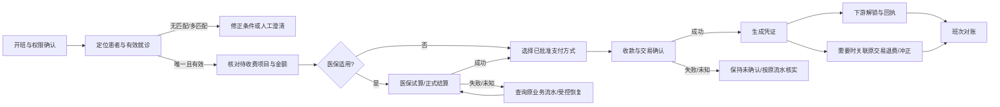
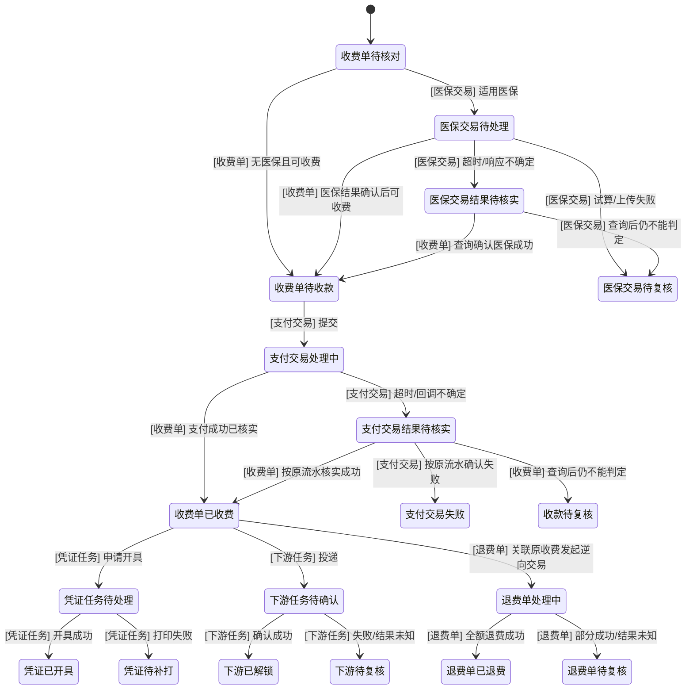

# 门诊收费产品需求（重梳理稿）

> 本稿是对现有门诊收费材料的统一评审入口，不代表业务已批准或开发已完成。标记含义：`VERIFIED`=现有材料明确记载；`INFERRED`=为串联材料作出的推断；`PROPOSED`=本稿建议；`UNKNOWN`=需责任人确认。任何 `UNKNOWN` 不能被 Agent 补成默认业务规则。

## 1. 产品目标与边界

门诊收费工作流应让收费人员在一个连续流程中找到正确患者与就诊、核对待缴费用、处理医保和支付、出具凭证，并支持退费、下游业务解锁及班次对账。关键交易要可追溯，重复请求和外部结果未知时不能造成重复收费或账实不一致。

- **VERIFIED**：现有基线将旧业务兼容、正常收费、医保结算、聚合支付、票据、退费/冲正、下游解锁、日结对账列为 P0。
- **PROPOSED**：以“收费交易及其逆向交易”为主线组织功能和验收；页面只是入口，不替代领域状态和交易记录。
- **边界**：详细页面交互、接口/数据结构、状态机/参数、测试矩阵分别引用现有 `analysis/02` 至 `analysis/05`，不在本 PRD 复制第二份。用户已确认目标院区现行 020 是事实基线；003/020 冲突按第 6 节逐项待决，不把 003 行为覆盖到目标规则。
- **非目标（本期基线）**：未获业务确认的高级运营分析、自定义审批编排、额外支付渠道、跨机构结算能力不得因原型出现就纳入本期。

## 2. 角色与主要任务

| 角色          | 主要任务                                                  | 状态                                            |
| ------------- | --------------------------------------------------------- | ----------------------------------------------- |
| 收费员        | 定位就诊、核对费用、结算、收款、打印/补打、发起允许的退费 | VERIFIED（角色来自现有材料）                    |
| 医保结算员    | 医保试算、正式结算、失败/未知结果查询及处理               | INFERRED（职责边界需确认）                      |
| 主管/授权人   | 按授权复核退费等高风险操作                                | VERIFIED（存在主管角色；具体阈值/层级 UNKNOWN） |
| 财务人员      | 日结、对账、定位差异并处理或转交                          | VERIFIED                                        |
| 药房/医技人员 | 仅处理已满足收费条件并完成下游解锁的业务                  | VERIFIED                                        |
| 系统管理员    | 配置窗口、班次、支付方式及业务开关                        | INFERRED（配置边界与授权 UNKNOWN）              |

权限最小化、岗位职责分离及关键操作留痕为验收方向；角色矩阵中的具体授权以业务负责人批准版本为准。

## 3. 端到端流程与状态边界

1. **开班与上下文**：确认人员、窗口和班次；条件不完整时禁止发起收费（现有 FR-01）。
2. **定位并核对**：按医院批准的患者标识查找唯一患者/就诊，查看按就诊、处方或项目组织的待缴明细；收费前展示费用及应付关系。
3. **医保（适用时）**：先识别/试算并展示统筹、个人账户、个人自付、自费；正式结算结果失败或未知时进入查询/恢复路径，不得盲目重试。
4. **收款**：按已配置方式收款，支持范围须经业务确认；处理中防重复提交。多渠道/混合支付失败不得留下“已全额支付”的部分状态。
5. **确认收费与凭证**：确认成功后形成可查询的唯一有效收费交易；打印失败不撤销交易，补打不得创建第二笔收费。
6. **下游解锁**：仅在满足收费条件后解锁对应发药/医技任务；失败进入可追踪的待处理状态。
7. **退费/冲正**：从原交易发起并校验剩余可退金额及权限；涉及已发药、医保和日结的场景必须按对应逆向流程处理。
8. **日结对账**：按班次/窗口/收费员及支付方式核对笔数、应收、实收、退费、冲正和差异；日结后原交易不可直接改写。

`UNKNOWN`：具体状态名、状态迁移、何时生成收费单与支付单、超时查询策略、医保/支付补偿机制，应以 `analysis/04` 的状态机和后续 Owner 契约评审定稿。本节是产品流程摘要，不是技术时序规格。

### 3.1 业务流程图（目标流程，PROPOSED）

上图只表达需求顺序，不代表系统已具备相同状态名或服务调用。外部调用超时统一进入“结果待核实”语义；业务 Owner 需批准具体恢复策略（Q-02/03/06）。

### 3.2 交易状态边界（逻辑状态，PROPOSED）

**对象归属与状态边界**：状态名前缀标明其业务对象，迁移标签标明被改变的对象；跨对象连线表达业务因果，不代表同一聚合字段变化。`支付交易失败` 不等于收费单失败，收费单是否允许重新收款由 Q-03 决定；医保试算/上传失败进入待复核，不隐含转自费。部分退费或结果未知进入 `退费单待复核`，不定义“已部分退费”终态。各对象的正式状态名、可重试规则和终态仍须以 `analysis/04` 及 Owner 契约评审批准。

## 4. 功能需求与验收

| 编号   | 优先级 | 需求/验收结果                                                                                                         |
| ------ | -----: | --------------------------------------------------------------------------------------------------------------------- |
| SUM-01 |     P0 | 患者和就诊按批准标识唯一定位；歧义时阻止继续并提示选择/澄清，不得猜测。                                               |
| SUM-02 |     P0 | 费用按来源明细核对；收费确认前清晰展示应付金额及医保/个人支付组成（适用时）。金额规则须采用已批准口径。               |
| SUM-03 |     P0 | 医保支持试算、结算、成功/失败/未知处理；上传失败不进入正式结算，未知结果先查询，避免重复结算。                        |
| SUM-04 |     P0 | 支付方式来自配置；同一业务提交具备防重；重复回调只入账一次；混合支付失败不形成错误的全额已付结果。                    |
| SUM-05 |     P0 | 支付成功形成唯一有效收费结果并可按患者/就诊/交易查询；失败和处理中可定位，不产生重复账。                              |
| SUM-06 |     P0 | 凭证开具/打印/补打/作废均可追踪；打印故障不回滚已成功收费，补打不新增收费。                                           |
| SUM-07 |     P0 | 退费/冲正关联原交易，累计金额不超过批准的可退金额；先满足相关药品、医保逆向及授权条件。日结后的处理遵循财务批准流程。 |
| SUM-08 |     P0 | 未满足收费条件时下游不可执行；成功收费后记录解锁结果，失败有待办及重试/人工处理入口。                                 |
| SUM-09 |     P0 | 日结提供笔数、应收、实收、退费、冲正、差异，并能定位差异交易；日结后禁止直接修改原单。                                |
| SUM-10 |     P0 | 对目标院区选定的旧业务场景建立新旧结果对照；差异有业务决议和回退方案后方可放量。                                      |
| SUM-11 |     P1 | 关键交易、人员、时间及敏感操作支持审计查询。                                                                          |
| SUM-12 |     P2 | 窗口运营统计；具体指标待业务确认，不阻塞 P0 闭环。                                                                    |

> **编号约束**：`SUM-01..12` 是本稿跨主题摘要编号，不占用既有 canonical `F-01..F-74`。摘要到 canonical F 的一对多映射必须由产品与开发基于 `analysis/20-F01-F74全覆盖二审.html` 逐条复核后补入；在复核前不得把 SUM 编号当作旧系统事实或替换原 F 编号。

### 全局质量门槛

- **正确性/幂等**：重复点击、重复回调、客户端重试、超时后重查不会重复收费/结算/入账。
- **可恢复性**：调用外部医保/支付/下游服务超时或断连时，显示真实状态并提供查询/补偿路径；未知不得显示成功。
- **审计性**：关键动作能还原操作人、业务交易、时间、前后状态及处理原因；留存期限待合规确认。
- **兼容性**：目标院区与旧系统之间的对照样本、差异审批和回退条件通过后才可切换。
- **安全性**：按角色授权，患者数据最小可见；日志和检索结果不得泄露不必要的敏感信息。具体隐私分级以合规/安全负责人确认为准。

## 5. 异常处理原则

| 异常                      | 必须保持的业务结果                                     |
| ------------------------- | ------------------------------------------------------ |
| 患者/就诊无匹配或多匹配   | 不收费；可修正条件后重查。                             |
| 医保上传/结算失败         | 不宣告完成；展示可理解原因并按批准策略处理。           |
| 医保/支付超时、结果未知   | 不重复发起；先按原业务流水查询，保持待确认状态。       |
| 重复支付回调              | 仅一次入账；后续回调可审计、可识别为重复。             |
| 混合支付部分失败          | 不形成全额已支付；展示各渠道状态并按待决补偿规则恢复。 |
| 凭证打印失败              | 保留已成功收费；允许受控补打并记录。                   |
| 退费超过可退金额/权限不足 | 拒绝执行并明确原因；不产生部分逆向交易。               |
| 下游解锁失败              | 不丢失已收费交易；产生可追踪待办，不伪装成下游已收到。 |
| 日结后发现差异            | 走财务调整/冲账记录；不直接覆盖原交易。                |

## 6. 双版本差异与需求决议

本表引用门诊收费一体化标准第 07 节的静态源码核对结果。用户已确认现行 020 为目标院区业务事实基线：020 版本记载的行为作为目标基线；003/020 冲突不自动继承，须形成逐项决议。涉及院区参数、角色授权、金额、锁协议等仍由对应 Q 项控制，不能从静态旧代码猜默认值。

| DIF    | 节点             | 003 东港                                             | 020 潼南                                                               | 产品决议建议 / 风险                                                          |
| ------ | ---------------- | ---------------------------------------------------- | ---------------------------------------------------------------------- | ---------------------------------------------------------------------------- |
| DIF-01 | 输入与回车       | Enter 将输入写入查询上下文后触发查询；003-C:365–384  | Enter 先读医保卡，满足条件时卡号补 10 位；020-C:790–820                | 统一显式提交；补零规则必须按院区配置批准，避免误匹配。                       |
| DIF-02 | 查询类型变化     | 清空查询号并重置挂号、明细、加费对象；003-C:428–436  | 先解锁，保留费别，清空查询内容并重置树明细；020-C:878–891              | 查询上下文切换定义原子清理边界；锁 Owner/租期按 Q-11 另立契约。              |
| DIF-03 | 查询路由         | 主索引直查，其他类型先经患者查询路由；003-Q:58–75    | 主索引、卡号、身份证、姓名、就诊流水分支处理，其他走电话；020-Q:77–109 | 采用显式枚举白名单；未知类型拒绝，不静默回退到别的标识。                     |
| DIF-04 | 挂号后取收费明细 | `ambPatientcharge/query/chargeRegist`；003-Q:74–75   | `/econ/ambcharge/build/registinfo`；020-Q:108–109                      | 端点不同不能假设语义等价；由契约 Owner 提供映射与差异样例。                  |
| DIF-05 | 无挂号结果       | 失败提示路径仍初始化收费上下文；003-Q:76–99          | 姓名/流水无结果直接返回；某些类型确认后可创建系统号；020-Q:120–140     | 查询不得隐含创建业务数据；是否允许建档及其确认、审计、防重边界按 Q-12 决策。 |
| DIF-06 | 特殊挂号过滤     | 已读查询片段未见同类过滤（不推断全库没有）           | `PATAD_IS_INRECORD_CHARGE=1` 时排除 source 98/99；020-Q:110–118        | 过滤规则、默认值及院区影响需现场确认；禁止默认为全院统一。                   |
| DIF-07 | 金额展示         | double 汇总后 BigDecimal 两位 HALF_UP；003-C:399–425 | 使用 BigDecimalUtils 累加再两位 HALF_UP；020-C:687–700                 | 两种客户端算法都不能作为账本金额权威；必须有财务批准的分币规则与边界样例。   |
| DIF-08 | 收款入口         | `rcpt` 直接调用预结算 Command；003-C:527–530         | 按钮短暂禁用并按费别分预结算/医保登记；020-C:1253–1299                 | UI 防连点不能替代业务幂等；支付/医保结果未知须先按原流水查询。               |
| DIF-09 | 锁释放           | Enter 查询前执行挂号解锁；003-C:375–376              | 查询类型变化解锁，dispose 按 visitCode 解锁；020-C:878–879、1220–1234  | 两个局部入口不足以构成完整锁协议；创建/续期/过期/崩溃恢复按 Q-11 决定。      |
| DIF-10 | 键盘与费别守卫   | 排除 KEY_RELEASED；003-C:368–374                     | 已读 Enter 处理未见该守卫；结算读费别前缀；020-C:790–819、1262–1264    | 作为兼容测试输入检查重复事件和空/短费别，不将静态风险写成已复现缺陷。        |

证据身份：旧源码快照 `yy` Git HEAD `99753aa844237286d9b7c87f561d6103d31bda77`；门诊收费分析材料与 `original.html`、`component-workbench.html` 随本稿作为可追溯证据包保存；标准依据为 `../../../docs/standards/EHR-BDS-001-business-engineering-standard.md` 第 02、07、18 节。代码知识图谱保留在旧工作区 `E:\old\pd\code-knowledge-graph`，不随交付复制；本表已摘录本稿采用的版本差异与证据位置。证据范围仅为标准注明的四个源码文件和已读取片段；未审查全仓或生产配置。

### 6.1 020 目标基线的实现状态（2026-10-28）

用户确认“先按照 020 去做”。因此以下 020 行为属于目标基线；“未实现”表示仍是产品需求、不得被误读成不在范围。状态只依据本轮核对的 EHR 仓库 `main@4170e95` 工作树、服务 README、契约和收费草稿适配器；不是全仓安全/业务验收，也不代表线上部署状态。

状态口径：`未实现`=没有真实业务闭环；`部分实现`=只存在收费草稿、联调桩或前端演示；`TODO`=真实外部集成未交付。只有证据列出的真实契约、应用逻辑和测试共同覆盖，才能把状态改为“已实现”。

| 020 能力 / 旧版行为                                                              | 目标处理与追溯                                                                                                                          | 当前实现状态                        | 代码证据与未完成内容                                                                                                                                                                       |
| -------------------------------------------------------------------------------- | --------------------------------------------------------------------------------------------------------------------------------------- | ----------------------------------- | ------------------------------------------------------------------------------------------------------------------------------------------------------------------------------------------ |
| 患者/就诊查询及查询类型路由（DIF-01..03，SUM-01，AC-OPF-01）                     | 按 020 的卡号、身份、姓名、就诊流水等分支作为目标事实；自动补零、角色范围等仍按院区参数和 Q-09/Q-12 验证。                              | **部分实现（演示）/真实查询未实现** | `ehr-charging` 的 `/api/v1/charge-drafts` 已有草稿入口，但 `StubEncounterAdapter` 将任意查询映射到固定样例；`ehr-patient` README 标注 MPI 查询/写入仍为骨架。无真实患者/就诊读取接入证据。 |
| 挂号后加载待收费明细、特殊挂号过滤、收费上下文切换（DIF-02/04/05/06，SUM-01/02） | 020 的查询返回与参数条件作为基线；无结果建档/建号的权限、确认、审计和防重由 Q-12 关闭前保持受控，不允许查询隐式创建。                   | **部分实现（桩）/目标规则未落地**   | `StubPendingChargeAdapter` 固定返回 3 条样例明细；本仓没有已核验的 020 挂号收费端点映射。外部 `ehr-encounter` 契约仍须由 Owner 映射并联调。                                                |
| 金额展示、收费明细与草稿（DIF-07，SUM-02，AC-OPF-02）                            | 020 的历史两位展示规则作为兼容事实；账本金额精度、计价和舍入仍受 Q-01 约束，不从客户端显示算法推导账本规则。                            | **部分实现（收费草稿）**            | `ChargeDraft`、行金额分单位不变量和草稿 API 已实现；没有完整正式计价、确认收费、支付入账闭环。`StubPendingChargeAdapter` 仍提供固定金额。                                                  |
| 按费别分流医保/支付和结果核实（DIF-08，SUM-03/04/05，AC-OPF-03）                 | 采用 020 记载的费别分支作为基线；真实医保/支付接口继续标记 TODO。未知结果先查原流水，Q-02/Q-03 未关闭前不自拟拆分、支付组合或补偿策略。 | **未实现 / TODO**                   | `ehr-insurance` 仍为骨架；`ehr-charging` 只有草稿，insurancepayment/payment 页面包尚无真实业务闭环。线上/原型的模拟状态不计验收。                                                          |
| 票据开具、打印、补打（SUM-06，AC-OPF-04）                                        | 020 的票据流程作为事实输入；法定类型、号码、作废、更正、补打权限依 Q-05 决定；真实票据接口未联调前为 TODO。                             | **未实现 / TODO**                   | `ehr-charging` 的 receipt 页面包与领域聚合尚为骨架；无真实票据契约、设备或接口验收证据。                                                                                                   |
| 退费/冲正、收费锁与并发恢复（DIF-09，SUM-07，AC-OPF-05a）                        | 保留 020 观察到的解锁时点作为兼容事实；锁创建、持有者、租期、释放、崩溃恢复由 Q-11 决议。退费权限、部分退费和逆向顺序由 Q-04 决议。     | **未实现**                          | `refundworkbench` 与 refund 聚合仅骨架；未见可验收的生产锁协议或退费 API。                                                                                                                 |
| 药房/医技下游解锁（SUM-08，AC-OPF-05b）                                          | 020 的收费条件及下游规则作为基线；投递确认、重复事件、失败补偿由 Q-06 确认。                                                            | **未实现**                          | 未见 Owner 批准的下游契约和生产解锁实现；前端演示中的只读状态不代表已发事件。                                                                                                              |
| 班次日结与差异对账（SUM-09，AC-OPF-05c）                                         | 按 020 现有班次行为建立目标场景；跨日、退款归属、差异处理和日结后调整由 Q-07 决议。                                                     | **未实现**                          | `shiftclose` 页面包与 shift 聚合仅骨架；没有可核验日结账本和对账 API。                                                                                                                     |
| 003/020 兼容、切换与回退（SUM-10，AC-OPF-06）                                    | 020 为本院区目标基线；003 只作为差异证据，冲突逐项待决。                                                                                | **部分实现（文档）/未验收**         | 本 PRD 已记录 DIF-01..10；兼容样本、业务签字、切换及回退演练尚未完成。                                                                                                                     |
| HIS 本地账号、首启建管理员及首次登录强制改密（HIS 全局依赖）                     | 按用户已确认的 ehr-auth 本地账号决议执行；一次性首启和强制改密属于目标要求。                                                            | **未实现**                          | `backend/ehr-auth/README.md` 明确登录/会话/权限仍为骨架；旧登录实现不作为此目标已完成的证据。                                                                                              |

上述未实现项是 020 基线下的明确交付缺口，不会因外部接口 TODO、Q 项待决或当前只交付演示切片而从产品范围中删除。Q 未关闭时，只阻断依赖该规则的具体行为验收；不依赖该规则的已确认切片可以继续开发。当前实现仍以 AC-OPF-07 演示切片为限，AC-OPF-01..06 不得标为产品完成。

## 7. 验收追溯和迭代范围

| 验收编号   | 关联需求     | 可验证结果                                                                                | 类型             | 阻塞 Q           |
| ---------- | ------------ | ----------------------------------------------------------------------------------------- | ---------------- | ---------------- |
| AC-OPF-01  | SUM-01       | 空值、超长、无匹配、多匹配均不进入收费；查询标识变更后不得残留前一患者明细。              | 业务验收         | Q-09、Q-12       |
| AC-OPF-02  | SUM-02       | 应收与分项金额一致；已选合计随勾选变化；计算使用整数分，边界与舍入规则由 Q-01 关闭。      | 财务/前端验收    | Q-01             |
| AC-OPF-03  | SUM-03/04/05 | 外部请求超时/重复请求/重复回调不造成重复结算或入账；未知状态显示待核实。                  | 集成验收         | Q-02、Q-03、Q-11 |
| AC-OPF-04  | SUM-06       | 打印失败不撤销收费，补打不增加交易；凭证及操作可审计。                                    | 票据验收         | Q-05             |
| AC-OPF-05a | SUM-07       | 退费/冲正关联原交易；部分成功或结果未知按批准路径复核，不覆盖原始账本。                   | 退费/冲正验收    | Q-04、Q-11       |
| AC-OPF-05b | SUM-08       | 下游解锁成功、失败及重复投递可追踪；失败产生待办，不伪装已解锁。                          | 下游验收         | Q-06、Q-11       |
| AC-OPF-05c | SUM-09       | 日结可核对笔数、应收、实收、退费、冲正与差异；差异可定位且不改写原交易。                  | 日结对账验收     | Q-07             |
| AC-OPF-06  | SUM-10       | 003/020 目标院区场景有差异决议、可重复对照样本、切换与回退记录。                          | 兼容验收         | Q-08             |
| AC-OPF-07  | 本期演示切片 | 页面只使用明确标注的合成数据；初始不勾选；查询、保存、收费、打印都不产生网络/数据库写入。 | 当前前端切片验收 | —                |

AC-OPF-01..06 是完整产品闭环目标，当前代码不宣称已实现。AC-OPF-07 是本次演示切片验收；代码内 `AC-P01-01..22` 是它的实现级子验收编号，不得与产品级 AC 混用，也不代表医保、支付或收费交易已实现。

### 7.1 演示切片 AC 追溯（实现级）

| 实现级验收 ID     | 页面行为与自动化证据                                                                                                               | 关联产品目标         | 证据边界                                          |
| ----------------- | ---------------------------------------------------------------------------------------------------------------------------------- | -------------------- | ------------------------------------------------- |
| AC-P01-01..02     | 唯一/多候选/未命中定位；多候选须人工选择；初始不勾选；无浏览器存储且刷新不恢复患者上下文                                           | AC-OPF-01、AC-OPF-07 | 只用合成 fixture，不证明真实患者查询              |
| AC-P01-03..06     | 明细只读；变更后拒绝旧金额；整数分汇总；无本地计价、舍入配置入口                                                                   | AC-OPF-02、AC-OPF-07 | 金额口径 Q-01 未决，不证明服务端计价正确          |
| AC-P01-07..08     | 医保拆分无真实调用；组合支付禁用；支付方式为演示配置                                                                               | AC-OPF-03、AC-OPF-07 | 不证明医保或支付集成                              |
| AC-P01-09..13、22 | 演示提交锁定防重；首个终态通知生效、重复/冲突通知不改终态；UNKNOWN 仅查询原交易；处理中/失败可查看轨迹；结果卡唯一；返回合成交易号 | AC-OPF-03、AC-OPF-07 | 纯前端 mock；不证明服务端幂等、事务或真实状态查询 |
| AC-P01-14..15     | 演示打印失败保留收费结果；补打不增加交易结果卡，且队列按当前就诊隔离                                                               | AC-OPF-04、AC-OPF-07 | 不证明真实票据设备、法定票据或打印服务            |
| AC-P01-16..18     | 日结、退费和票据操作受限并分别标注 Q-07/Q-04/Q-05；下游状态只读，不触发解锁                                                        | AC-OPF-05、AC-OPF-07 | 只证明当前切片不越界，不证明逆向交易/下游业务可用 |
| AC-P01-19..21     | 清屏清除演示患者上下文且重新查询不伪报草稿恢复；并发冲突提示；审计键脱敏                                                           | AC-OPF-01、AC-OPF-07 | 内存 mock，不证明服务端隐私、并发控制或审计留存   |

实现级证据文件：`frontend/ehr-finance-workbench/src/modules/charging/pages/__tests__/ChargeWorkbench.ac.spec.ts`；运行命令 `pnpm test`。测试覆盖演示交互与边界，不是 AC-OPF-01..06 的业务闭环验收。

### 本次迭代范围

- **包含**：在收费工作台呈现合成数据定位（唯一/多候选/未命中）、明细核对、默认不勾选、整数分汇总、演示支付结果/未知状态/交易轨迹/补打队列、冲突与清屏反馈；未决的真实医保、支付、退费、票据和日结入口明确禁用；不触发任何服务端副作用。
- **不包含**：医保、支付、正式收费草稿、数据库/Outbox、票据、退费、下游解锁、班次日结、真实患者数据和新 API 契约。
- **安全约束**：示例就诊号只用于代码演示；如后续接入真实院区数据，必须先移除本地 fixture 并走已批准的认证/授权与契约，不可把演示号作为生产数据。

### 2026-10-28 交付范围补充（用户已确认；本稿仍为 In Review）

- **系统边界**：本次交付属于完整 HIS `ehr-platform`，不存在独立收费程序或收费专用登录。首批业务闭环为门诊收费及患者、挂号、医保、支付、票据、退费、班次日结依赖。
- **全局认证**：使用 `ehr-auth` 本地账号密码；医院管理员通过首次启动向导一次性创建首个管理员账号，该账号首次登录必须修改密码。系统登录由 HIS 共享，不为收费模块另建登录。
- **外部集成**：当真实医保、支付或票据接口尚无可联调契约/环境时，该能力保持未完成（TODO），界面必须明确显示“未完成”；不得用模拟成功结果替代真实闭环，也不得宣称已验收。
- **双向一致性**：交互原型用 HIS 实际前端样式呈现；每个已实现功能须能从 PRD 需求/验收编号追溯到前端、应用服务、领域规则及验证证据。当前 PRD 的 Q-01..Q-12 仍须按责任人和关闭条件逐项关闭，未决业务规则不得推断。
- **范围边界**：以上决策确定了交付范围和认证来源，不等于批准金额、医保拆分、支付补偿、退费审批、票据规则、班次边界、患者授权或收费锁等具体业务规则；原 Q 清单保持有效。
- **目标院区基线（用户已确认）**：以目标院区现行 020 版本作为业务事实基线；003 与 020 的差异逐项列入待决，冲突未关闭前不将 003 行为覆盖到目标规则。医保、支付、票据的真实接口即使存在本地原型，也保持 TODO / 未完成，直到取得真实契约和可联调环境。

## 8. 评审与发布门禁

开发不得以本稿单独开工冻结。进入开发基线前需：①产品/收费业务确认用户场景和 P0 范围；②财务及医保负责人关闭金额、医保拆分、退费和日结口径；③技术负责人把逻辑需求映射到领域、接口 Owner 契约及状态机；④测试负责人将每条 F 编号转为正向、异常、重试/幂等和回归用例；⑤旧系统兼容样本及灰度/回退方案获得签字。

## 9. 待确认事项

| 编号 | 待决问题                                                                                            | 建议责任角色                      | 关闭条件                                                                                         |
| ---- | --------------------------------------------------------------------------------------------------- | --------------------------------- | ------------------------------------------------------------------------------------------------ |
| Q-01 | 金额精度、计价/汇总/舍入层级、正负数和边界值采用什么口径？                                          | 产品 + 财务                       | 发布书面规则、样例及期望结果；更新金额决策材料并由开发/测试复核。                                |
| Q-02 | 医保基金、个人账户、自付、自费的字段来源、比例/精度及失败/未知查询规则？                            | 医保业务 + 接口 Owner             | 医保场景表和接口契约确认，覆盖成功、拒绝、超时、重复请求。                                       |
| Q-03 | 哪些支付方式及组合在目标院区启用？部分成功后的撤销、补扣或人工处理策略？                            | 收费业务 + 财务 + 支付 Owner      | 院区配置清单、交易状态与补偿决议签署。                                                           |
| Q-04 | 退费权限阈值、审批层级、部分退费、已发药、已日结时的逆向次序？                                      | 收费主管 + 财务                   | 权限矩阵和场景决议通过，明确不可自动化的情形。                                                   |
| Q-05 | 发票/收据的法定类型、号码规则、作废、更正、重打权限与审计保存要求？                                 | 财务/票据负责人                   | 票据规则和外设/平台责任边界确认。                                                                |
| Q-06 | 下游“收费条件满足”的判定、消息确认、重复投递及失败人工闭环？                                        | 药房/医技 + 接口 Owner            | 下游契约明确业务键、确认、重试和补偿。                                                           |
| Q-07 | 班次边界、跨日、退款归属、差异阈值以及日结后财务调整方式？                                          | 财务                              | 对账样表、计算规则和操作权限批准。                                                               |
| Q-08 | 020 现行规则为目标基线；003/020 冲突项、旧功能全量继承映射、兼容样本与切换/回退负责人仍待逐项确认。 | 产品负责人 + 院区负责人           | 020 基线行为有可追溯证据；003/020 差异均有业务决议；兼容矩阵无未解释 P0 差异，回退演练记录通过。 |
| Q-09 | 角色授权、患者数据可见范围、审计留存和导出限制？                                                    | 安全/合规 + 业务                  | 权限矩阵及数据处理要求批准。                                                                     |
| Q-10 | 一期明确不做哪些旧功能、预交金、绿通/挂账及运营能力？                                               | 产品负责人 + 收费业务             | 每项标注保留/替代/延期/淘汰及受影响用户。                                                        |
| Q-11 | 就诊收费锁由谁持有；创建、续期、释放、过期、进程崩溃恢复和并发窗口冲突如何处理？                    | 收费领域 Owner + 技术负责人       | 提交锁契约、租期/心跳策略、并发时序与恢复用例；与端点/事件契约一致并经开发、测试复核。           |
| Q-12 | 患者无有效挂号时，哪些角色可否创建系统号/挂号；如何确认、授权、审计和防止重复建档？                 | 产品负责人 + 挂号业务 + 安全/合规 | 明确允许场景、字段权威源、确认文案、权限、审计键及幂等规则；禁止查询隐式创建。                   |

## 10. Agent 协作与需求变更约定

- 产品 Agent 维护本 PRD、问题清单和决议记录；所有业务判断均标记 `VERIFIED / INFERRED / PROPOSED / UNKNOWN` 并附来源。
- 每次提交需求给开发 Agent 时，附带变更编号、涉及 F/BR/A/Q 编号、用户场景、验收、未决项和兼容影响；不把截图或聊天意见默认为批准规则。
- 开发 Agent 必须逐项返回“可行/不可行/需决策”、领域/API/数据影响、幂等与失败处理、估算和需要产品澄清的问题；不得自行改写金额、医保、退费等业务规则。
- 产品 Agent 对开发反馈逐项回复“接受/修改/拒绝/待业务决策”，更新需求稿并标注版本；开发基于已确认版本实现，并回传代码位置、接口/迁移、验证证据和遗留风险。
- 测试 Agent 按 F 编号反向核对正向、异常、重复请求、并发/超时、回归兼容；缺少业务答案时阻断该场景验收而非猜测。
- 团队主持 Agent 负责将产品任务派给开发，开发反馈后必须回派产品做确认，再让开发按确认稿收敛；产品与开发的往返结论及未决项需在团队会话可见并归档。不能用主持人一次性摘要代替双方互审。

## 11. 追溯与材料整理

- **本稿**：门诊收费产品需求评审入口，ID `PRD-001`，当前 `0.7 In Review`；批准后须记录批准人/日期/摘要并更新索引。
- **细节引用**：`analysis/02` 页面交互，`analysis/03` 领域/接口，`analysis/04` 状态/业务规则/异常，`analysis/05` 集成/验收；专题 06–23 作为分主题证据，不整篇复制进本稿。
- **原型**：只用于讨论交互意图。界面呈现不构成业务规则批准；原型路径与采用页面由产品/设计评审后补充。
- **旧系统**：固定代码提交、图谱和截图用于说明现状/兼容证据，必须标明系统与版本；不作为新行为的默认依据。
- **代码互证**：本稿的验收目标用于检查代码是否越界；当前分支的实现级 `AC-P01-*` 只验证 AC-OPF-07 演示切片。2026-10-27 修订验证：`pnpm test` 24/24 passed；`pnpm build:remote` 中 `vue-tsc -b` 和 Vite 生产构建通过。jsdom/Ant Design Vue 的伪元素样式告警仍存在，不影响断言；构建有 842.65 kB 主 chunk 体积告警。产品级 AC-OPF-01..06 仍未实现、未验收。后续功能说明必须引用实际提交、API 契约和测试结果，不得将本稿目标直接改写为“已实现”。
- 当前目录含大量专题 HTML、原型、截图和历史分析；本轮不删除、不批量移动。待评审确认后再按文档标准更新 `analysis/00-文档索引.html`，旧材料标注状态/用途并从默认检索中排除。

### 来源可信度限制

现有材料索引说明门诊收费没有归档的 Markdown 原始源，部分 HTML 由旧开发环境文件生成；因此本稿的来源证据目前可定位到目录内 HTML 章节，但原始作者、生成链和权威版本尚未完全确认。负责人需核对源文件/提交记录后，方可将本稿标为 `Approved`。

## 12. 变更记录

| 版本 | 日期       | 状态      | 变更                                                                                                                                                                    |
| ---- | ---------- | --------- | ----------------------------------------------------------------------------------------------------------------------------------------------------------------------- |
| 0.1  | 2026-10-24 | In Review | 初版统一评审入口。                                                                                                                                                      |
| 0.2  | 2026-10-27 | In Review | 按文档治理标准补元数据和稳定 ID；将摘要需求编号改为 SUM，避免与既有 F-01..F-74 冲突；新增业务流程/逻辑状态图、003/020 差异、验收追溯及当前演示范围。                    |
| 0.3  | 2026-10-27 | In Review | 与平台生成的页面和 22 条实现级 AC 双向对齐；明确演示 mock 与产品级闭环的证据边界，并记录本地测试和构建结果。                                                            |
| 0.4  | 2026-10-27 | In Review | 根据产品/开发 Agent 互审澄清对象状态迁移、补充锁与建档待决项，拆分退费/下游/日结验收，修正 AC 与 Q 的追溯，并按复核发现补强演示测试与患者队列隔离。                     |
| 0.5  | 2026-10-28 | In Review | 记录用户确认的 HIS 统一边界、首批门诊收费依赖范围、ehr-auth 本地账号及首次启动管理员流程；外部医保/支付/票据无联调契约时明确保持 TODO，不伪装成功；保留未关闭业务问题。 |
| 0.6  | 2026-10-28 | In Review | 用户确认以现行 020 作为目标院区事实基线；003/020 差异保持待决，医保/支付/票据真实接口继续标记 TODO。                                                                    |
| 0.7  | 2026-10-28 | In Review | 明确 020 行为是本院区目标基线，并新增按需求、服务与证据列出的实现缺口表；把未实现能力明确保留在交付范围，区分演示、桩、骨架与真实 TODO。                                |
