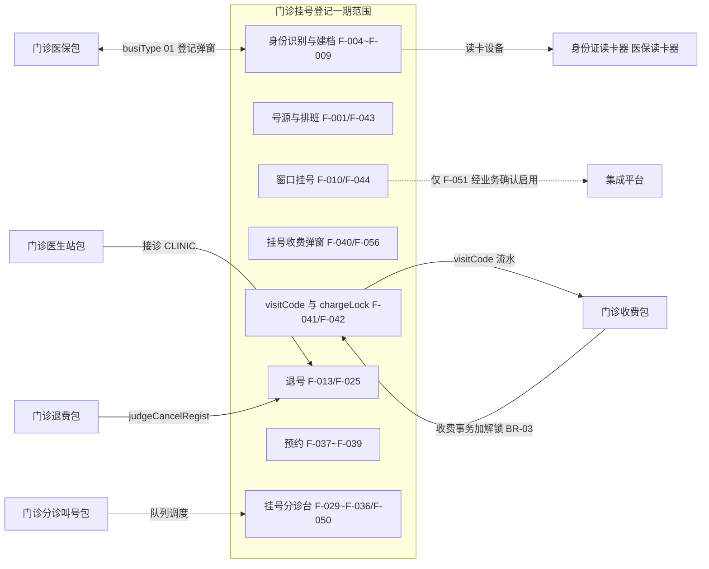

# 产品需求与功能基线

版本：v0.2（评审稿）

用途：定义门诊挂号登记做什么、旧功能如何继承、页面范围、角色权限和验收基线。

本文件是门诊挂号登记开发主阅读文档。F 编号沿用 `prd/traceability-registry.json` 中 `outpatient-registration` 包登记的 canonical 编号（F-001～F-036 为已登记项，F-008=建卡，含义与编号不得改动），本包新增能力自 F-037 起扩展；BR/A/Q 为本包自有一套编号。原始业务口径来源：本包 `prd-doc.html`（页面级 PRD，003 东港 / 020 潼南源码逆向）与 `spec.html`（业务流程 8 环节）。

> **业务基线决议（2026-11-02）**：020 潼南是目标基线。003 东港仅作补充证据；当 020 没有对应行为时，003 独有能力先标为 `SUPPLEMENT-PENDING`，只有业务负责人确认后才进入目标行为。版本冲突统一按 020 处理。`VERIFIED` 仅说明源码可定位，不代表行为已获业务批准。所有 F-001～F-056 均须保留处置与验收状态。

---

## 合并模块：03-产品范围与边界

# 门诊挂号登记产品范围与边界

## 1. 产品定位与目标

门诊挂号登记是门诊业务链的**入口**：识别或建立患者身份 → 分配号源 → 收取挂号费 → 生成就诊记录（visitCode）。它是 `AMB_REGIST.CHARGE_LOCK`（挂号收费锁）与 `visitCode`（就诊流水号）的发源地——门诊收费、医生站、药房全部挂在这条流水上（证据：prd-doc 一章；AmbRegistMapper.xml 两侧同源）。

主链：查询排班号表 → 选号（锁号源）→ 读卡/建卡定位患者 → 费别/身份/优惠确认 → 算费（挂号费+卡费+病历本）→ 挂号收费弹窗（支付/发票）→ 窗口挂号事务落库 → 打印指引单 →（分诊台）分诊/报到 → 接诊。

产品目标（可验收）：

1. 身份正确：五种介质（就诊卡/身份证/医保卡/电子凭证/手工）识别收敛到唯一患者主索引，多命中不自动猜测。
2. 号源不超：并发挂号不超过排班容量；选择态计数与可挂容量分离（BR-01）。
3. 流水唯一：visitCode 全院唯一、原子分配；chargeLock 互斥语义统一（BR-02/BR-03）。
4. 结果原子：窗口挂号"挂号+收费+票据+分诊"一次事务，中断无半程数据（BR-10）。
5. 旧功能全量盘点：F-001～F-056 全部有唯一映射、目标处置、证据状态和验收责任人；003 独有项未经确认不得标成已继承。

## 2. 演进范围分类

| 类型 | 目标 | 判定方式 |
|---|---|---|
| 保持兼容 | 保持旧产品业务结果和责任边界 | 新旧系统对同一挂号场景结果一致（visitCode、号额、收费、票据、状态） |
| 体验优化 | 减少旧产品的页面切换和人工判断 | 003 双 Tab / 020 三 Tab 两套交互统一为一个工作台；号表卡片/表格双视图保留 |
| 能力补齐 | 补足旧产品无法保证的断点 | 服务端原子占号、服务端重校验、参数缺失显式提示、并发与事务可验收 |

## 3. 一期产品定义

一期产品包含以下 8 项能力域（56 项 canonical 功能 F-001～F-056 全量归属，详见继承矩阵）：

1. **身份识别与建档**：F-004～F-009、F-019～F-023、F-048、F-052、F-053（五通道读卡、建卡、退卡、查重、三无、新生儿）。
2. **号源与排班**：F-001～F-003、F-015～F-017、F-043、F-054、F-056（查询/清空/收款跳转入口、占用与并发、号别分类、算费）。
3. **窗口挂号**：F-010、F-014、F-018、F-040～F-042、F-044、F-049、F-055（提交、验重、visitCode、chargeLock、序号计算、状态生命周期）。
4. **已挂与退号**：F-011、F-013、F-025；F-051（JH0105 推送）为 003 独有候选能力，待业务负责人确认后才纳入目标基线。
5. **预约**：F-037～F-039（预约挂号/取消、预约取号、预约管理）。
6. **分诊台（挂号侧）**：F-029～F-036、F-050（加现场号、报到、分诊、开停诊、复诊、插队、取消分诊、坑位占用）。
7. **票据打印**：F-012、F-026、F-016 辅助（指引单补打、原号重打）。
8. **减免与特殊人群**：F-024、F-045～F-047（三无、慢特病便民、优惠减免、账户支付）。

以上是能力域，不是旧功能删减清单。003/020 已存在的能力均需在继承矩阵中逐项映射到一期或明确的后续版本。

## 4. 一期不包含

- **挂号费收费与日结本体**——收费事务、日结缴款归《门诊收费》包；本包只负责锁号联动（chargeLock/BR-03）、费用锁定前的算费校验与窗口挂号事务内嵌的收费明细/收据写入（020 windowRegist 同事务范围）。
- **医保登记细节**——待遇识别、医保挂号上传（busiType=01 弹窗内容）、反结算细则归《门诊医保》包；本包保留费别分流与弹窗触发点（F-048）。
- **接诊与医嘱**——生成就诊后的医生站流转归《门诊医生站》包（020 AmbPatientListView 证据，prd-doc 四章）。
- **排队叫号调度**——叫号、过号、大屏规则本体归《门诊分诊叫号》包；本包保留挂号→分诊写入接口与坑位占用（F-050），继承矩阵中 F-029～F-036 不删除（Q-11 交接）。
- **挂号日报与挂号员结算**——`AmbRegistTallyView` 在 client-econ（收费侧），归《门诊收费》包；本包提供挂号数据（index 核心功能 7 承接说明）。
- **线上渠道（自助机/微信公众号/小程序）**——二期。020 已有第三方挂号证据（`RegistCommand.java:127-145` 窗口与第三方共用便民门诊慢特病校验），边界与号源池同步机制待确认（Q-10）。

**渠道矩阵**（防遗漏备忘：线下/自助/线上三渠道与各能力的归属，避免后续误判"一期漏做"）：

| 能力 | 窗口 | 自助机 | 线上（公众号/小程序/App） | 归属与说明 |
|---|---|---|---|---|
| 号源查询与占号 | 一期（F-001/F-043/F-044） | 二期，复用同一号源池 | 二期，复用同一号源池 | 号源池为本包原子能力，各渠道共用（Q-10 同步机制待定） |
| 挂号/取号 | 一期（F-010） | 二期（003 PatadAmbAppointRegist/TakeRegist 证据） | 二期 | 020 `RegistCommand.java:127` 注释明确"自助机、微信公众号、移动医保"为第三方渠道 |
| 便民/慢特病资格校验 | 一期（BR-09） | 二期，与窗口同规则 | 二期，与窗口同规则 | 020 证据：第三方渠道与窗口共用同一校验，规则不因渠道分叉 |
| 缴费 | 一期弹窗（F-040，事务内嵌） | 二期 | 二期 | 收费事务归《门诊收费》 |
| 排班/号源维护 | 一期（F-043） | 不适用（管理侧） | 不适用 | 管理端仅窗口 |
| 身份识别 | 一期（F-004~F-009，读卡器） | 二期（身份证阅读器/扫码） | 二期（电子凭证） | 设备清单见 05 |

- **退费**——挂号退费的资金逆向归《门诊退费》包（退号 F-013/F-025 中"已收费走 judgeCancelRegist"只触发跨包调用）。

## 5. 产品边界

## 6. 版本建议

| 版本 | 范围 | 目标 |
|---|---|---|
| V0 | 身份识别、号源查询与原子占号、自费窗口挂号、窗口事务 | 跑通无医保普通挂号闭环 |
| V1 | 医保费别分流与登记弹窗、账户支付、发票强校验、chargeLock 联动 | 处理主流医保挂号 |
| V2 | 退号、预约/取号/管理、减免体系、分诊台；003 独有规则先逐项确认 | 跑通逆向与预约闭环 |
| V3 | 线上渠道（自助机/公众号）、第三方号源同步、黑名单完善 | 支撑多渠道挂号 |

## 7. 范围冻结规则

- 未完成"目标院区、费别分流清单（BR-09）、号源并发策略（BR-01）、退号口令与校验组合（BR-11）、现场开关值（Q-08）"确认前，不冻结开发范围。
- 新增功能必须说明影响的状态、权限、接口、测试和上线回滚成本。
- 旧代码中发现的界面或接口（含 020 `patad/evn/amb/windowRegist/insert` 双路径，Q-01）默认进入"兼容性评估"，不自动进入新界面。
- 任何体验优化都不得改变既有 visitCode 分配、号额扣减、收费与票据结果，除非形成单独的业务变更决策。
- 任何旧功能不得因为"低频、页面多或实现复杂"而直接移除；必须给出替代入口、升级方案、迁移影响和业务确认（F-028 清理 POS 机按钮已注释，仅登记为历史证据，不算删除）。

---

## 合并模块：09-门诊挂号登记产品PRD

# 门诊挂号登记产品 PRD

## 0. 产品演进原则

本产品基于旧产品演进，不是绿地重建。020（潼南，client-pat，PatadAmbRegistView 三 Tab + 2567 行 Controller）是目标院区的默认事实基线；003（东港，HIP-CLIENT-PATAD，PatadAmbRegistView 双 Tab + RegistCommand 789 行）只作补充证据。任何 003 独有行为须经业务确认，版本冲突按 020 处理。所有需求标记为：

- **兼容项**：保持旧产品结果和责任边界。
- **优化项**：不改变结果，只改善操作、提示、可见性和恢复能力。
- **补齐项**：针对旧产品断点增加服务端校验、并发保护、审计或配置能力。

F_ID 沿用 registry 登记编号（F-001～F-036）并向后扩展（F-037～F-056），不自造第二套编号；测试、Legacy 证据和跨域追踪只维护一套编号。挂号登记与门诊收费共用 chargeLock/visitCode 状态语义，不自创第二套状态机。

## 1. 问题陈述

挂号窗口需要同时处理五通道身份识别、号源并发、费别分流、临床限制、发票与支付校验、窗口事务落库、chargeLock 联动、退号多重校验和预约/取号/分诊。两个现有项目已经承载这些业务，但实现分散且语义不一致：003 选号阶段用客户端 GET/PUT 读改写号额（无原子性）、挂号 Tab 权限来源不明、急诊线独立成页；020 用服务端条件扣减但双路径并存、取消预约命令空实现、取号提交链被注释。产品要在保持业务连续性的前提下，统一挂号工作台、补齐服务端原子占号与服务端重校验，并处理 003/020 在号别体系、锁号时机、预约放号、退号规则和票据归属上的差异（全部进差异表）。

## 2. 目标

- 让挂号员在一个连续工作台中完成从读卡定位到打印指引单的窗口挂号流程。
- 提交前明确展示号源余量、临床限制结论、发票余量与应缴金额。
- 号源并发、visitCode 分配、窗口事务失败均有服务端保证与恢复路径。
- 兼容不同院区的费别分流、退号口令、减免与必填参数策略（参数化，不硬编码）。
- 挂号完成后 chargeLock/visitCode 可靠供收费、医生站、分诊消费。

## 3. 用户故事

### P0-01 身份识别与建档

作为挂号员，我想通过就诊卡/身份证/医保卡/电子凭证任一介质定位患者，无档案时建档，以便挂号挂在正确的人身上。

验收标准：多命中时不自动选择，弹候选人工收敛（F-053）；建档查重避免重复主索引；三无人员免卡直建受开关控制（F-024）。

### P0-02 号源查询与选择

作为挂号员，我想按科室/医生/号别/急诊筛选排班并看到剩余号，以便快速选号。

验收标准：过时时段（结束时间早于当前）不展示但口径统一为服务端判定；剩余号为 0 提示「已无号源！」；选择态计数与可挂容量分离（F-043/BR-01）。

### P0-03 窗口挂号提交

作为挂号员，我想一键（或双击号表）完成挂号提交，临床限制与重复挂号被系统拦截，以便合规挂号。

验收标准：儿科超龄/妇科性别/三日重复三条规则服务端执行（BR-04/BR-05）；拦截文案与 Legacy 原文一致；确认后可继续的场景留痕。

### P0-04 挂号收费与发票

作为挂号员/收费员，我想在挂号收费弹窗完成支付与发票选择，发票不足时被阻断，以便费用一次收清。

验收标准：算费含挂号费+卡费+病历本并按 Econ_Rounded 舍入（F-056）；发票余量 endNo+1-nowNo 不少于所选号别数，不足阻断（BR-08）；无支付方式阻断并提示配置。

### P0-05 就诊生成与收费联动

作为系统，挂号事务内生成 visitCode 并供收费加锁，以便收费、医生站、药房挂在同一条流水上。

验收标准：visitCode 由序列原子分配（AMB_VISIT_CODE_ID）；chargeLock 按 VISIT_CODE 0/1 互斥，谁加锁谁解锁（BR-02/BR-03）。

### P0-06 退号

作为挂号员，我想对未就诊挂号执行退号，已缴费/诊断/医嘱/电子票据按 020 规则校验，接诊确认按已核实基线执行，以便退号不产生资金与医疗数据不一致。

验收标准：020 侧按现场参数执行密码确认、缴费/医嘱/诊断/电子票据入账校验；已接诊确认只有在 020 对照或业务决议确认后启用；已收费按跨包契约退费+医保反结算；成功置 BACK_REGIST（BR-11/BR-12）。

### P0-07 预约挂号与取号

作为挂号员/患者，我想预约未来号源并在就诊日取号，以便错峰就诊。

验收标准：预约日期最早明天；取消预约落库（020 空实现为断点，Q-03）；取号提交链路明确（020 被注释，Q-02）后可验收。

### P0-08 挂号分诊台

作为分诊护士，我想在分诊台看到队列、加现场号、分诊/取消分诊、开停诊，以便患者按序就诊。

验收标准：坑位按最小可用 SEE_NO 占用且防重复（F-050）；叫号调度规则归《门诊分诊叫号》包，本包写入接口可用。

### P0-09 特殊人群与减免

作为挂号员，我想对三无人员、新生儿、贫困/优抚/老年减免、慢特病患者按政策挂号，以便政策落地一致。

验收标准：三无免卡建档受开关控制；老年减免命中参数后现金置 0、支付方式转减免码（F-046）；便民门诊慢特病资格服务端校验（BR-06）。

### P0-10 既有业务兼容

作为医院业务负责人，我希望升级后的产品保留旧产品已验证的号源、流水、收费票据和退号结果，以便升级不中断现有窗口业务。

验收标准：目标院区选定的兼容场景有新旧结果对照；visitCode 连续性、号额一致性、票据连续性一致；任何不一致都有明确变更决策和回退方案。

---

## 合并模块：04-角色与权限矩阵

# 角色与权限矩阵

## 1. 角色清单

| 角色 | 职责 | 现场 |
|---|---|---|
| 挂号员（窗口） | 主用角色：读卡建档、选号、挂号提交、退号、补打指引单 | Common |
| 收费员 | 挂号收费弹窗收款、发票选择（003 挂号/收费分离时为收费窗角色） | 003 |
| 分诊台护士 | 分诊/取消分诊/报到/加现场号/开停诊（挂号侧） | Common |
| 医生 | 医生端预约挂号（PatadAmbAppointDoctorRegistView）、我的号源 | 003/020 |
| 医保窗口人员 | 医保读卡与登记弹窗配合（细则归《门诊医保》包） | 差异 |
| 信息科 | 开关/参数维护（DICT_SWITCH/DICT_PARAMETER）、发票管理 | Common |
| 患者 | 间接对象（证件与介质提供方），不直接操作窗口系统 | Common |

## 2. 功能权限矩阵

| 功能 | 挂号员 | 收费员 | 分诊护士 | 医生 | 受控方式 |
|---|---|---|---|---|---|
| F-010/F-018 挂号提交 | ✓ | ✓ | — | — | 挂号 Tab 权限（003 getCanRegist，赋值来源 Q-04）；020 按钮权限项 |
| F-013/F-025 行内退号 | ✓ | ✓ | — | — | Patad_CancelRegist=1 时口令确认（020）；已接诊二次确认（Common） |
| F-008/F-022 建卡 | ✓ | ✓ | — | — | 岗位权限；ITFS_IDCARD 开关控制异步读证 |
| F-024 三无人员 | ✓ | ✓ | — | — | Patad_IsNoMessageUp 开关 |
| F-040 挂号收费弹窗收款 | ✓ | ✓ | — | — | 岗位权限 + 发票校验（BR-08） |
| F-029～F-036 分诊台动作 | — | — | ✓ | — | TriagePermRelation 分诊台-号别权限关系 |
| F-037～F-039 预约/取号/管理 | ✓ | ✓ | — | ✓ 医生端预约 | 岗位权限；F-039 仅预约管理岗 |
| F-012/F-026 指引单/原号重打 | ✓ | ✓ | — | — | 岗位权限 |
| F-003/F-017 收款跳转 | ✓ | ✓ | — | — | 跨包入口（门诊收费包权限） |

权限实现口径：003 挂号 Tab 是权限功能（`getCanRegist()!="1"` 时移除 Tab，PatadAmbRegistController.java:278-284）；020 分诊台按 TriagePermRelation（分诊台-号别权限关系）控制。具体权限项名称由实施配置（Q-04）。

---

## 合并模块：02A-旧功能继承与升级矩阵

# 旧功能继承与升级矩阵

## 1. 继承规则

旧产品功能清单全量保留，不能从需求追溯中遗漏；目标行为默认按 020 潼南，未确认的 003 独有行为记录为待确认而非自动实现。允许合并页面（003 双 Tab + 020 三 Tab → 统一挂号工作台）、重做交互、统一状态和替换底层实现。每项旧功能必须在本矩阵中有唯一映射和验收责任人。F-001～F-036 为 `traceability-registry.json` 已登记编号（含义与编号沿用），F-037～F-056 为本包扩展。

## 2. 功能清单总表

| F_ID | 功能名称 | 功能简述 | 状态变化/状态机 | Legacy 类/方法 | V2 类/方法 | 来源 |
|---|---|---|---|---|---|---|
| F-001 | 号源查询（003） | 按科室/医生/号别/急诊查询可挂号源；本地过滤+远程查询双模式 | 只读 | queryScheduleByPerm；QueryScheduleByPermCommand → GET patad/evn/amb/schedule/query | M_RESERVE_SCHEDULE 查询段（PROPOSED） | 003 |
| F-002 | 号源清空（003） | 清空查询条件与号表选择态 | 选择态复位 | refreshSchedule；refeshScheduleCommand（Legacy 原拼写） | 前端交互 | 003 |
| F-003 | 收款跳转 F1（003） | 携挂号上下文跳转门诊收费 | 跨包入口 | econSkipButton；skipEconCommand | 收费包入口适配 | 003 |
| F-004 | 身份证读卡 | 身份证阅读器读卡回填患者 | 患者定位 | readPatCard；externalDevices.identificationRead() → GET pat/getbyidno/query | M_PAT_IDENTIFY | 003 |
| F-005 | 电子凭证读卡（全） | 医保电子凭证扫码识别患者 | 患者定位 | miECReadCard；dgAmbBusiness.readErCardIdNo() | M_PAT_IDENTIFY | 003 |
| F-006 | 医保刷脸 | 医保刷脸识别；仅费别 07，否则「请输入正确的费别！」 | 患者定位 | miFsReadCardButton；dgAmbBusiness.readFsCardIdNo() | M_PAT_IDENTIFY | 003 |
| F-007 | 读医保卡 | 费别 07 → readMiCaedIdNo（Legacy 原拼写）；费别 09 工伤 → miInjuryInterface.readCard("1") | 患者定位 | miBaseReadAmbCard | M_PAT_IDENTIFY | 003 |
| F-008 | 建卡 | 读卡后建档建卡（registry F-008 登记含义沿用） | 患者建档 | createPatCard；readCardCommand + cardInterface.createCard() | M_PAT_IDENTIFY 建档段 | 003 |
| F-009 | 退卡（注销） | 就诊卡注销 | 卡状态 | backCard；backCardCommand | 卡管理服务 | 003 |
| F-010 | 挂号（003） | 前置校验后挂号提交，弹挂号收费窗 | NO_CLINIC | regist；RegistCommand（789 行） | M_REGIST_PIPELINE | 003 |
| F-011 | 查询已挂/我的挂号 | 按发票号/时间/科室/卡号查已挂号；我的挂号带 registUser | 只读 | queryAlreadyRegist / mySchedule → GET patad/evn/amb/alreadyRegist/query | RegistQueryService | 003 |
| F-012 | 补打指引单 | 热敏补打就诊指引单 | — | printRegist；PrintUtil.Print("指引单补打", Thermal) | 打印平台适配 | 003 |
| F-013 | 行内退号（003） | 已挂号行内退号（规则见 BR-11） | →BACK_REGIST | cancelRegist；cancelRegistCommand | M_REGIST_PIPELINE 逆向段 | 003 |
| F-014 | 双击号表直挂 | 选中并直接挂号：费别 08 走 registCommand，其他费别走东港医保分支 dGMIAmbRegistCommand | NO_CLINIC | 双击事件；dGMIAmbRegistCommand | M_REGIST_PIPELINE | 003 |
| F-015 | 号源查询（020） | 科室/医生/号类下拉 + 号别分类单选过滤；服务端 listForRegist | 只读 | queryScheduleByPerm；QueryScheduleByPermCommand → patad/amb/schedule/list/regist | M_RESERVE_SCHEDULE 查询段 | 020 |
| F-016 | 清空 Delete（020） | 清空条件与选择；refreshSchduling 联动 | 选择态复位 | refreshSchedule；RefeshScheduleCommand（Legacy 原拼写）+ refreshSchduling | 前端交互 | 020 |
| F-017 | 收款 F3（020） | 跳转收费：SkipEconCommand → openBusiness("ambChargeModel") | 跨包入口 | econSkipButton；SkipEconCommand | 收费包入口适配 | 020 |
| F-018 | 挂号 F2（020） | 三分支：欠费 QZF/公费 GFYL → RegistCommand；医保普通 → RegistAmbRegistPsninfoCommand；号源限制 → RegistSourceLimitCommand | NO_CLINIC | regist；RegistCommand/RegistAmbRegistPsninfoCommand/RegistSourceLimitCommand | M_REGIST_PIPELINE | 020 |
| F-019 | 读医保卡/电子凭证（020） | MiReadCardDialogModel 弹窗统一读卡 | 患者定位 | readCardMI；MiReadCardDialogModel | M_PAT_IDENTIFY | 020 |
| F-020 | 患者信息修改 F5 | 打开患者修改业务（带查询条件） | 患者档案 | updatePatInfo；openBusiness("regPatModel") | 患者域入口 | 020 |
| F-021 | 绑健康卡/健康卡 | 开关 Patad_IsCreateEhc → patEhcUtil.queryForStage("000000")；BindEhcCardPatCommand | 卡绑定 | bindEhcCard / readEhcCard | 卡管理服务 | 020 |
| F-022 | 建卡 F4（020） | PatadCreatePatCardModel 弹窗（1024×450）；ITFS_IDCARD=1 异步读身份证；QueryCanUseCarCodeCommand 取卡号 | 患者建档 | createPatCard | M_PAT_IDENTIFY 建档段 | 020 |
| F-023 | 高级查询 | PatadAmbQueryRegistPatModel.showDialog（默认近 1 月） | 只读 | queryPat | RegistQueryService | 020 |
| F-024 | 三无人员 | 开关 Patad_IsNoMessageUp=0 时页面直建：「三无」+yyMMddHHmmss、withoutType=1、免卡号 | 患者建档 | noMessage 回调 | M_PAT_IDENTIFY 建档段 | 020 |
| F-025 | 行内退号（020） | Patad_CancelRegist=1 → 密码确认框 PatadCancelRegistLoginUserModel；否则 CancelRegistCommand → PUT patad/evn/amb/cancel/regist | →BACK_REGIST | cancelRegist；CancelRegistCommand | M_REGIST_PIPELINE 逆向段 | 020 |
| F-026 | 行内原号重打 | PrintRegistInvoiceCommand 重打挂号发票 | — | printRegist | 打印平台适配 | 020 |
| F-027 | 行内代煎 | 中药代煎登记（020 特有） | 跨域登记 | cdrugDecpction（Legacy 原拼写）；AmbCdrugDecoctionCommand | 药房域入口 | 020 |
| F-028 | 清理 POS 机（已注释） | LocalPos.balance(BalanceDTO)；按钮在 020 中已注释，仅登记历史证据 | — | clearPos | —（不继承为活动功能） | 020 |
| F-029 | 加现场号·保存 | 分诊台加现场号 | 号额+坑位 | AddNumCommand → PUT patad/amb/schedule/regwinnum/add | M_RESERVE_SCHEDULE 现场号段 | 020 |
| F-030 | 报到 | 患者报到签到 | 分诊状态 | SignInCommand → POST patad/amb/triage/signIn | 分诊写入接口 | 020 |
| F-031 | 分诊 | 按分诊台号别关系分诊 | 分诊状态 | AddRegistTriageCommand → POST patad/amb/triage/triage | 分诊写入接口 | 020 |
| F-032 | 开诊/停诊 | 排班开诊/停诊切换 | 排班状态 | StartScheduleCommand → PUT patad/amb/schedule/start | Schedule 域 | 020 |
| F-033 | 复诊 | 复诊登记 | 分诊状态 | TriageRepeatCommand → POST patad/amb/triage/repeat | 分诊写入接口 | 020 |
| F-034 | 插队 | 队列顺序调整 | 队列序 | changeSchedule 族 | 分诊写入接口 | 020 |
| F-035 | 取消分诊 | 取消已分诊记录 | 分诊状态 | CancelTriageCommand → POST patad/amb/triage/cancel | 分诊写入接口 | 020 |
| F-036 | 分诊台刷新 | 按分诊台刷新号表与队列 | 只读 | QueryRegistTriageAmbScheduleCommand → GET patad/amb/triage/query/stationCode | 分诊查询接口 | 020 |
| F-037 | 预约挂号与取消预约 | 预约未来号源；取消预约；预约日期最早明天 | 预约记录 | saveAppointsEncAptAmbCommand → registForNotRepeatCommand；PUT patad/evn/amb/cancelAppointRegist（020 CancelAppointCommand 空实现，Q-03） | AppointmentService（PROPOSED） | 003+020 |
| F-038 | 预约取号 | 多选预约记录 → 取号收费 | NO_CLINIC | GET patadAmbTake/query/schedule → POST patadAmbTake/amb/update（020 CommitRegistTakeCommand 被注释，Q-02） | AppointmentService 取号段 | 003+020 |
| F-039 | 预约管理 | 树形排班/批量取消/导出 Excel/午别筛选 | 预约记录 | AmbRegistAppointManage（6 接口 19 列 12 按钮） | AppointmentService 管理段 | 020 |
| F-040 | 挂号收费弹窗 | 承接挂号费支付方式/发票选择；003 REGISTER_AMB_RCPT_MODEL / 020 patadAmbRcptModel("挂号计费信息",720,440) | 收费联动 | PatadAmbRegistRcptView；CommitRcptRegisterAmbCommand | M_SETTLE_REG_FEE | 差异 |
| F-041 | visitCode 流水号分配 | GET patadAmb/query/visitCode?lockUser= 取号即锁；序列 AMB_VISIT_CODE_ID.nextval | 流水分配 | RegistCommand.java:294-299；AmbRegistMapper.xml:2030（003）/:1076-1079（020） | M_REGIST_PIPELINE | Common |
| F-042 | chargeLock 挂号收费锁 | update AMB_REGIST set CHARGE_LOCK where VISIT_CODE（两项目 SQL 一致） | 锁状态 | PUT patadAmb/updateChargeLock（003 服务端锁）/ PUT amb/regist/update/chargelock（020 客户端 dispose 解锁） | ChargeLockPort（PROPOSED） | 差异 |
| F-043 | 号源占用与并发控制 | 003 客户端 GET/PUT ±1（无原子性）；020 服务端 UPDATE ... WHERE REG_REMAINING_NUM > 0 条件扣减 | 号额扣减 | UpdateScheduleCommand.java:38-64（003）；AmbSchedulingRegMapper.xml:962-966（020） | M_RESERVE_SCHEDULE | 差异 |
| F-044 | 三日重复挂号校验 | POST patad/evn/amb/Regist/examine；BACK_REGIST 计数达阈值（patad_CancelRegistNum 默认 3）阻止 | 验重拦截 | examineForRegist（003 PatadAmbEvnImpl.java:1973-2025 / 020 AmbRegistSyntheticServiceImpl.java:2160-2224） | M_VALIDATE_REGIST_INPUT | Common |
| F-045 | 便民门诊慢特病资格 | 开关 Patad_ChronicDiseasesRegist + 参数 ChronicDiseases_Regist → POST /ambRegistPsn/getList；medType=11 排除；「非慢特病患者不能挂便民门诊！」 | 资格拦截 | RegistCommand.java:127-145（020，窗口与第三方共用） | EligibilityPolicy | 020 |
| F-046 | 优惠减免体系 | 贫困 poorType/优抚/老年减免：Econ_AmbIsDerateMitigate + Econ_AmbIsAgeDerateMitigate + Patad_RegistJMPayWay（「年龄：号类\|号类」命中后现金置 0、转 ZCJM/XXZCJM）；003 侧另有癌痛标记 | 减免计价 | RegistCommand（020 L1029-1077 段内） | Charging 域减免策略 | 020（贫困 Common） |
| F-047 | 账户支付与充值补差 | Econ_IsAccCharge 控制账户区；余额不足显示充值补差（czbc）；ECON_CHARGECHANGEACOUNT/ECON_CHANGEACOUNTTYPE | 账户扣款 | AmbClinicRegistController.java:352/647/691；priceBalanceCheck | M_SETTLE_REG_FEE | 020 |
| F-048 | 医保挂号登记 | 费别分流：QZF/GFYL 直接挂；其他先取 visitCode 再 miAmbBusiness.ambRegistDialog（busiType=01）；003 DG 医保分支 dGMIAmbRegistCommand | 医保登记联动 | RegistCommand（020 L1029-1077）；RegistAmbRegistPsninfoCommand | Insurance 适配（归门诊医保包） | 差异 |
| F-049 | 挂号序号与看诊时间计算 | countRegistNo（003：号别+来源+当日最大号+clinicInterval）；createRegistNO（020：ReserveWay/最小空号/最大号+1） | 序号分配 | PatadAmbEvnImpl.java:940-997（003）；PatadAmbEvnSyntheticServiceImpl.java:3333-3377（020） | M_REGIST_PIPELINE 序号段 | 差异 |
| F-050 | 分诊坑位占用 | AMB_REGIST_NO 按最小可用 SEE_NO 选取，useRegsitNo（Legacy 原拼写）条件更新 REG_TAKE_FLAG=1；开关 Patad_isUseTriageNo | 坑位状态 | AmbRegistNoMapper.xml:73-112,333-343,354-363；AmbTriageServiceImpl.java:147-198 | M_REGIST_PIPELINE 坑位段 | 020 |
| F-051 | 退号集成推送 | 退号成功后向集成平台推送 JH0105；失败不阻塞退号 | 事后通知 | cancelRegistCommand 段内（003） | 仅业务确认后启用；默认不发送 | 003（仅补充证据；SUPPLEMENT-PENDING） |
| F-052 | 新生儿登记 | NewbornRegistView 新生儿建档挂号 | 患者建档 | NewbornRegistView（ctl✓ 5 列 4 按钮） | M_PAT_IDENTIFY 建档段 | Common |
| F-053 | 患者查重与多命中收敛 | 按证件号查主索引（statusCode=ACTIVE）；TEL/身份证型多命中弹选择框；020 单命中回填并清空 visitCode | 患者定位 | QueryPatByCardCommand（003/020 双实现）；pat/regpatmi/query | M_QUERY_PAT_BY_CARD | Common |
| F-054 | 号别分类体系 | 020 号别分类 regClass 枚举：1 普通/0 急诊/2 专家/3 系统/8 特需（DictElementClinicRegEnum）；003 号别 permName/permCode+助记码 | 号别属性 | DictElementClinicRegEnum.java:5-9 | 号别字典 | 差异 |
| F-055 | 挂号状态生命周期 | statusCode：NO_CLINIC（建号）→CLINIC（接诊）→BACK_REGIST（退号） | 状态机 | buildRegistVO（NO_CLINIC）；退号实现（BACK_REGIST）；「已经接诊」分支（CLINIC） | M_REGIST_PIPELINE | Common |
| F-056 | 算费与四舍五入 | 003 POST /ambPatientcharge/amb/costs/byRegist；020 GET econ/ambcharge/compute/regist/costs；Econ_Rounded（003 OUT/IN 全舍；020 1=1 位小数 0=2 位 ROUND_DOWN）；病历本/卡费按价目 | 计价 | RegistCommand.java:264-386（003）；020 算费段 | M_SETTLE_REG_FEE | 差异 |

升级映射：V2 统一挂号工作台（P01）；号源占用统一为服务端原子 hold/release；五通道读卡统一 detectCredential 识别链。退号等差异按 020 潼南为默认，003 东港独有补充项待业务确认。

## 3. 功能归属矩阵与差异表

来源列只说明历史实现位置，不代表目标需求采纳。020 潼南为默认业务基线；若某项仅有 003 证据、020 是否覆盖尚未核实，保留该 F 项并标 `BASELINE-VERIFY`，不得把 003 的具体行为、参数默认值或接口直接写成 V2 默认。已确认属于 003 独有的行为标 `SUPPLEMENT-PENDING`，进入目标规则必须有业务决议。差异项全部进本表，禁止静默择一。

| 功能点 | 003 行为 | 020 行为 | 实施提示/采纳结论 |
|---|---|---|---|
| 号别体系（F-054） | 号别 permName/permCode + 助记码 inputPy 过滤；可一次选择多个号别循环提交 | 号别分类 regClass 枚举（1 普通/0 急诊/2 专家/3 系统/8 特需）+ 挂号类型下拉；单排班提交 | 采纳 020 的 regClass 枚举为统一编码，perm 字典保留映射；003 多号别选择能力保留为"多行循环提交" |
| 锁号/CHARGE_LOCK 时机（F-042） | 收费时服务端加锁（EconAmbPatientChargeServiceImpl L398-405「锁定挂号表」chargeLock=1）；挂号页 GET visitCode?lockUser= 即锁 | 收费组件关闭时客户端解锁（AmbChargeController.dispose → PUT amb/regist/update/chargelock=0，失败弹「解锁挂号表失败」） | SQL 两侧完全一致；V2 统一为「收费事务开启时加锁、事务结束（含异常）服务端解锁」，废弃客户端 dispose 解锁语义；跨包规则本体见 04 章 BR-03 |
| 号源并发（F-043） | 客户端先 GET patad/amb/schedule/queryScheduleByKey 再 PUT updateRegistNum ±1，无版本/原值条件，允许负数/超额 | 服务端 @Transactional 内 UPDATE AMB_SCHEDULING_REG SET REG_REMAINING_NUM=REG_REMAINING_NUM-1 WHERE ID=? AND REG_REMAINING_NUM>0，行数 0 抛错回滚 | 采纳 020 条件扣减语义；补强：SQL 同时校验排班 STATUS_CODE/停诊/日期（020 原 SQL 未查，依赖前序校验）；003 选择态 ±1 仅保留为 UI 现象，不作为容量 |
| 预约放号模型（F-037～F-039） | AMB_SCHEDULE_APPOINTS/AMB_PERM_APPOINTS/AMB_PERM_TEMPLET 三表 + 预约/已预约双 Tab 页 | AMB_APP_REG（AmbAppRegMapper）+ 预约管理页（树形排班/批量取消/导出）+ AMB_SCHEDULING_REG.reserveWay 放号 | 两套模型都保留证据；V2 统一为「排班 + 预约配额」模型：预约配额挂排班（吸收 AMB_SCHEDULE_APPOINTS 语义），预约记录吸收 AMB_APP_REG；放号字典 ReserveWay 内容待核（Q-20） |
| 退号规则（F-013/F-025） | statusCode=CLINIC 弹「已经接诊，是否要继续退号？」；已收费走 judgeCancelRegist（退费+医保反结算，工伤 09 三段）；003 候选：退号推 JH0105（待业务确认） | Patad_CancelRegist=1 密码确认；已缴费单据/诊断（Patad_CancelRegistDiag）/医嘱/电子票据入账四重校验；置 statusCode=BACK_REGIST | 目标规则以 020 潼南为准；003 独有接诊确认和 JH0105 推送标记 SUPPLEMENT-PENDING；电子票据入账校验按 020 基线保留（BR-11）；JH0105 仅业务确认后纳入（BR-12） |
| 票据归属（F-040/F-056） | 挂号与收费分离：verifyInvoiceAndPayWay 校验发票余量（endNo+1-nowNo ≥ 号别数）；票据推进在 windowRegist 事务内 | 弹窗内结算：payWay commit、电子发票 billNo、发票统计条（InitialAmbRegistInvoiceNumCommand）；Econ_Use_Amb_Invoice 预检查 | 票据本体归《门诊收费》包；本包保留：发票余量强校验（BR-08）、票据推进在窗口挂号事务内完成（BR-10）、电子发票失败作为附加错误返回不回滚资金 |
| 必填体系（BR-07） | 代码硬编码必填（verifyItems 十条消息原文） | 参数化必填 Patad_PatRequired（name:sex:birthDate:feeType:patIdentity:tel:addr，\| 和 : 分组） | 采纳 020 参数化 + 003 十条校验语义作为默认集；服务端重校验，不信任前端 |
| 医保读卡（F-048） | DG 本地接口嵌入页面（readMiCaedIdNo/readFsCardIdNo/readErCardIdNo） | 弹窗 miAmbBusiness.ambRegistDialog（busiType=01）+ MiReadCardDialogModel | 采纳弹窗统一；DG 本地接口差异归《门诊医保》包适配层 |
| 挂号序号（F-049） | countRegistNo：号别+来源当日最大号 + clinicInterval（缺省 10 分钟）推算看诊时刻；计算值写回语句被注释（prd-doc 已注明） | createRegistNO：ReserveWay 字典 + listByScheduleId 最小空号/最大号+1；并发下无唯一约束可能重号 | 采纳 020 语义；V2 由服务端在挂号事务内分配序号并加唯一约束（排班ID+序号），看诊时刻推算规则保留（Q-15） |
| 窗口提交路径 | POST patad/evn/amb/windowRegist/insert（camelCase） | 客户端并存 windowRegist/insert 与 window/regist/insert 两路径；服务端仅注册 window/regist/insert | 双路径事实登记；框架是否归一 camelCase 待运行确认（Q-01）；V2 只保留一条提交契约 |

## 4. 待确认清单

| 编号 | 待确认事项 | 影响章节 | 责任方 |
|---|---|---|---|
| Q-01 | 020 客户端 windowRegist/insert 与 window/regist/insert 双路径，服务端仅注册后者；camelCase 是否被框架归一 | 03/05 | 开发/架构 |
| Q-02 | 020 预约取号 CommitRegistTakeCommand（165 行）整体被注释，取号收费最终提交链路 | 02/03/05 | 开发/业务方 |
| Q-03 | 020 CancelAppointCommand.doServer 空实现，取消预约开关关闭分支是否落库 | 03/04 | 开发 |
| Q-04 | 003 挂号 Tab 权限 getCanRegist 赋值来源（客户端全库无 setCanRegist 调用点，仅 PatadAmbRegistModel 字段声明，确认为框架/配置注入，具体权限项名称不明） | 01/03 | 信息科/开发 |
| Q-05 | 服务端 MedicalTechnologyImpl 多处 updateChargeLock 与客户端 dispose 解锁是否重复加锁（涉《门诊医生站》包） | 04/05 | 医生站组/架构 |
| Q-06 | 020 TriageNewView 与 RegistTriageView 分工（新旧版/菜单归属）及大屏/临时排班按钮启用条件 | 02 | 业务方/现场 |
| Q-07 | 003 急诊线（PatEmerRegistView、TriageEmergencyView）在 020 无对应页，是否为业务真实差异 | 01/02 | 业务方 |
| Q-08 | Patad_RegistJMPayWay、Patad_RegistSourceLimit、Econ_ConfAmount 现场配置值（决定减免与确认弹窗行为） | 04 | 现场/信息科 |
| Q-09 | 发票强校验是否仍为现行流程（020 已有电子发票号 billNo 列） | 03/04 | 财务/业务方 |
| Q-10 | 线上/自助机挂号与号源池实时同步方式（二期；020 RegistCommand.java:127-145 已证实窗口与第三方共用慢特病校验） | 01/05 | 业务方/渠道组 |
| Q-11 | 分诊叫号优先级与过号规则（归《门诊分诊叫号》包，本包交接） | 01/02 | 分诊叫号包 |
| Q-12 | 黑名单用途（020 insertPatadAmbRegist 段内已证实查黑名单）与维护界面、生效范围 | 03/04 | 业务方 |
| Q-13 | 两版患者证件查找、主索引更新/新建、MED_ID 卡生成与唯一约束 SQL 链（03 标注未闭环部分） | 03 | 开发 |
| Q-14 | examineForRegist 跨院区/费别分支完整条件（两版主查询已回源 VERIFIED） | 03 | 开发 |
| Q-15 | 003 countRegistNo 调用方赋值顺序与 AMB_TRIAGE 写入事务行为（计算值写回语句被注释） | 03/04 | 开发 |
| Q-16 | 020 限诊扣减/坑位占用与窗口挂号事务是否同数据源同事务 | 03/05 | 开发/架构 |
| Q-17 | 计价、医保预结算、账户余额、发票号、收据支付结算明细的完整 DAO/Mapper/事务链 | 03/05 | 开发 |
| Q-18 | 字典缓存刷新源、同编码跨院区优先级、无缓存时是否放行 | 04/05 | 开发/信息科 |
| Q-19 | Patad_Is_Discredit_AmbRegist / PATAD_IS_DISCREDIT_AMBREGIST（失信拦截）语义与两现场取值 | 04 | 业务方/现场 |
| Q-20 | ReserveWay 放号字典内容与预约序号分配规则 | 03/04 | 开发/业务方 |
| Q-21 | 三无人员全链路落库（建档 VERIFIED，REG_PAT_CARD/账户侧细节） | 03/05 | 开发 |
