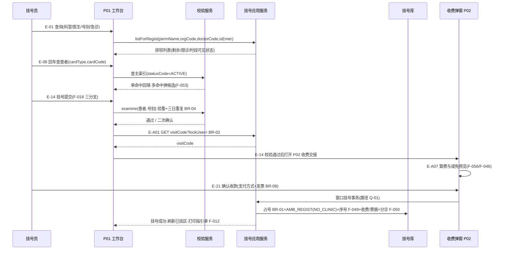
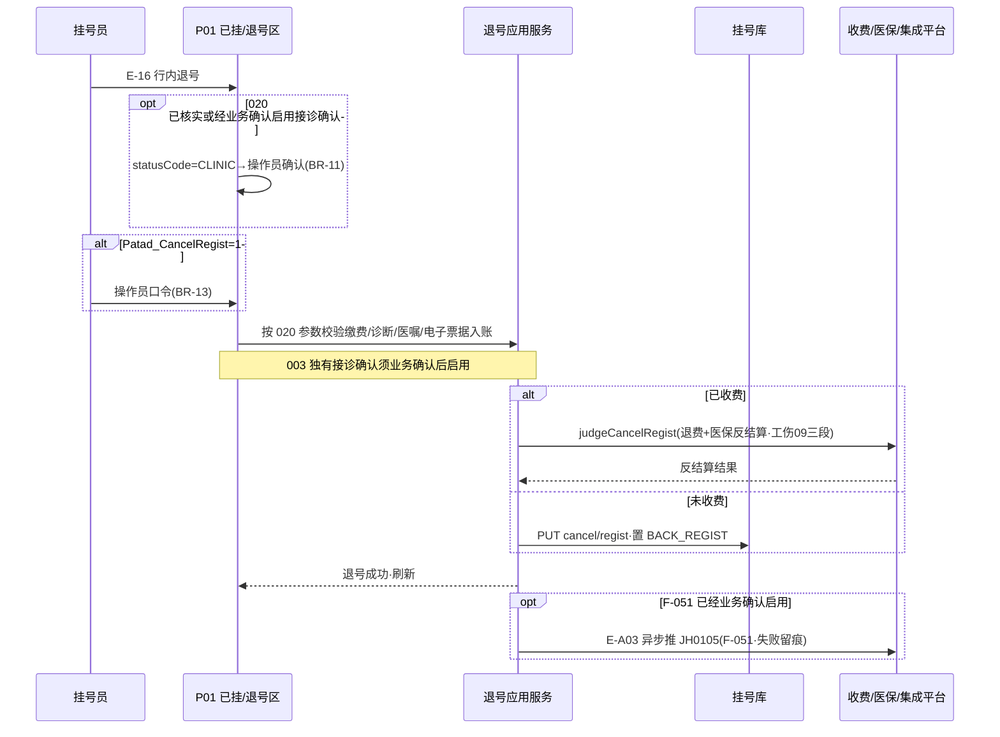
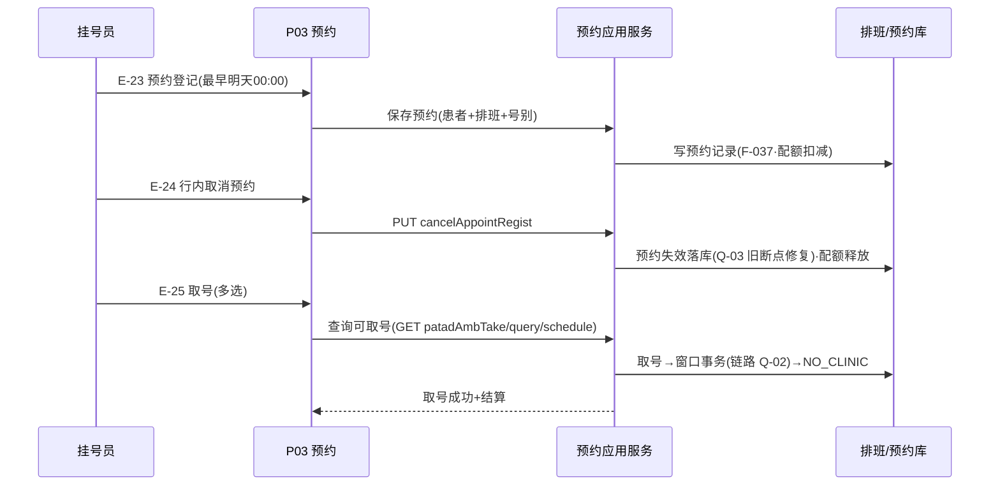
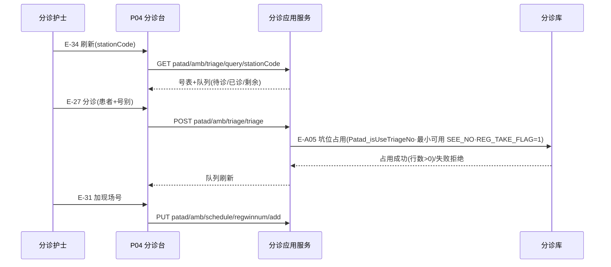
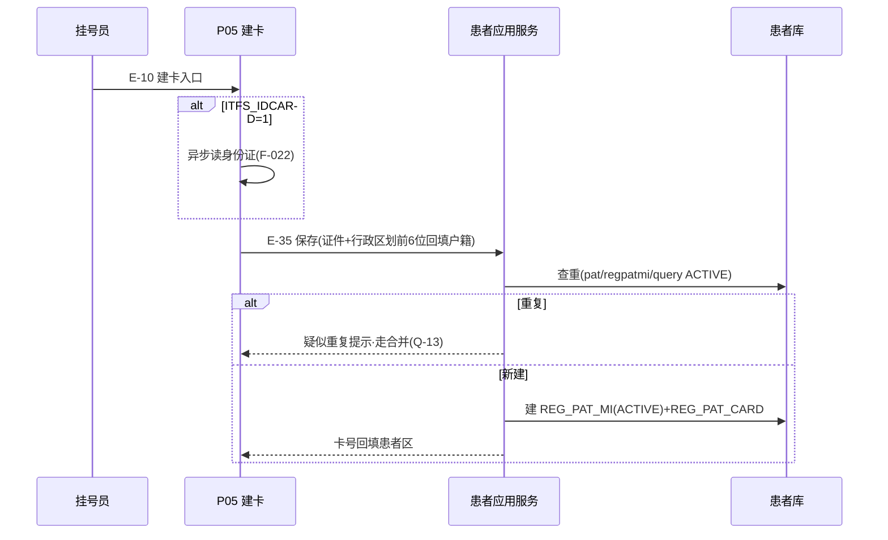

# 页面与交互规格

版本：v0.2（评审稿）

用途：定义门诊挂号登记页面元素、动作、数据绑定和页面时序约定。页面范围为统一挂号工作台 P01、挂号收费弹窗 P02、预约与取号 P03、挂号分诊台 P04、建卡与特殊人群 P05；003 双 Tab 与 020 三 Tab 是两代历史实现，目标产品合并为 P01，业务能力不因页面合并而丢失。

**源行为判定：** 020 潼南为默认目标；003 东港只作补充证据。页面动作表中的 Legacy 方法不自动代表目标规则；003 独有项须有业务确认记录。P02 只描述挂号收费交接与本模块所需的输入/结果，不重写收费域内部规则。

---

## 合并模块：12-页面元素规格说明

# 页面元素规格说明

## 1. 通用元素规则

- 只读区一律禁用输入；患者档案区（主索引/身份/费别）在 chargeLock=1 时整体禁用（BR-03）。
- 金额显示两位小数；待缴金额 = 挂号费 + 卡费 + 病历本费 − 减免，按 Econ_Rounded 舍入（F-056）。
- 号表"剩余"列 = 容量 − 已挂数；剩余 0 置灰并提示「已无号源！」；过时时段（服务端判定结束时间早于当前）默认隐藏。
- 查询输入框回车即查询；卡号框回车即读卡查询（003 15/18 位长度分支，F-053）。
- 提示文案沿用 Legacy 原文（04 章异常清单口径），语义不得变更；UNKNOWN/待核数据明确标识，不放行无依据。
- 按钮可见性与可用性受配置与状态双重控制（见 13 章"动作与状态关系"）。
- F→页面覆盖总表见本章 7 节。

## 2. P01 门诊挂号工作台

P01 是主页面。历史结构：003 双 Tab（挂号/退号）+ 020 三 Tab（挂号/已挂/预约挂号，29 接口 40 列 17 按钮）。V2 统一为四个工作区：号源区、患者区、挂号操作区、已挂/退号区；预约入口进 P03。

| 区域        | 元素                                                                                                                                                                                                 | 数据来源/绑定                          | 关键展示要求                                                                        | 现场   |
| ----------- | ---------------------------------------------------------------------------------------------------------------------------------------------------------------------------------------------------- | -------------------------------------- | ----------------------------------------------------------------------------------- | ------ |
| 号源查询区  | 科室/医师/号别/急诊条件、查询/清空、（003 收款跳转 F1、020 收款 F3）                                                                                                                                 | F-001/F-015 QueryScheduleByPermCommand | 回车即查询；020 号别分类单选（普通/急诊/专家/系统/特需，F-054）；003 助记码本地过滤 | 差异   |
| 号表区      | 003 号表 9 列（金额/医师/科室/诊区/已挂号数量/午别/剩余/号别/助记码）；020 号表 14 列（号别/科室/医生工号/状态/候诊/挂号类型/午别/限诊/已挂号数/金额/医生特长/开诊时间/离诊时间/坐诊地点）+ 卡片视图 | F-001/F-015 排班数据                   | 剩余 0 置灰；双击直挂（F-014）；卡片按科室聚合剩余号源                              | 差异   |
| 患者查询区  | 卡类型/卡号输入、读卡按钮组（身份证/电子凭证/医保刷脸/读医保卡）、高级查询、回车查患者                                                                                                               | F-004～F-007/F-019/F-023/F-053         | 多命中弹候选不自动选择；单命中回填并清空 visitCode                                  | Common |
| 患者信息区  | 费别/身份/贫困类型/单位/姓名/性别/出生日期/年龄/电话/证件/癌痛标记/住址/便捷收费；020 另有医保类型/优抚/快捷收费                                                                                     | F-053 回填 + Patad_PatRequired 必填集  | 出生日期↔年龄双向换算；必填受参数驱动（BR-07）；chargeLock=1 禁用                  | Common |
| 挂号信息区  | 跨午别/病历本/开卡费/电子发票/发票号/号别分类/挂号科室/挂号医生/挂号类型/待缴金额/贫困类型/优抚类型/快捷收费                                                                                         | F-054/F-056/F-046                      | 待缴金额实时算费；减免命中后现金置 0                                                | 差异   |
| 账户信息区  | 余额/充值/支付方式/金额                                                                                                                                                                              | F-047（Econ_IsAccCharge）              | 仅启用账户支付时显示；余额不足显示充值补差                                          | 020    |
| 建卡入口区  | 建卡/三无人员/绑健康卡/健康卡/退卡                                                                                                                                                                   | F-008/F-022/F-024/F-021/F-009          | 三无受 Patad_IsNoMessageUp 控制                                                     | Common |
| 已挂/退号区 | 查询条件（发票号/时间/科室/卡号）+ 已挂表（003 12 列 / 020 30 列，含退号/原号重打/代煎行内操作）+ 我的挂号                                                                                           | F-011/F-013/F-025/F-026/F-027          | 状态列statusCode；chargeLock 状态可见；020 发票统计条（共使用 N 张发票）            | 差异   |
| 补打区      | 补打指引单按钮                                                                                                                                                                                       | F-012                                  | 热敏打印                                                                            | 003    |

**科室字段的数据源说明：** PRD 已确认 E-01 号源查询使用 `orgCode` 等筛选条件，并调用 020 `GET patad/amb/schedule/list/regist`；但当前登记的 020 源码证据没有定位科室下拉候选列表本身的字典/授权查询接口，也没有确认科室名称到 `orgCode` 的映射，故候选源标记 `UNKNOWN`。原型固定展示内科/儿科/外科，仅为本地模拟，不代表医院配置。

页面串联：P01 选号+定位患者 → 挂号提交触发 E-14 → P02 收费弹窗 → 窗口挂号事务成功回 P01 刷新已挂区并打印指引单；退号在已挂/退号区行内完成（E-16）。

## 3. P02 挂号收费弹窗

| 区域     | 元素                                                                                                                                                           | 数据来源/绑定  | 关键展示要求                            | 现场   |
| -------- | -------------------------------------------------------------------------------------------------------------------------------------------------------------- | -------------- | --------------------------------------- | ------ |
| 费用摘要 | 挂号费/卡费/病历本费/减免/合计                                                                                                                                 | F-056 算费结果 | 减免明细可见（F-046）；舍入规则生效     | Common |
| 支付区   | 支付方式（003 历史默认 payWay=500901000001 现金；020 普通账户 PTZH /现金 XJ /三方 Econ_Other_Pay；均为历史实现，目标默认值由院区字典确认）、账户余额与充值补差 | F-040/F-047    | 余额不足显示补差金额（czbc）            | 差异   |
| 发票区   | 发票选择/发票号、电子发票选项、发票统计                                                                                                                        | F-040/BR-08    | 余量不足阻断文案原文；020 电子票 billNo | 差异   |
| 操作区   | 确认收款/取消                                                                                                                                                  | E-21           | 确认后进窗口挂号事务（BR-10）           | Common |

历史证据：003 `PatadAmbRegistRcptView`（REGISTER_AMB_RCPT_MODEL 弹窗，3 列 1 按钮）；020 `patadAmbRcptModel.showDialog("挂号计费信息",720,440)`（6 接口 4 列 3 按钮）。

## 4. P03 预约与取号

| 区域       | 元素                                                                    | 数据来源/绑定                 | 关键展示要求                                   | 现场    |
| ---------- | ----------------------------------------------------------------------- | ----------------------------- | ---------------------------------------------- | ------- |
| 预约登记区 | 排班树/号表、患者检索、预约/取消预约按钮、快捷日期（明天/本周/下周/月） | F-037                         | 预约日期最早=明天 00:00；无主索引时姓名可编辑  | 003+020 |
| 已预约区   | 已预约列表、行内取消                                                    | F-037 PUT cancelAppointRegist | Tab 切换自动查询；取消须落库（Q-03 断点修复）  | 003+020 |
| 取号区     | 查询（idCard/isCharge 默认 0）、号表多选、取号按钮                      | F-038                         | 取号进结算流程（提交链 Q-02 明确后可验收）     | 003+020 |
| 预约管理区 | 树形排班、批量取消、导出 Excel、午别筛选                                | F-039                         | 仅预约管理岗可见（020 AmbRegistAppointManage） | 020     |

## 5. P04 挂号分诊台

继承 020 RegistTriageView（8 接口 16 列 11 按钮）与 003 TriageView（未分诊/已分诊双 Tab）。排队叫号调度规则归《门诊分诊叫号》包（Q-11），本页保留挂号侧动作。

| 区域         | 元素                                                                                         | 数据来源/绑定     | 关键展示要求                                                       | 现场   |
| ------------ | -------------------------------------------------------------------------------------------- | ----------------- | ------------------------------------------------------------------ | ------ |
| 分诊台选择区 | 分诊台下拉、号别权限（TriagePermRelation）                                                   | BR-13             | 未选分诊台提示「请选择一条分诊台信息」                             | Common |
| 号表区       | 11 列（科室/诊室/医生/号类/午别/待诊(复)/剩余/已诊/操作：分诊·添加诊室·停诊·开诊）+ 卡片切换 | F-029/F-032/F-036 | 表格/卡片双视图；待诊数实时刷新                                    | 020    |
| 队列区       | 9 列（序号/就诊卡号/姓名/就诊/叫号/挂号类型/复诊/操作：复诊·插队·取消分诊·报道）             | F-030～F-035      | 未选提示「请选择对应的号别」；号别医生与分诊台医生不一致 putNum=-1 | Common |

## 6. P05 建卡与特殊人群

| 区域       | 元素                                                                               | 数据来源/绑定 | 关键展示要求                                   | 现场   |
| ---------- | ---------------------------------------------------------------------------------- | ------------- | ---------------------------------------------- | ------ |
| 建卡区     | 卡号（QueryCanUseCarCodeCommand 取号）、证件、必填集、读身份证（ITFS_IDCARD 异步） | F-008/F-022   | 020 弹窗 1024×450；行政区划前 6 位回填户籍地址 | Common |
| 特殊建档区 | 三无人员直建（「三无」+yyMMddHHmmss、withoutType=1）、新生儿登记                   | F-024/F-052   | 三无免卡号；开关控制                           | 020    |
| 卡管理区   | 退卡（注销）                                                                       | F-009         | 注销留痕                                       | 003    |

## 7. F → 页面覆盖总表

| 页面/自动点                  | 覆盖 F_ID                                                                                                                                                             |
| ---------------------------- | --------------------------------------------------------------------------------------------------------------------------------------------------------------------- |
| P01 号源查询区/号表区        | F-001、F-002、F-003、F-014、F-015、F-016、F-017、F-043、F-054                                                                                                         |
| P01 患者查询/信息区          | F-004、F-005、F-006、F-007、F-019、F-020、F-023、F-053、F-046（贫困/癌痛标记）                                                                                        |
| P01 挂号信息/账户区          | F-047、F-054、F-056                                                                                                                                                   |
| P01 建卡入口区               | F-008、F-009、F-021、F-022、F-024                                                                                                                                     |
| P01 挂号提交（自动校验点）   | F-010、F-018、F-044、F-045、F-048、F-049、F-055、F-056                                                                                                                |
| P01 已挂/退号区              | F-011、F-012、F-013、F-025、F-026、F-027                                                                                                                              |
| P02 收费弹窗                 | F-040、F-046、F-047、F-056、F-042（联动）                                                                                                                             |
| P03 预约与取号               | F-037、F-038、F-039                                                                                                                                                   |
| P04 分诊台                   | F-029、F-030、F-031、F-032、F-033、F-034、F-035、F-036、F-050                                                                                                         |
| P05 建卡与特殊人群           | F-008、F-009、F-022、F-024、F-052                                                                                                                                     |
| 自动校验点（无独立按钮）     | F-041（visitCode）、F-042（chargeLock）、F-043（占号）、F-044（验重）、F-045（资格）、F-046（减免）、F-049（序号）、F-050（坑位）、F-051（JH0105）、F-055（状态迁移） |
| 历史证据登记（不入活动页面） | F-028（清理 POS 机，已注释）                                                                                                                                          |

---

## 合并模块：13-元素动作与数据绑定设计

# 元素动作与数据绑定设计

## 1. 动作定义模板

每个动作按固定字段描述：动作编号、名称、触发方式、前置条件、后端动作、成功反馈、失败反馈、权限/开关控制。

## 2. 动作总表

| 编号  | 动作                              | 触发                       | 前置                       | 调用                                                                                                                                                         | 成功反馈                        | 失败/异常提示                                        | 受控               |
| ----- | --------------------------------- | -------------------------- | -------------------------- | ------------------------------------------------------------------------------------------------------------------------------------------------------------ | ------------------------------- | ---------------------------------------------------- | ------------------ |
| E-01  | 号源查询                          | 查询按钮/回车              | —                          | queryScheduleByPermCommand → GET patad/evn/amb/schedule/query（003）/ patad/amb/schedule/list/regist（020）                                                  | 号表刷新                        | 查询失败提示                                         | 岗位权限           |
| E-02  | 清空刷新                          | 清空/Delete                | —                          | refeshScheduleCommand（Legacy 原拼写）/ RefeshScheduleCommand + refreshSchduling                                                                             | 条件与选择态复位                | —                                                    | —                  |
| E-03  | 收款跳转                          | F1（003）/F3（020）        | 已有挂号上下文             | skipEconCommand / SkipEconCommand → openBusiness("ambChargeModel")                                                                                           | 进入门诊收费                    | 上下文缺失提示                                       | 跨包权限           |
| E-04  | 身份证读卡                        | 身份证按钮                 | 读卡设备就绪               | readPatCard → externalDevices.identificationRead() → GET pat/getbyidno/query                                                                                 | 患者区回填                      | 读卡失败/未识别                                      | 岗位权限           |
| E-05  | 电子凭证读卡                      | 电子凭证按钮               | 扫码枪就绪                 | miECReadCard → dgAmbBusiness.readErCardIdNo()                                                                                                                | 患者区回填                      | 凭证无效                                             | 岗位权限           |
| E-06  | 医保刷脸                          | 刷脸按钮                   | 费别=07                    | miFsReadCardButton → dgAmbBusiness.readFsCardIdNo()                                                                                                          | 患者区回填                      | 「请输入正确的费别！」                               | 费别约束           |
| E-07  | 读医保卡                          | 读医保卡按钮               | 费别已选                   | miBaseReadAmbCard：07→readMiCaedIdNo（原拼写）、09→miInjuryInterface.readCard("1")；020 走 MiReadCardDialogModel                                             | 患者区回填                      | 读卡失败                                             | 费别约束           |
| E-08  | 卡号/证件回车查患者               | 卡号框回车                 | 有输入                     | QueryPatByCardCommand → pat/regpatmi/query（ACTIVE）                                                                                                         | 单命中回填；多命中弹候选        | 多命中请人工选择                                     | —                  |
| E-09  | 高级查询                          | 高级查询按钮               | —                          | queryPat → PatadAmbQueryRegistPatModel.showDialog（默认近 1 月）                                                                                             | 历史挂号列表                    | —                                                    | 岗位权限           |
| E-10  | 建卡入口                          | 建卡按钮                   | —                          | createPatCard → 弹 P05                                                                                                                                       | 打开建卡弹窗                    | —                                                    | BR-13              |
| E-11  | 三无人员                          | 三无按钮                   | Patad_IsNoMessageUp=0      | 页面直建「三无」+yyMMddHHmmss、withoutType=1、免卡号                                                                                                         | 患者区建档                      | 开关关闭不显示                                       | 开关               |
| E-12  | 患者信息修改                      | F5                         | 已定位患者                 | updatePatInfo → openBusiness("regPatModel") 带查询条件                                                                                                       | 修改后回填                      | chargeLock=1 拒绝                                    | BR-03              |
| E-13  | 绑健康卡/健康卡                   | 对应按钮                   | Patad_IsCreateEhc          | BindEhcCardPatCommand；readEhcCard → patEhcUtil.queryForStage("000000")                                                                                      | 卡绑定成功                      | 绑定失败提示                                         | 开关               |
| E-14  | 挂号提交                          | 挂号 F2/双击号表           | 患者已定位+已选号+校验通过 | F-018 三分支（QZF/GFYL→RegistCommand；医保→RegistAmbRegistPsninfoCommand；号源限制→RegistSourceLimitCommand）；003 费别 08 直挂、其他走 dGMIAmbRegistCommand | 打开 P02                        | 必填/临床/验重/发票/支付校验文案（04 章）            | BR-04~BR-09        |
| E-15  | 号源选择态维护                    | 选中/取消号表行            | —                          | 003 UpdateScheduleCommand：GET queryScheduleByKey → PUT updateRegistNum ±1；V2 改为纯前端选择态                                                              | 剩余数显示联动                  | 并发丢失更新（旧缺陷不继承）                         | BR-01              |
| E-16  | 行内退号                          | 已挂表操作列               | 满足 BR-11                 | 003 cancelRegistCommand；020 Patad_CancelRegist=1 先密码框，再 CancelRegistCommand → PUT patad/evn/amb/cancel/regist                                         | BACK_REGIST+刷新                | BR-11 拦截文案                                       | BR-11/BR-13        |
| E-17  | 查询已挂/我的挂号                 | 查询按钮/我的挂号          | —                          | queryAlreadyRegist / mySchedule → GET patad/evn/amb/alreadyRegist/query                                                                                      | 已挂表刷新                      | —                                                    | 岗位权限           |
| E-18  | 补打指引单                        | 补打按钮                   | 已挂号                     | printRegist → PrintUtil.Print("指引单补打", Thermal)                                                                                                         | 打印输出                        | 打印失败提示                                         | 岗位权限           |
| E-19  | 原号重打                          | 已挂表操作列               | 已收费                     | printRegist → PrintRegistInvoiceCommand                                                                                                                      | 重打发票                        | 重打留痕失败提示                                     | 岗位权限           |
| E-20  | 代煎                              | 已挂表操作列               | 中药处方                   | cdrugDecpction（原拼写）→ AmbCdrugDecoctionCommand                                                                                                           | 代煎登记成功                    | 处方校验提示                                         | 岗位权限           |
| E-21  | 确认收款                          | P02 确认按钮               | 发票/支付校验通过          | CommitRcptRegisterAmbCommand → POST 窗口挂号事务（路径 Q-01）                                                                                                | 挂号成功+打印指引单             | 事务失败整体回滚（BR-10）；020 失败释放首排班        | BR-08/BR-10        |
| E-22  | 发票预检查                        | P02 打开时                 | Econ_Use_Amb_Invoice       | 发票余量校验（endNo+1-nowNo ≥ 号别数）                                                                                                                       | 可收款                          | BR-08 阻断文案                                       | 开关               |
| E-23  | 预约登记                          | 预约按钮                   | 必填+号源                  | saveAppointsEncAptAmbCommand → registForNotRepeatCommand                                                                                                     | 预约成功                        | 证件号过长等校验提示                                 | 岗位权限           |
| E-24  | 取消预约                          | 行内取消                   | 已预约                     | PUT patad/evn/amb/cancelAppointRegist（020 空实现断点 Q-03）                                                                                                 | 预约失效落库                    | 旧系统该分支不落库                                   | 岗位权限           |
| E-25  | 预约取号                          | 取号按钮                   | 已选预约记录               | GET patadAmbTake/query/schedule → POST patadAmbTake/amb/update（Q-02 链路明确后验收）                                                                        | 生成挂号 NO_CLINIC              | 取号失败提示                                         | 岗位权限           |
| E-26  | 预约管理批量操作                  | 树形排班/批量取消/导出     | 管理岗                     | AmbRegistAppointManage 6 接口                                                                                                                                | 批量结果反馈                    | 部分失败逐条列示                                     | F-039 权限         |
| E-27  | 分诊                              | 队列操作列                 | 分诊台+号别已选            | AddRegistTriageCommand → POST patad/amb/triage/triage                                                                                                        | 队列刷新                        | 「请选择一条分诊台信息」/「请选择对应的号别」        | TriagePermRelation |
| E-28  | 取消分诊                          | 队列操作列                 | 已分诊                     | CancelTriageCommand → POST patad/amb/triage/cancel                                                                                                           | 坑位释放                        | —                                                    | 同上               |
| E-29  | 报到                              | 报到按钮                   | 已挂号                     | SignInCommand → POST patad/amb/triage/signIn                                                                                                                 | 状态更新                        | —                                                    | 同上               |
| E-30  | 开诊/停诊                         | 号表操作列                 | 排班权限                   | StartScheduleCommand → PUT patad/amb/schedule/start                                                                                                          | 排班状态切换                    | 停诊需处理已挂患者提示                               | BR-01              |
| E-31  | 加现场号                          | 加现场号+保存              | 分诊台                     | AddNumCommand → PUT patad/amb/schedule/regwinnum/add                                                                                                         | 号额+1                          | —                                                    | BR-13              |
| E-32  | 复诊                              | 队列操作列                 | 已就诊                     | TriageRepeatCommand → POST patad/amb/triage/repeat                                                                                                           | 新队列序号                      | —                                                    | 同上               |
| E-33  | 插队                              | 队列操作列                 | 队列权限                   | changeSchedule 族                                                                                                                                            | 顺序调整                        | —                                                    | 同上               |
| E-34  | 队列刷新                          | 刷新按钮                   | —                          | QueryRegistTriageAmbScheduleCommand → GET patad/amb/triage/query/stationCode                                                                                 | 号表+队列刷新                   | —                                                    | —                  |
| E-35  | 建卡保存                          | P05 保存                   | 必填+查重通过              | readCardCommand + cardInterface.createCard()；020 QueryCanUseCarCodeCommand 取卡号                                                                           | 卡号回填患者区                  | 重复建档提示                                         | BR-07              |
| E-36  | 退卡注销                          | 退卡按钮                   | 卡可注销                   | backCardCommand                                                                                                                                              | 卡状态注销                      | —                                                    | 岗位权限           |
| E-A01 | visitCode 获取锁定（自动）        | E-14 前置                  | 费别分流后需流水           | GET patadAmb/query/visitCode?lockUser=                                                                                                                       | 流水号写入 VO                   | 获取失败阻断                                         | F-041              |
| E-A02 | chargeLock 加解锁（自动）         | 收费事务开/结束            | 收费包触发                 | PUT patadAmb/updateChargeLock / amb/regist/update/chargelock                                                                                                 | 锁状态落库                      | 020 旧客户端解锁失败弹「解锁挂号表失败」（语义废弃） | F-042/BR-03        |
| E-A03 | JH0105 推送（003 候选，默认关闭） | 仅业务确认启用后，退号成功 | 业务开关与集成配置         | PatToFhirUtil.sendRegistInfoUpdate（003）                                                                                                                    | 启用后集成平台收到              | 默认不发送；启用后失败留痕补偿，不回滚退号           | F-051/BR-12        |
| E-A04 | 序号/看诊时刻计算（自动）         | 窗口挂号事务内             | 排班已定                   | countRegistNo（003）/ createRegistNO（020，Q-20）                                                                                                            | REGIST_NO/SEE_DATE 落库         | 序号重复风险（V2 加唯一约束）                        | F-049              |
| E-A05 | 坑位占用（自动）                  | 分诊/挂号事务内            | Patad_isUseTriageNo        | AmbRegistNoMapper getByAttributes/getMinNo/useRegsitNo（原拼写）                                                                                             | REG_TAKE_FLAG=1                 | 占用失败行数 0 拒绝                                  | F-050              |
| E-A06 | 医保登记弹窗触发（自动）          | E-14 费别分流              | 非欠费/公费                | miAmbBusiness.ambRegistDialog（busiType=01）                                                                                                                 | 医保登记完成                    | 医保侧失败阻断（归医保包）                           | F-048              |
| E-A07 | 减免计算（自动）                  | P02 打开时                 | 减免参数命中               | Patad_RegistJMPayWay 等                                                                                                                                      | 现金置 0/支付方式转 ZCJM/XXZCJM | 未配置参数提示原文                                   | F-046              |

## 3. 数据绑定规则

- 号源查询区条件 → `QueryScheduleByPermCommand` 入参（permName/orgCode/doctorCode/isEmer/serviceItemCode；003 isEmer=true 映射 0 否则 1）；返回绑定号表区，过时时段由服务端回传可见状态统一判定。
- 科室筛选的候选列表来源与名称→`orgCode` 映射：当前证据未确认（`UNKNOWN`）；不得将原型内置数组当作真实院区字典。已确认的 020 号表读取链为 `GET patad/amb/schedule/list/regist` → `AmbSchedulingRegMapper.listForRegist` → `AMB_SCHEDULING_REG`，关联 `AMB_TIME_DESCRIBE`、号类字典和价目数据。
- 患者区数据 = 查重接口（pat/regpatmi/query，statusCode=ACTIVE）单命中回填；020 单命中回填患者、年龄、费别并清空 visitCode；多命中由前端弹候选，选择结果回传。
- 已挂区数据 = GET patad/evn/amb/alreadyRegist/query；020 30 列含 visitCode、日结状态 receivableFlag、挂号来源 source、退号人 backDoctCode。
- 待缴金额由服务端算费接口返回（003 POST /ambPatientcharge/amb/costs/byRegist；020 GET econ/ambcharge/compute/regist/costs），前端不自行计价；减免命中后展示减免明细。
- 初始化读参：进入 P01 时按 04 章 15 节初始化读取顺序拉取开关/参数快照，控制按钮可见性、必填集与确认弹窗。
- 发票统计条由 InitialAmbRegistInvoiceNumCommand 在 Tab 选中即刷新【推断】（020）。

## 4. 动作与状态关系

| 动作                           | 未定位患者  | 已定位未提交 | 已提交 NO_CLINIC          | CLINIC             | BACK_REGIST       |
| ------------------------------ | ----------- | ------------ | ------------------------- | ------------------ | ----------------- |
| E-08/E-09/E-04～E-07 查询/读卡 | ✓           | ✓            | ✓                         | ✓                  | ✓                 |
| E-14 挂号提交                  | ✗           | ✓            | ✗（同患者同号别受 BR-04） | 受 BR-04 验重      | 可再挂新号        |
| E-12 患者信息修改              | ✗           | ✓            | ✓（CHARGE_LOCK=0 时）     | ✓（受 BR-03）      | ✗                 |
| E-16 行内退号                  | ✗           | ✗            | ✓                         | ✓（确认+三重校验） | ✗                 |
| E-18/E-19 补打/重打            | ✗           | ✗            | E-18 ✓                    | ✓                  | ✓（按已挂号记录） |
| E-23/E-24 预约登记/取消        | E-23 需患者 | ✓            | ✓                         | —                  | —                 |
| E-27～E-33 分诊台动作          | ✗           | ✗            | ✓                         | ✓（报到/复诊）     | ✗                 |

---

## 合并模块：17-页面与动作时序图

# 页面与动作时序图

## P01 窗口挂号主链

## 动态原型与页面动作映射约定

PRD 页的原型是本地交互演示，P01～P05 使用可操作的表单、列表、状态标签和校验反馈构成；不把静态截图作为交互页面。布局借鉴最初门诊收费工作台的分区卡片、当前业务上下文、摘要和操作栏，具体字段与流程仍以本挂号 PRD 为准。点击带 E 编号的控件/业务行时，右侧业务方法说明和动作详情必须同步切换；动作目录可用于直接查阅。交互只改变浏览器演示状态，不调用真实挂号、支付、医保、预约或分诊写接口。动作目录直接读取本章动作总表（E-01～E-36、E-A01～E-A07，共 43 项），每个动作只映射到一个页面：

| 页面              | 动作                                                                       | 原型行为边界                                                                                                  |
| ----------------- | -------------------------------------------------------------------------- | ------------------------------------------------------------------------------------------------------------- |
| P01 窗口挂号/号源 | E-01、E-02、E-04～E-09、E-12、E-14～E-20、E-30、E-A01、E-A03、E-A04、E-A06 | 患者识别与号源选择分别演示；E-14 必须先完成两项才进入 P02。E-A03 是 003 补充项，默认不触发且待业务确认。      |
| P02 收费交接      | E-03、E-21、E-22、E-A02、E-A07                                             | E-14 只负责通过校验并进入本页；E-21 是单独的确认收款动作。收费、锁、减免仅本地模拟；E-A02 的跨包时机待 Q-05。 |
| P03 预约取号      | E-23～E-26                                                                 | E-23/E-24 仅演示预约状态；取消预约落库待 Q-03。E-25 取号链待 Q-02，待决关闭前不得演示为成功。                 |
| P04 挂号分诊      | E-27～E-29、E-31～E-34、E-A05                                              | 仅演示本地分诊状态变化；坑位及权限等真实校验按 03/04 章和 A-验收执行。                                        |
| P05 建卡档案      | E-10、E-11、E-13、E-35、E-36                                               | 仅演示本地查重与档案操作；不创建或修改真实患者档案。                                                          |

动作说明中的源码证据与目标决议分开呈现。UNKNOWN、待确认和 003 补充项不得因原型按钮可点击而标记为已实现或已验收。

## P01 退号链

## P03 预约与取号

## P04 分诊台与坑位

## P05 建卡链

## 时序图验收规则

- 每条主链有图；消息带具体数据字段（条件值、statusCode、lockUser、开关名），不写"调用后端"。
- 每个外部/跨系统调用（收费、医保、集成平台、打印）有成功/失败分支或明确阻断说明。
- 每个页面动作（E-xx/E-Axx）能在至少一张时序图中找到；图中消息可反查动作编号。
- 时序图消息带短编号（E-01 等），完整定义以 13 章"动作总表"为准。
