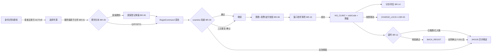
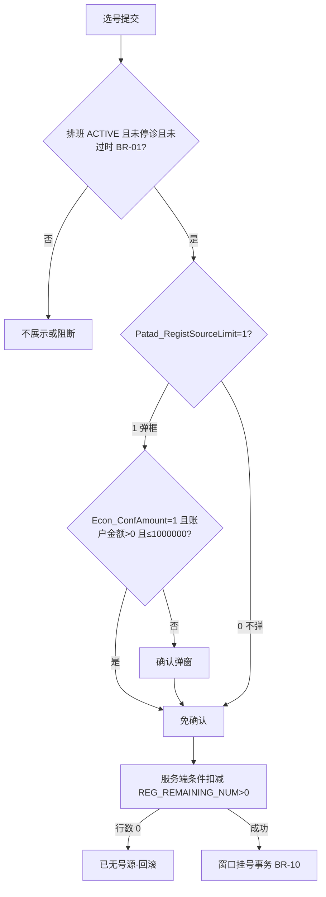
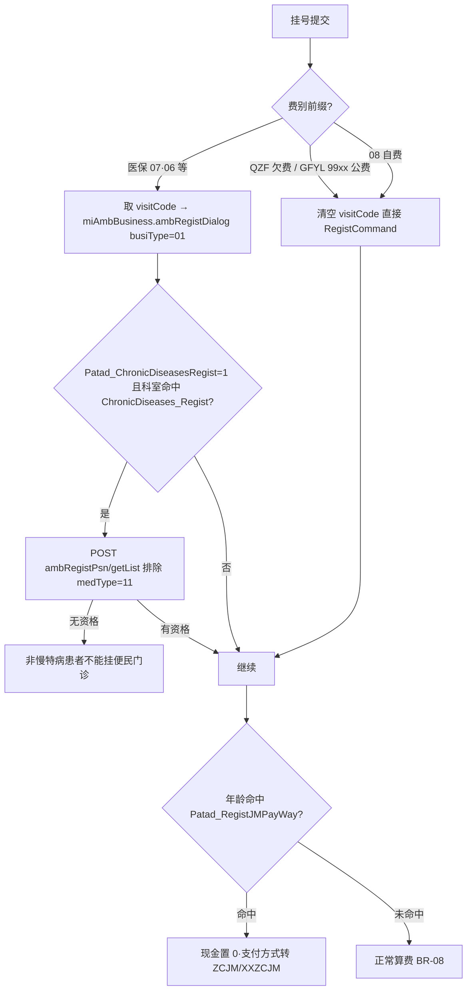
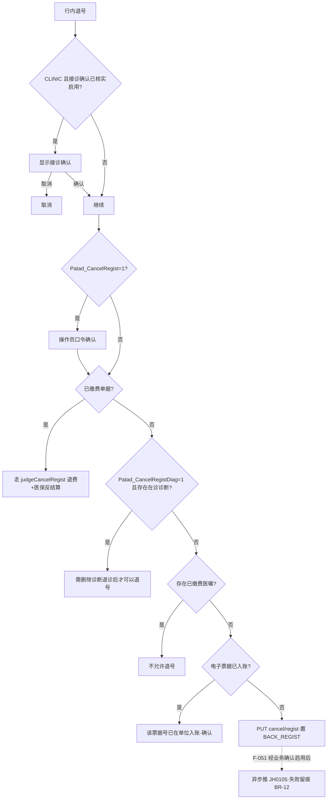
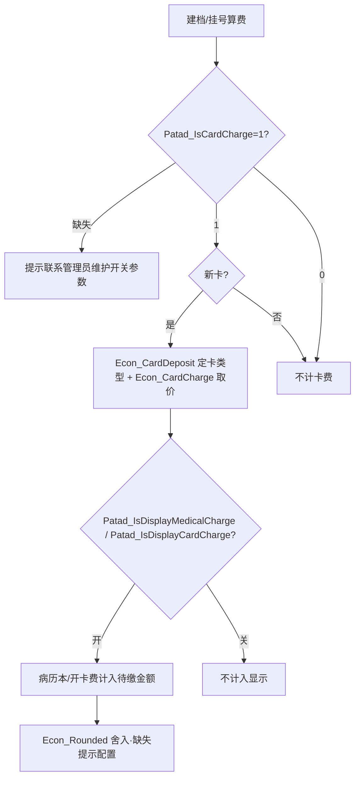

# 业务规则与流程控制

版本：v0.2（评审稿）

用途：定义门诊挂号登记的状态机、业务规则、异常场景、开关参数和流程控制。

**基线约束：** 020 潼南是默认业务事实；003 东港只作补充证据。003 独有规则/开关效果须逐项确认后纳入。未知默认值、费别或院区取值保持 `UNKNOWN`，不可从代码猜定。

---

## 合并模块：05-状态机与主流程

# 门诊挂号登记状态机与主流程

## 1. 状态模型

挂号登记包含一台核心状态机、两个计数型状态量与两个互斥锁状态，互相独立、由引用关联：

| 状态机/状态量 | 拥有者 | 主线 | 说明 |
|---|---|---|---|
| 挂号状态机 | AMB_REGIST.STATUS_CODE | NO_CLINIC → CLINIC（接诊）；NO_CLINIC/CLINIC → BACK_REGIST（退号） | F-055；三值均 VERIFIED（buildRegistVO、退号实现、「已经接诊」分支） |
| 号源容量（计数，非状态机） | 003 AMB_SCHEDULE.REGIST_USE_NUM / 020 AMB_SCHEDULING_REG.REG_REMAINING_NUM | 占号 +1、退号释放 +1/−1 | 页面选择态计数与业务容量分离（BR-01） |
| 分诊坑位状态 | AMB_REGIST_NO.REG_TAKE_FLAG | 0（未占用）/1（已占用） | F-050；VERIFIED（useRegsitNo 条件更新） |
| 挂号收费锁 | AMB_REGIST.CHARGE_LOCK | 0（未锁）/1（锁）按 VISIT_CODE | F-042；两项目 SQL 完全一致（「0不锁定、1锁定」） |
| 患者状态 | REG_PAT_MI.STATUS_CODE | ACTIVE（有效） | 查重与建档约束（statusCode=ACTIVE） |
| 派生状态线（域级，INFERRED） | 患者/挂号/队列 | 未建档 → 已建档 → 已挂号（未就诊）→ 候诊中 → 接诊中 → 已就诊/已退号 | 来自 spec.html 知识图谱归纳；落库以 NO_CLINIC/CLINIC/BACK_REGIST 为准 |

## 2. 状态定义

| 状态 | 含义 | 进入事件 | 允许迁出 | 禁止 |
|---|---|---|---|---|
| NO_CLINIC | 已挂号未就诊 | 窗口挂号事务提交成功（buildRegistVO statusCode=NO_CLINIC、source=Window） | CLINIC（医生站接诊）；BACK_REGIST（退号） | 已就诊后直接改写 |
| CLINIC | 已接诊 | 医生站接诊（归《门诊医生站》包，本包只读投影） | BACK_REGIST（确认后，BR-11） | 静默退号（须确认+校验） |
| BACK_REGIST | 已退号 | 退号命令成功（020 实现置 BACK_REGIST、消息「退号成功！」） | —（终态；可重新挂号产生新记录） | 复用原记录；不释放坑位 |
| REG_TAKE_FLAG=1 | 分诊坑位已占用 | useRegsitNo 条件更新（WHERE REG_TAKE_FLAG=0，行数>0） | 0（取消分诊/退号释放） | 两笔挂号占用同一坑位 |
| CHARGE_LOCK=1 | 收费中锁定 | 收费事务开启（003 服务端锁，V2 统一服务端语义） | 0（收费事务结束） | 挂号侧改患者数据（BR-03）；客户端 dispose 解锁（020 旧语义废弃） |
| 停诊 | 排班停诊 | StartScheduleCommand（F-032） | 开诊 | 停诊排班继续挂号（BR-01） |

## 3. 主流程输入与输出

| 环节 | 操作人 | 系统动作 | 输出 | 关键规则 |
|---|---|---|---|---|
| ① 身份识别 | 挂号员 | 五通道读卡/录入 → 查主索引（statusCode=ACTIVE）→ 多命中人工收敛 | 患者主索引命中 | BR-07、BR-13 |
| ② 建档 | 挂号员 | 无档案建档（查重）；三无/新生儿特殊建档 | 患者档案 + 卡证绑定 | BR-07、BR-15 |
| ③ 选择号源 | 挂号员 | 科室/医生/号类过滤 → 选号（选择态）→ 提交时服务端原子占号 | 锁号记录 | BR-01、BR-05、BR-06 |
| ④ 医保登记 | 系统 | 医保费别 → 登记弹窗（busiType=01）/慢特病资格校验 | 医保登记引用 | BR-06、BR-09 |
| ⑤ 收费 | 挂号员/收费员 | 算费（挂号费+卡费+病历本+减免）→ 发票/支付校验 → 收费弹窗 → 窗口挂号事务 | 挂号收费记录 + 票据 | BR-08、BR-10、BR-16 |
| ⑥ 生成就诊 | 系统 | visitCode 原子分配、序号/看诊时刻计算、收费加锁（chargeLock=1） | 就诊记录 + 排队号 | BR-02、BR-03 |
| ⑦ 分诊叫号 | 分诊护士 | 分诊/报到/坑位占用；队列调度归分诊叫号包 | 分诊记录 + 坑位 | BR-14 |
| ⑧ 退号 | 挂号员 | 按 020 基线校验 → （已收费）跨包退费+医保反结算 → BACK_REGIST；JH0105 仅确认后启用 | 退号记录 | BR-11、BR-12 |

主流程状态主线：

## 4. 关键状态原则

1. 挂号状态（NO_CLINIC/CLINIC/BACK_REGIST）只能由业务事件（挂号提交、接诊、退号）驱动，禁止人工直接改状态。
2. 号源选择态计数（003 REGIST_USE_NUM ±1）只是 UI 现象，不是容量保护；可挂容量以服务端条件扣减为准（BR-01）。
3. chargeLock 谁加锁谁解锁，统一为服务端收费事务语义；020 客户端 dispose 解锁为旧语义，废弃（BR-03，Q-05 关联）。
4. visitCode 与挂号 ID 由 Oracle 序列（AMB_VISIT_CODE_ID / AMB_REGIS_ID）原子分配，分配后不可复用（BR-02）。
5. 退号到达阈值（patad_CancelRegistNum，默认 3）时 examine 阻止再次挂号，与三日重复共用验重入口（BR-04）。
6. 停诊排班不可挂号；停诊处理已挂号患者走改约或全额退号（spec 分支）。

---

## 合并模块：06-异常场景清单

# 门诊挂号登记异常场景清单

## 1. P0 异常：必须在一期闭环

| 异常 | 触发条件 | 系统行为 | 用户提示 | 恢复路径 | 规则 |
|---|---|---|---|---|---|
| 号源并发超号 | 余 1 号双窗口并发挂号 | 020 条件扣减行数 0 → 抛错回滚；003 客户端 ±1 会丢更新（已证实的旧缺陷） | 已无号源！ | 刷新号表改选其他号/医生 | BR-01 |
| 三日重复/退号超限 | examine 命中「一次挂号管三天」或 BACK_REGIST 达 patad_CancelRegistNum 阈值 | 二次确认（003 前端 YES 可继续）；阈值命中阻止 | 该患者满足一次挂号管三天…是否继续挂号？ | 确认继续（留痕）或取消 | BR-04 |
| 儿科/妇科临床限制 | 超过 Patad_BabyAge 年龄；男性挂 GNCLG 妇科号 | 阻断 | 此患者年龄大于N岁，不能按儿童挂号! / 只有女性患者，才可以挂妇科类的号！ | 改普通号或如实修正患者信息 | BR-05 |
| 发票不足/无支付方式 | 发票余量 endNo+1-nowNo < 号别数；未配置支付方式 | 阻断提交 | 此人当前结算发票剩余N张，不足以结算当前挂号，请先领取发票 / 没有支付方式，找管理员配置支付方式 | 领票/配置后继续 | BR-08 |
| 窗口事务失败 | windowRegist 任一环节异常（020 限诊扣减行数 0 抛错） | 本地 DB 写全部回滚（@Transactional）；020 客户端释放首排班补偿 | 挂号失败（客户端判定口径，Q-01） | 排查后重新提交；不残留半程数据 | BR-10 |
| chargeLock 冲突 | 收费中（CHARGE_LOCK=1）挂号侧改患者数据 | 拒绝变更 | 锁定挂号表，避免计费时医生对患者数据进行变更（003 注释原文语义） | 等收费事务结束解锁 | BR-03 |
| 退号拦截（020 基线） | 已缴费单据/在诊诊断/已缴费医嘱/电子票据已入账 | 按 020 规则及现场开关阻断退号 | 患者存在…需要删除诊断退诊后才可以退号 / 患者存在已缴费的医嘱，不允许退号 / 该票据号已在单位：xxx入账 | 处理对应前置后重试 | BR-11 |
| 慢特病资格不符 | 便民门诊科室命中参数且患者无资格（medType=11 全部被排除） | 阻断挂号（窗口与第三方同规则） | 非慢特病患者不能挂便民门诊！ | 改挂普通号或补资格 | BR-06 |

## 2. P1 异常：一期应覆盖或明确降级

| 异常 | 触发条件 | 系统行为 | 恢复路径 |
|---|---|---|---|
| 开关/参数缺失 | Patad_IsCardCharge、Econ_Rounded、Econ_ConfAmount、Patad_RegistJMPayWay、Patad_PatRequired 等未配置 | 按 Legacy 原文提示阻断或记 message 继续（逐项见 15 章表），不静默 | 补配置后重试；默认值不得凭空设定（BR-15） |
| 医生未到开诊时间 | PATAD_LIMIT_DOCTOR_REGIST_DATE 配置了 doctorCode:HH:mm 且未到 | 阻断 | 到点后挂号；无配置允许继续（isTimeReached 语义） |
| JH0105 推送失败（条件场景） | 业务确认启用 F-051 且集成平台不可达 | 留痕补偿，不改写退号成功结果（BR-12） | 默认关闭；启用后平台恢复再补偿 |
| 读卡设备失败 | 身份证/医保读卡器无响应 | 提示后允许手工录入走查重 | 手工录入证件号收敛 |
| 医生站来源退号 | statusCode=CLINIC 且未收费 | 走已确认的 020 退号契约；003 专用 cancelDoctorRegist 待确认 | 待 Q 决策后验收 |
| 预约取消空实现 | 020 CancelAppointCommand.doServer 为空 | 旧系统该分支不落库（已证实断点） | Q-03 结论后修复；一期必须落库 |
| 电子发票失败 | 电子票 API 失败/中间表非 1 条 | 记附加错误返回，不影响挂号与资金事实；中间表非 1 条抛错 | 人工补开 |
| 账户余额不足 | 普通账户支付且余额不足 | 显示充值补差金额（czbc）；充值不成功拒绝 | 充值或换支付方式 |
| JVM/DB 时钟偏差 | 020 验重用 JVM Calendar、其他用 DB 时间 | 边界日期可能误判（已证实差异） | V2 统一服务端（DB）时钟判定日界 |

## 3. 每个异常必须具备的字段

- 触发条件：什么情况下发生。
- 检测点：在哪一层检测（页面/应用服务/领域服务/数据库约束/外部系统）。
- 用户提示：操作员看到的文案（Legacy 原文口径，语义不得变更）。
- 系统状态：涉及的状态机/计数/锁如何变化、哪些字段落库。
- 恢复路径：按什么键重查、谁能处理、处理后状态。
- 留痕：审计字段（操作人 + 时间 + 原因）。

---

## 合并模块：07-业务规则清单

# 门诊挂号登记业务规则清单

以下 16 条为强制约束，不可配置的标"不可配置"，可配置的注明开关；开发时须逐条落为**服务端校验**（客户端提示仅为体验层）。编号本包内全局唯一，供测试用例与验收引用。

## 1. 号源与流水

- **BR-01 号源不可超挂**：挂号提交以服务端原子条件扣减为准（`UPDATE ... SET REG_REMAINING_NUM=REG_REMAINING_NUM-1 WHERE ID=? AND REG_REMAINING_NUM>0`，020 AmbSchedulingRegMapper.xml:962-966）；页面选择态计数（003 ±1）不是容量；扣减同时校验排班 ACTIVE/停诊/日期；号源为 0 提示「已无号源！」。（F-001/F-015/F-043，不可配置）
- **BR-02 visitCode 原子唯一**：visitCode 由序列 AMB_VISIT_CODE_ID 原子分配（003 Mapper :2030 / 020 Mapper :1076-1079）；GET visitCode 支持 lockUser 锁定；全院唯一、不复用。（F-041，不可配置）
- **BR-03 chargeLock 互斥**：`update AMB_REGIST set CHARGE_LOCK=? where VISIT_CODE=?`（两项目 SQL 一致）；收费事务开启加锁、结束（含异常）服务端解锁；锁定期间挂号侧患者数据变更被拒；废弃 020 客户端 dispose 解锁。（F-042，不可配置；Q-05 关联）

## 2. 验重与临床

- **BR-04 重复挂号验重**：提交前逐号别 POST Regist/examine；当日同患者同号别有挂号（003 数 BACK_REGIST 达 3 次阻止；020 patad_CancelRegistNum 默认 3 可院区覆盖）或三日重复时按配置确认/阻止；确认继续须留痕。（F-044/F-055，可配置 patad_CancelRegistNum）
- **BR-05 临床限制**：儿科 `CacheOrg.adminTypeCode==PED` + Patad_BabyAge 年龄阈值；妇科 GNCLG + Patad_PatSex 性别限制；由服务端以权威生日/性别与科室分类计算，不信任页面。（F-010/F-018，可配置）

## 3. 资格与分流

- **BR-06 便民门诊慢特病资格**：开关 Patad_ChronicDiseasesRegist=1 且号别科室命中参数 ChronicDiseases_Regist（逗号分隔）时，POST /ambRegistPsn/getList 校验并排除 medType=11；无资格阻断；窗口与第三方渠道同规则。（F-045/F-048，可配置）
- **BR-07 必填与证件校验**：必填集参数化（Patad_PatRequired，默认 name:sex:birthDate:feeType:patIdentity:tel:addr）；证件号 15/18 位正则（末位 X|x）；电话 11 位；出生日期上限=今日；身份证读卡生日回填患者档案。（F-004/F-053，可配置）

## 4. 票据与支付

- **BR-08 发票强校验**：当前人员门诊收据余量 `endNo + 1 - nowNo` 不少于所选号别数，否则「此人当前结算发票剩余N张，不足以结算当前挂号，请先领取发票」；无发票「此人没有结算发票.先去领取发票」；无支付方式「没有支付方式，找管理员配置支付方式」。（F-040/F-056，可配置 Econ_Use_Amb_Invoice）
- **BR-09 费别分流参数化**：08 自费/07·06 医保/09 工伤/QZF 欠费/GFYL 99xx 公费分流逻辑保留，但编码表与急诊科室码（020 硬编码 0001101134，迁移必改）必须参数化，禁止硬编码进新代码。（F-014/F-018/F-048，可配置）
- **BR-10 窗口挂号事务原子性**：挂号 + 分诊 + 收费明细 + 收据/支付/结算 + 票据推进 + 号额扣减在一个服务端事务内完成（020 @Transactional 基线）；任一环节失败整体回滚，不残留半程数据；003 主方法未见事务注解属旧缺陷，不继承。（F-010/F-018/F-040，不可配置）
- **BR-16 打印与票据一致性**：指引单/原号重打走统一打印平台；发票号连续唯一；电子发票失败作为附加错误返回，不回滚资金事实。（F-012/F-026，可配置 Econ_Electronic_Invoice）

## 5. 退号与集成

- **BR-11 退号校验（020 默认）**：020 潼南已证实的操作员口令确认（Patad_CancelRegist=1）、已缴费单据/医嘱、在诊诊断（Patad_CancelRegistDiag）及电子票据入账校验为目标基线；所有受开关控制的项目按现场值执行。CLINIC 已接诊确认如仅有 003 证据则标为待确认。003 独有校验不自动并入，逐项记为 `SUPPLEMENT-PENDING`，经业务确认后才进入目标规则。已收费退费与医保反结算调用相邻包；挂号包只依赖明确的成功/失败/UNKNOWN结果。（F-013/F-025/F-055；开关见本章参数表）
- **BR-12 退号状态与外部推送**：退号业务成功后置 statusCode=BACK_REGIST；状态更新与退号事实一致。JH0105 为 003 东港证据、020 潼南未确认的补充行为，默认不触发，标记 `SUPPLEMENT-PENDING`；业务确认启用后，需采用异步推送、失败留痕和可重试补偿，推送失败不得改写已成功的退号结果。医生站来源未收费的专用撤销路径须核对 020 服务契约后实现。（F-051/F-055）

## 6. 通用

- **BR-13 权限与口令**：挂号 Tab 是权限功能（getCanRegist，赋值来源 Q-04）；退号口令按 Patad_CancelRegist；分诊台动作受 TriagePermRelation 号别权限约束。（F-010/F-025/F-031，可配置）
- **BR-14 状态只能业务事件驱动**：NO_CLINIC/CLINIC/BACK_REGIST、REG_TAKE_FLAG、CHARGE_LOCK 只随业务事件迁移；选择态计数、查询缓存不作为状态依据。（F-055，不可配置）
- **BR-15 参数缺失不静默**：开关/参数缺失时按 15 章表逐项给出 Legacy 原文提示并阻断或显式降级；配置默认值不得凭空设定，必须从现场配置核验。（全包；逐项核对基线来源、院区值与缺失行为）

---

## 合并模块：15-开关与业务参数设计

# 开关与业务参数设计

## 1. 参数分层

| 层级 | 说明 | 示例 |
|---|---|---|
| 系统级 | 全院统一，实施后基本不变 | Econ_Rounded、ITFS_IDCARD |
| 院区级 | 按院区运营习惯配置（020 字典带 hospitalCode 过滤） | Patad_PatRequired、Patad_RegistJMPayWay、Patad_CancelRegistNum |
| 操作级 | 按医生/科室/号别动态判定 | PATAD_LIMIT_DOCTOR_REGIST_DATE（doctorCode:HH:mm）、ChronicDiseases_Regist（科室清单）、Patad_RestrictedMiDepartments（orgCode 清单） |

新系统禁止把这些值继续散落在 if/else 中；新参数编码对业务语义负责，旧配置键作为迁移映射保留。未列出的开关一律按「不启用」处理；开关缺失时按 Legacy 行为兜底，**实际默认值必须从现场配置核验，不得凭空设定**。配置物理表已确认：DICT_SWITCH / DICT_PARAMETER（003 客户端经 /cache/dictswitch|dictparm 缓存链，020 经 PatBaseFacade → LocalCacheSwitchImpl，Mapper 按医院编码过滤）。

## 2. 业务开关

> 来源列中的 `020` 表示已定位的默认基线证据，`003` 表示仅有东港实现证据；003 独有开关默认不启用且状态为 `SUPPLEMENT-PENDING`。所有现场值仍须在上线前导出核验。

| Legacy 键 | 旧语义 | V2 编码 | 类型 | 取值 | 归属域 | 现场 |
|---|---|---|---|---|---|---|
| Patad_IsCardCharge | 是否收取卡费（1=计卡费）；缺失提示「请联系管理员维护开关参数【Patad_IsCardCharge…】」 | CARD_CHARGE_ENABLED | 开关 | 0/1 | Charging | 003 |
| Patad_PatSex | 妇科性别限制（GNCLG 科室 + 男性拒绝） | GYNECOLOGY_SEX_CHECK_ENABLED | 开关 | 0/1 | Encounter 政策 | Common |
| Patad_ChronicDiseasesRegist | 便民门诊慢特病资格校验开关 | CONVENIENCE_CLINIC_ELIGIBILITY_CHECK_ENABLED | 开关 | 0/1 | Encounter 政策 | 020 |
| Patad_CancelRegist | 退号是否要求操作员口令确认（=1 弹 PatadCancelRegistLoginUserModel） | REGIST_CANCEL_PASSWORD_CONFIRM_ENABLED | 开关 | 0/1 | Encounter 逆向 | 020 |
| Patad_CancelRegistDiag | 退号是否校验在诊诊断 | REGIST_CANCEL_DIAGNOSIS_CHECK_ENABLED | 开关 | 0/1 | Encounter 逆向 | 020 |
| Patad_IsNoMessageUp | 三无人员建档方式（=0 页面直建免卡） | UNREGISTERED_PATIENT_DIRECT_CREATE_ENABLED | 开关 | 0/1 | Patient | 020 |
| Patad_IsCreateEhc | 健康卡绑定能力 | EHC_CARD_BINDING_ENABLED | 开关 | 0/1 | Patient | 020 |
| ITFS_IDCARD | 建卡弹窗异步读身份证 | IDCARD_ASYNC_READ_ENABLED | 开关 | 0/1 | Patient | 020 |
| Patad_IsAutoZero | 卡号 <10 位左补零至 10 位 | CARD_CODE_ZERO_PAD_ENABLED | 开关 | 0/1 | Patient | 020 |
| Patad_ThirdPartyInfo | =1 且长度>63 识别 EHEALTH_CARD；卡号含冒号截取前段 | THIRD_PARTY_CARD_RECOGNITION_ENABLED | 开关 | 0/1 | Patient | 020 |
| Econ_ConfAmount | 账户金额>0 且 ≤1000000 时免号源确认弹窗；缺失提示「未获取到开关[Econ_ConfAmount]信息，请配置后重试」 | ACCOUNT_CONFIRM_EXEMPT_ENABLED | 开关 | 0/1 | Charging | 020 |
| Econ_IsAccCharge | 是否显示账户充值区/启用账户支付 | ACCOUNT_PAY_ENABLED | 开关 | 0/1 | Charging | 020 |
| Econ_Other_Pay | 三方支付开关：开启且支付非现金走微信/支付宝 POS 分支（020 AmbClinicRegistController.java:690） | THIRD_PARTY_PAY_ENABLED | 开关 | 0/1 | Charging | 020 |
| Econ_Electronic_Invoice | 电子发票启用 | ELECTRONIC_INVOICE_ENABLED | 开关 | 0/1 | Charging/Invoice | Common |
| Econ_Use_Amb_Invoice | 窗口挂号发票预检查（020 windowRegist :311-327） | INVOICE_PRECHECK_ENABLED | 开关 | 0/1 | Charging/Invoice | 020 |
| Econ_AmbIsDerateMitigate | 减免号类范围（老年减免） | ELDER_DERATE_REG_CLASS_ENABLED | 开关 | 号类集 | Charging 减免 | 020 |
| Econ_AmbIsAgeDerateMitigate | 减免年龄阈值 | ELDER_DERATE_AGE_ENABLED | 开关 | 年龄 | Charging 减免 | 020 |
| Patad_IsDisplayMedicalCharge | 病历本费显示 | MEDICAL_RECORD_FEE_VISIBLE | 开关 | 0/1 | Charging 展示 | 020 |
| Patad_IsDisplayCardCharge | 开卡费显示 | CARD_CHARGE_VISIBLE | 开关 | 0/1 | Charging 展示 | 020 |
| Patad_IsRegYfCharge | 优抚费显示 | PREFERENTIAL_TREATMENT_VISIBLE | 开关 | 0/1 | Charging 展示 | 020 |
| Patad_isUseTriageNo | 是否分配分诊坑位（缺省/0 不分配） | TRIAGE_SEAT_ALLOCATION_ENABLED | 开关 | 0/1 | Triage | 020 |
| Patad_Is_Discredit_AmbRegist / PATAD_IS_DISCREDIT_AMBREGIST | 失信拦截（语义待核，Q-19） | DISCREDIT_PATIENT_CHECK_ENABLED | 开关 | 0/1 | Encounter 政策 | Common |

## 3. 业务参数

| Legacy 键 | 旧语义 | V2 编码 | 类型 | 归属 | 现场 |
|---|---|---|---|---|---|
| Econ_CardDeposit | 押金奖卡类型（卡费体系） | CARD_DEPOSIT_CARD_TYPES | 参数/数据集 | Charging | 003 |
| Econ_CardCharge | 卡费价目项目编码 | CARD_CHARGE_PRICE_ITEM | 参数 | Charging | 003 |
| PATAD_MEDICALCHARGE | 病历本费对应生效价目 | MEDICAL_RECORD_FEE_PRICE_ITEM | 参数 | Charging | 020 |
| Patad_BabyAge | 儿科挂号年龄阈值 | PEDIATRIC_AGE_LIMIT | 参数 | Encounter 政策 | Common |
| Patad_PatRequired | 参数化必填（name:sex:birthDate:feeType:patIdentity:tel:addr，\| 和 : 分组；未配置提示维护参数） | PATIENT_REQUIRED_FIELDS | 参数 | Patient | 020 |
| ChronicDiseases_Regist | 便民门诊科室清单（逗号分隔） | CONVENIENCE_CLINIC_DEPT_CODES | 参数/数据集 | Encounter 政策 | 020 |
| PATAD_LIMIT_DOCTOR_REGIST_DATE | 医生可挂号开始时间（doctorCode:HH:mm,...） | DOCTOR_REGIST_START_TIMES | 参数/数据集 | Schedule | 020 |
| Patad_RegistSourceLimit | 号源确认弹窗（0 不弹/1 弹） | SOURCE_LIMIT_CONFIRM_MODE | 参数 | Schedule | 020 |
| Patad_RegistJMPayWay | 老年减免（格式「年龄：号类\|号类」，命中现金置 0、转 ZCJM/XXZCJM；未配置提示「未配置参数[Patad_RegistJMPayWay]」） | ELDER_DERATE_PAYWAY_RULE | 参数 | Charging 减免 | 020 |
| Patad_RestrictedMiDepartments | 限医保科室（\|分隔 orgCode，命中强制医保类型 01/08 并禁用费别下拉） | MI_RESTRICTED_DEPT_CODES | 参数/数据集 | Encounter/Insurance | 020 |
| patad_CancelRegistNum | 退号次数阈值（默认 3，examine 阻止再挂） | REGIST_CANCEL_COUNT_LIMIT | 参数 | Encounter 逆向 | Common |
| ECON_CHANGEACOUNTTYPE / ECON_CHARGECHANGEACOUNT | 账户充值/变更类型与开关（windowRegist 配置段） | ACCOUNT_CHANGE_TYPE | 参数 | Charging/Account | 020 |
| Econ_EleInvoice_DefaultPrint | 电子发票默认打印 | E_INVOICE_DEFAULT_PRINT | 参数 | Invoice | Common |
| Econ_Rounded | 四舍五入规则（003 OUT/IN 全舍；020 1=保留 1 位小数 0=2 位 ROUND_DOWN；缺失提示「请先去配置结算的时候的四舍五入规则」） | AMOUNT_ROUNDING_RULE | 参数 | Charging | Common |
| ReserveWay | 放号方式字典（createRegistNO 序号分配依赖，内容待核 Q-20） | APPOINT_RESERVE_WAY | 数据集 | Schedule/Appointment | 020 |
| AdministrativeDivesions（Legacy 原拼写 Divesions） | 行政区划字典：证件号前 6 位对照回填户籍地址（003 :1116/1158） | ADMINISTRATIVE_DIVISIONS | 数据集 | Patient | 003 |

## 4. 开关流程图

### 4.1 号源占用与确认

### 4.2 费别分流与减免

### 4.3 退号校验链

### 4.4 卡费与显示开关

## 5. 参数变更流程

- 参数由信息科在参数配置界面按 Legacy 键名（或 V2 编码）配置；变更需登记变更人/时间/原因。
- 初始化读取顺序（Legacy 证据）：003 客户端 `CacheDictSwitch/CacheDictParm` 惰性加载 `/cache/dictswitch|dictparm/list/all` → Redis → DICT_SWITCH/DICT_PARAMETER（Patad_IsCardCharge、Patad_PatSex、Econ_Rounded、Econ_Electronic_Invoice、Patad_Is_Discredit_AmbRegist、Reg_TriageCOntrol 等）；020 服务端 `PatBaseFacadeImpl → CacheDictSwitchServiceImpl/LocalCacheSwitchImpl → DictSwitchDao.selectBySelective(hospitalCode)`（Econ_Use_Amb_Invoice、Reg_TriageCOntrol、ECON_CHARGECHANGEACOUNT、ECON_IS_ACC_CHARGE、PATAD_IS_DISCREDIT_AMBREGIST 等）；020 客户端另经缓存 HTTP 读 Patad_ChronicDiseasesRegist、PATAD_LIMIT_DOCTOR_REGIST_DATE、ECON_CONF_AMOUNT、patad_CancelRegistNum 等。缓存刷新源与跨院区优先级待核（Q-18）。
- V2 统一为进入挂号页初始化时一次读取并随会话缓存；参数变更后下次进入页面生效，进行中的挂号提交以提交时快照为准。
- 020 特有语义：parmName 是逗号/冒号/管道分隔的结构化配置，必须记录解析规则、空值默认、解析失败与覆盖顺序；同名键跨 003/020 语义不等价（如 Econ_Rounded 取值口径不同），不能按名字假设等价。
