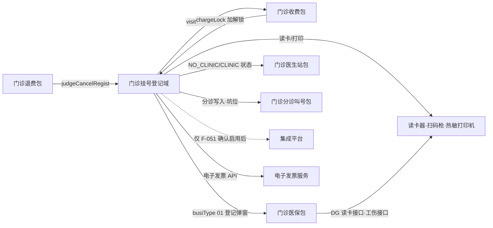

# 技术集成与验收测试

版本：v0.2（评审稿）

用途：定义门诊挂号登记的系统集成、外部依赖、技术边界、联调和测试验收。

**验收约束：** 每个 F/E/BR 和动态操作热点均须可追溯到验收项。目标行为按 020 潼南验证；003 东港仅用于补充兼容样本，且仅覆盖已获业务确认的差异。截图/动态 demo 是需求导航和 mock 演示，不是生产接口验收证据。

---

## 合并模块：08-外部系统与设备清单

# 外部系统与设备清单

## 1. 集成总览

## 2. 系统清单

| 对方系统/模块 | 数据流方向 | 关键内容 | 失败语义 |
|---|---|---|---|
| 门诊收费包 | 双向 | 本包供 visitCode/挂号上下文与收费入口（F-003/F-017）；收费包在收费事务加锁/解锁 chargeLock（BR-03，规则本体 04 章）；收费明细/收据/票据在窗口挂号事务内写入（BR-10）；挂号日报归收费包 | 加解锁失败拒绝收费变更；投影/日报归收费包，失败不影响挂号事实 |
| 门诊医保包 | 双向 | 费别分流触发登记弹窗（F-048，busiType=01）；慢特病资格查询 /ambRegistPsn/getList（F-045）；003 DG 读卡/工伤接口适配；退号医保反结算 | 登记失败阻断挂号；反结算 UNKNOWN 转人工 |
| 门诊医生站包 | 入 | 接诊推进 CLINIC；MedicalTechnologyImpl updateChargeLock 时机（Q-05）；020 AmbPatientListView 待诊列表消费 amb/regist/list/today | 状态只由接诊事件驱动（BR-14） |
| 门诊分诊叫号包 | 出/入 | 本包供分诊写入接口与坑位（F-050）；叫号/过号/优先级规则归该包（Q-11） | 坑位占用行数 0 拒绝；队列规则失败不回滚挂号 |
| 门诊退费包 | 入 | 退号触发跨包退费+医保反结算（judgeCancelRegist，工伤 09 三段） | 反结算 FAILED/UNKNOWN 阻断退号资金侧，状态按 BR-11 |
| 集成平台 | 条件出向 | F-051 经业务确认启用后，退号成功异步推 JH0105 | 默认不调用；启用后失败留痕补偿，不阻塞已成功退号（BR-12） |
| 电子发票服务 | 出 | 电子票开具（Econ_Electronic_Invoice）；中间表恰好 1 条否则抛错 | API 失败记附加错误，不回滚资金事实 |
| 设备（身份证读卡器/扫码枪/医保读卡器/热敏打印机） | 入/出 | identificationRead、readErCardIdNo/readFsCardIdNo/readMiCaedIdNo（原拼写）、miInjuryInterface.readCard、PrintUtil 热敏 | 设备失败提示后允许手工录入走查重；打印失败留痕重打 |

## 3. 设备清单

身份证阅读器（F-004，ITFS_IDCARD 异步读证）、医保读卡器/刷脸设备（F-006/F-007）、扫码枪（电子凭证 F-005）、热敏打印机（指引单 F-012）、发票打印机（P02/原号重打 F-026，归收费包打印平台契约）。

## 4. 接口契约必须包含

幂等键（requestId/挂号引用）与重复提交语义；条件更新行数语义（号源/坑位）；超时与 UNKNOWN 判定（仅对已经确认启用的 JH0105、医保、电子发票）；结果查询接口（凭幂等键/流水号反查）；失败返回码与 Legacy 原文提示映射；对账字段（visitCode、发票号、SP_TRANSACTION_ID、时间戳）。

## 5. 已有代码中的对接证据

见 03 章 3.1 Legacy REST 证据表（号源查询、窗口挂号事务双路径 Q-01、退号 camel/kebab 双套、visitCode、chargeLock、算费、身份识别、慢特病、分诊、预约取号）与 03 章 3.2 出向 V2 接口（PROPOSED）。

---

## 合并模块：10-系统总体方案设计

# 门诊挂号登记系统总体方案设计

## 1. 演进策略

不绿地重建：003/020 的业务结果与责任边界是兼容基线；V2 重写交互与底层实现，但每项旧能力在继承矩阵（01 章）中有唯一映射。页面合并（003 双 Tab + 020 三 Tab → P01）不减少业务能力。

## 2. 设计目标

一个工作台完成主挂号链；提交前明确号源、临床限制、发票与应缴金额；占号/流水/事务有服务端保证；两现场费别、退号、减免、必填策略参数化；chargeLock/visitCode 可靠供下游消费。

## 3. 建议逻辑分层

| 层 | 职责 | 参考（PROPOSED） |
|---|---|---|
| 前端工作台 | P01～P05 交互与展示（hook 参考 useRegistSubmit） | regist-workbench |
| HTTP 适配 | REST 契约、上下文注入 | RegistController / ScheduleController / PatientController |
| 应用服务 | 编排、状态机、幂等 | PatientQueryService / ScheduleHoldService / WindowRegistService / RegistCancelService / AppointmentService / TriageCommandService |
| 领域 | 状态、校验、不变量 | RegistRecord / ScheduleSlot / TriageSeat / VisitCode |
| 端口适配 | 外部系统边界 | ChargeLockPort / InsuranceDialogAdapter / IntegrationPushService / PrintAdapter |
| 策略 | 前置决策 | RegistValidateService（验重/临床/资格） |

## 4. 核心领域边界

挂号登记域拥有 RegistRecord/ScheduleSlot/VisitCode/TriageSeat/TriageRecord/AppointmentRecord/PatientMainIndex/PatientCard；收费明细、收据、票据、账户在窗口挂号事务内写入但权威归收费包；医保登记归医保包；队列调度归分诊叫号包。feeType/优惠/减免快照随挂号落库。

## 5. 主流程时序

见 02 章时序图（窗口挂号主链、退号链、预约与取号、分诊台与坑位、建卡链五条主链）。

## 6. 一致性与幂等要求

- 本地事务：挂号+号额+坑位+分诊+收费明细/收据同事务（020 @Transactional 基线）；跨系统（仅对已经确认启用的 JH0105、医保、电子发票）走"先落事实 → 调外部 → 按结果落库"。
- 幂等：requestId（提交）、挂号引用（退号/推送）、VISIT_CODE（chargeLock）全链路透传。
- 序列原子：AMB_REGIS_ID/AMB_VISIT_CODE_ID 数据库序列分配；序号加（排班ID+序号）唯一约束兜底。
- UNKNOWN 收敛：已启用的 JH0105、反结算、电子发票未知状态必须有补偿任务收敛，不允许长期悬挂。
- 投影一致：医生站/分诊消费挂号状态允许最终一致，可由 AMB_REGIST 全量重放。

## 7. 003/020 适配建议（020 为默认目标）

### 7.1 号源并发适配

容量与并发以 020 条件扣减语义（AmbSchedulingRegMapper.xml:962-966）为默认目标；003 客户端 GET/PUT ±1（AmbScheduleMapper.xml:475-513）只作为历史差异证据，不继承其并发行为。

### 7.2 chargeLock 时机适配

003 服务端加锁 vs 020 客户端 dispose 解锁语义不一致（事故源）；V2 统一服务端收费事务加锁/解锁；SQL 按 VISIT_CODE 保留两项目一致写法（BR-03，Q-05 医生站联动核验）。

### 7.3 退号规则适配

退号适配以 020 潼南为默认目标；003 独有接诊确认、电子票据拦截、JH0105 与 cancelDoctorRegist 均需逐项业务确认。V2 可统一为一条契约，但契约统一不扩大规则范围。

### 7.4 必填与费别参数化适配

003 硬编码必填十条与 020 Patad_PatRequired 参数化统一为参数驱动+服务端重校验（BR-07）；费别分流/急诊科室码硬编码（0001101134）全部参数化（BR-09）。

### 7.5 号别与预约模型适配

号别统一 regClass 枚举（DictElementClinicRegEnum）+ perm 字典映射；预约统一"排班+预约配额"模型吸收 AMB_SCHEDULE_APPOINTS 与 AMB_APP_REG（差异表，Q-20）。

## 8. 研发交接清单

- 领域对象与状态机：以 03 章数据字典 + 04 章状态定义为准。
- 端口契约：ChargeLockPort / InsuranceDialogAdapter / IntegrationPushService / PrintAdapter（Q-05/Q-10 未冻结前以端口接口开发）。
- 配置初始化：按 04 章 15 节参数分层与初始化读取顺序实现参数服务；DICT_SWITCH/DICT_PARAMETER 双码迁移。
- V2 参考实现：`analyzer/data/v2-reference.js`（全部 PROPOSED）；Legacy 源码快照 `analyzer/data/legacy-source-snapshots.js`。

## 9. 灰度与回退

先自费窗口挂号灰度（无医保依赖）→ 医保费别与登记弹窗 → 账户支付与减免 → 按 020 退号基线与预约 → 分诊台。回退：新入口与旧入口不并行写同一 AMB_REGIST 表；灰度期旧流程保持可用，异常按班次切回；visitCode 序列共用不回退。

## 10. 功能覆盖发布门禁

- 56 项 canonical 功能（F-001～F-056）在 01 章均有目标处置和追溯映射；活动功能由验收矩阵覆盖。F-028 是 020 已注释的历史证据，不作为活动功能执行验收（覆盖表见本章 6 节）。映射覆盖不表示实现或验收已经通过。
- 发布前须为 16 条 BR（04 章）提供服务端校验与测试证据，并执行 A-01～A-14；14 项全部通过且逐案留证后才满足本包验收门禁。此处是发布要求，不是当前实现或测试状态声明。
- 阻塞发布的待确认必须有结论或明确降级方案：Q-01（提交路径）、Q-02（取号链）、Q-03（取消预约落库）、Q-04（挂号权限项）、Q-08（现场开关值）。

## 11. 技术决策待办

Q-05 chargeLock 跨包加锁时机；Q-06 分诊新旧页分工；Q-10 线上渠道号源同步（二期）；Q-16 坑位/限诊事务同源性；Q-18 字典缓存刷新源；Q-19 失信拦截语义；Q-20 放号字典与序号规则。

---

## 合并模块：18-功能验收与测试矩阵

# 功能验收与测试矩阵

## 1. 验收维度

功能正确性（BR 逐条）、并发与原子性（占号/流水/事务）、异常恢复（拦截文案、跨包失败、推送补偿）、权限留痕（口令/权限项/操作员）、性能（号源查询 ≤1s、提交 ≤3s）、配置生效（每开关逐条验证）。

## 2. 功能矩阵（A-01～A-14，与本包 test.html V-01～V-14 一一对应）

| 编号 | 验收条目 | 判据 | 追溯 | 对应 V 编号 |
|---|---|---|---|---|
| A-01 | 号源并发 | 选号锁号源后剩余数正确递减；并发挂号不超号（003 客户端 ±1 的原子性风险不继承） | F-043/BR-01 | V-01 |
| A-02 | 锁号释放 | 切换号表/关页释放选择态；号源为 0 提示「已无号源！」 | F-002/F-043/BR-01 | V-02 |
| A-03 | 参数化必填 | Patad_PatRequired 配置驱动必填项；未配置提示维护参数原文 | F-018/BR-07/BR-15 | V-03 |
| A-04 | 三日重复挂号 | examine 返回三日重复时二次确认可继续；直接挂号被拦 | F-044/BR-04 | V-04 |
| A-05 | 儿科/妇科限制 | Patad_BabyAge 超龄拦截；Patad_PatSex 性别拦截（文案原文一致） | F-010/F-018/BR-05 | V-05 |
| A-06 | 发票强校验 | 无发票/余量不足两条文案正确触发，阻断后可继续领票 | F-040/F-056/BR-08 | V-06 |
| A-07 | 支付方式校验 | 无支付方式提示「没有支付方式，找管理员配置支付方式」 | F-040/BR-08 | V-07 |
| A-08 | 算费与四舍五入 | 算费金额正确；Econ_Rounded 缺失提示配置（020 1 位 / 0 两位 ROUND_DOWN） | F-056/BR-15 | V-08 |
| A-09 | 卡费开关 | Patad_IsCardCharge / Econ_CardDeposit / Econ_CardCharge 缺失提示原文 | F-008/F-022/BR-15 | V-09 |
| A-10 | 窗口事务原子性 | 窗口挂号事务一次完成挂号+收费+发票+指引单；中断无半程数据 | F-010/F-018/F-040/BR-10 | V-10 |
| A-11 | chargeLock 语义 | 收费加锁/事务结束解锁；锁定期间挂号侧患者数据变更被互斥 | F-042/BR-03 | V-11 |
| A-12 | 退号规则（020 基线） | 按 020 已确认的密码、缴费/医嘱、诊断、电子票据入账规则验收；003 独有接诊确认只有业务确认启用后才纳入扩展用例 | F-013/F-025/F-055/BR-11 | V-12 |
| A-13 | 医保弹窗分流 | 非 QZF/GFYL 费别挂号走 miAmbBusiness.ambRegistDialog（busiType=01）；慢特病无资格被拦 | F-045/F-048/BR-06/BR-09 | V-13 |
| A-14 | 退号外部推送（条件验收） | 默认验证退号事实成功且无 JH0105 调用；业务确认启用后再验证异步推送、失败留痕与补偿 | F-051/BR-12 | V-14 |

## 3. 页面验收矩阵

| 页面 | 必验点 |
|---|---|
| P01 挂号工作台 | 五通道读卡与多命中收敛（F-053）；双击直挂（F-014）；号表剩余/置灰；必填参数驱动；已挂 30 列关键字段（visitCode/日结/来源/退号人）；发票统计条 |
| P02 收费弹窗 | 减免命中现金置 0（F-046）；账户补差（F-047）；发票余量阻断；事务一次成功（A-10） |
| P03 预约与取号 | 预约最早明天；取消预约落库（Q-03 修复验证）；取号链路（Q-02 结论后）；管理页批量操作逐条留痕 |
| P04 分诊台 | 坑位防重复占用；取消分诊释放；开停诊联动；权限（TriagePermRelation） |
| P05 建卡 | 查重合并提示；三无直建免卡号；新生儿；退卡留痕 |

## 4. 必测异常组合

1. 号源余 1 × 双窗口并发挂号 × 不超号（A-01）。
2. 三日重复 × 确认继续 × 正常落库（A-04）。
3. 儿科号 × 超龄患者 × 拦截 × 改普通号放行（A-05）。
4. 发票余量不足 × 拦截 × 领票后继续（A-06）。
5. 020 退号密码/缴费医嘱/诊断/电子票据规则按配置验收（A-12）；003 独有接诊确认仅作为确认后的扩展用例。
6. 医保费别 × busiType=01 弹窗 × 挂号一条龙（A-13）。
7. 收费中 chargeLock=1 × 挂号侧改患者 × 互斥（A-11）。
8. JH0105 默认关闭时退号不发推送（A-14）；经业务确认启用后，再测不可达、留痕与补偿重推。
9. 事务中断 × 重试 × 无半程数据（A-10）。
10. 开关缺失 × 原文提示 × 阻断（A-03/A-08/A-09）。

## 5. 完成门禁

04 章 16 条业务规则逐条通过 + 03 章实体约束落库校验通过 + 本章异常场景演练通过 + 04 章 15 节配置项逐条生效验证通过。测试执行记录归档于本包测试与验收页签（V-01～V-14 逐案留证）。

## 6. F-ID → 验收映射总表（56 项映射与处置覆盖）

本表证明每个 F-ID 都有验收条目或明确处置，不代表测试已执行或通过。执行状态须在测试记录中逐案填写；F-028 仅登记历史源码证据，不作为活动功能验收。

| 验收条目 | 覆盖 F_ID |
|---|---|
| A-01/A-02 | F-001、F-002、F-015、F-016、F-029、F-043 |
| A-03 | F-018、F-024、F-053（必填集涉及建档字段） |
| A-04 | F-010、F-014、F-018、F-044、F-055 |
| A-05 | F-010、F-015、F-018 |
| A-06/A-07 | F-040、F-056 |
| A-08 | F-046、F-047、F-056 |
| A-09 | F-008、F-009、F-022 |
| A-10 | F-010、F-012、F-018、F-040、F-041、F-049、F-050、F-055 |
| A-11 | F-004、F-012、F-020、F-042、F-048 |
| A-12 | F-011、F-013、F-025、F-051、F-055 |
| A-13 | F-005、F-006、F-007、F-014、F-019、F-045、F-048 |
| A-14 | F-013、F-025、F-051 |
| 页面矩阵补充覆盖 | F-003、F-017（跳转入口，P01 联调验证）；F-021（健康卡绑定，P01）；F-023（高级查询，P01）；F-026（原号重打，P01）；F-027（代煎，P01）；F-028（历史证据，不验收）；F-030、F-031、F-032、F-033、F-034、F-035、F-036（分诊动作，P04 矩阵）；F-037、F-038、F-039（预约，P03 矩阵）；F-052（新生儿，P05 矩阵）；F-054（号别分类，P01/P04 号表验证） |

## 7. PRD 动态原型回归判据

以下用例验证 PRD 页面本地演示与本章动作表的一致性，不替代 A-01～A-14 业务验收，也不证明真实服务端实现。

| 编号 | 操作 | 预期结果 |
|---|---|---|
| Demo-00 | 打开 PRD HTML 原型并查看 P01～P05 | 原型由真实表单、表格、状态和反馈组成；采用收费工作台分区卡片布局；点击带 E 编号的控件/业务行后，右侧方法说明与动作详情立即切换；没有以截图作为交互画布。 |
| Demo-01 | 打开动作目录并逐页筛选 | 43 个 E-ID 均唯一且映射到 P01～P05 的一个页面；目录字段来自 02 章动作表。 |
| Demo-02 | 选择 P01 的 E-14，分别缺少患者或号源后提交 | 提交被阻止并提示缺少前置条件；患者与号源均已选择才跳转 P02。 |
| Demo-03 | 进入 P02 后查看 E-21 | E-14 与 E-21 是两个独立动作；只有触发 E-21 才显示本地演示完成，且明确无真实收费/挂号写入。 |
| Demo-04 | 打开 P03 并触发预约/取消/取号动作 | E-23/E-24 只改变本地模拟状态；Q-03 标为待决；E-25 在 Q-02 关闭前不可执行成功路径。 |
| Demo-05 | 在 P04 演示分诊、在 P05 演示建卡查重 | 状态变化仅在本地；重复患者不能直接创建新档案。 |
| Demo-06 | 查看证据与目标决议字段 | 源码可信状态与目标待决状态分开显示；UNKNOWN/待确认/003 补充项不显示为已实现或已验收。 |
