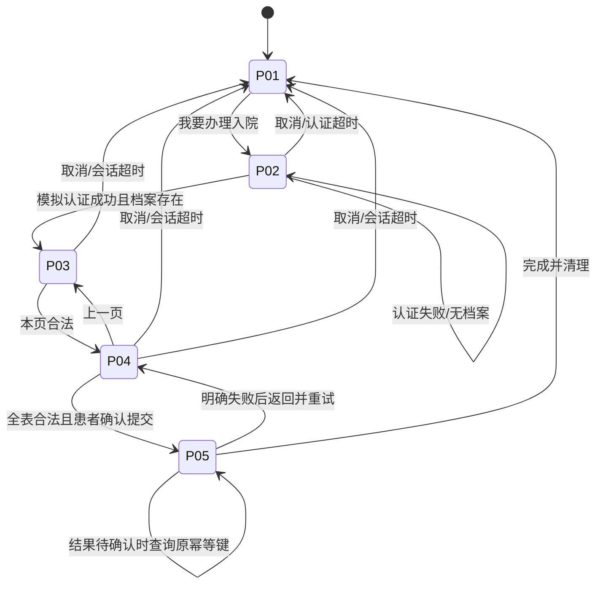

# 04 · 标准开发文档

版本 v1.1 / 2026-10-19。本文同时约束已交付原型与下一步联调；页面、字段与需求以 `02-prd.md` 为准，验收以 `05-acceptance.md` 为准。

## 1. 第一性原理与工程选型

本系统的最小可信链是：当前身份 → 受约束的表单 → 本人核对 → 一次登记意图。ASR 只产生文字、AI 只产生候选，均不拥有认证、修改只读身份或提交权限。医院服务 mock 与平台能力是不同边界；“外部接口全 mock”不意味着另建语音供应商或复制入院 AI。

后端比较两条路径：把路由放进 Octop 主应用最容易复用登录，但会把演示 mock 生命周期和改动带入已有平台；独立 FastAPI 服务符合本次 Python 服务要求，并隔离医院 mock，但部署必须 loopback 绑定且由 Octop 同源反代。采用第二条，AI 只把当前 bearer 转发至固定 Octop origin 的既有接口。前端用 Vue 2.7 + Element UI 2（用户指定）、Vite Vue2 插件构建；无需 Vue Router/Vuex/Pinia、数据库或容器。Vue 2 已 EOL 是明确维护限制。

三个主要失败面：跨患者的历史转写导致补错字段（单次上下文、禁止历史落盘）；客户端篡改字段或跳过界面校验（共享Schema、后端复验只读快照）；提交响应丢失后重复登记（幂等键绑定请求摘要、原键查询）。另一个部署边界是平台 token，故仅支持 Octop 同源代理，不能假定跨端口读取localStorage。

对既有 EHR Vue 3 / Ant Design Vue 技能基线的明确差异：用户本次指定 Vue 2 + Element UI 优先；后续按Vue2组件方式实现。业务边界、命名、请求层隔离、敏感信息、校验与测试要求继续沿用。

## 2. 文件与组件职责

实现目录与所有权如下；Vue 和 Python 均读取上层共享合同，避免复制字段规则：

实际代码结构：

```text
contracts/admission-fields.schema.json   唯一字段格式/枚举/长度合同
contracts/regions.mock.json              大陆省市区县及港澳地区树，前后端共同读取
frontend/src/App.vue                     5个页面状态与流程编排
frontend/src/model/validation.js          JSON Schema 前端运行时校验
frontend/src/api/admission.js             mock /平台 API 请求边界
frontend/src/style.css                    竖屏适配及页面视觉
frontend/tests/                           合同与流程测试
backend/src/admission_registration/main.py       FastAPI 路由及 Octop AI 代理
backend/src/admission_registration/contracts.py  JSON Schema 服务端校验与地区路径校验
backend/src/admission_registration/store.py      进程内 mock 身份/幂等状态
backend/tests/                                    后端合同及 API 测试
```

Vue 页面以一个流程页组件编排5个页面状态，两个表单页分别展示 F01–F08 与 F09–F14，最后一页卡片内确认提交。字段合同、请求与校验分别置于独立模块；不在此单页原型提前引入全局Store或每字段组件。项目使用 JavaScript SFC，不声明未启用的 TypeScript DTO 类型。

后续若纳入正式 EHR 页面，可按职责拆分为：

| 组件/模块                                | 输入                         | 输出/职责                                  |
| ---------------------------------------- | ---------------------------- | ------------------------------------------ |
| AdmissionRegistrationPage.vue            | 当前会话与动作服务           | 布局编排，不直接 fetch                     |
| IdentityVerificationPanel.vue            | 认证方式、状态、剩余时间     | 发出 verify/cancel，显示设备反馈           |
| RegistrationFields.vue                   | 字段定义、草稿、错误、当前页 | fieldChanged/pageChanged；不维护第二份草稿 |
| RegistrationReview.vue                   | 可信快照、草稿               | editGroup/confirm；只展示脱敏值            |
| VoiceInteractionPanel.vue                | 语音状态、转写、提示         | start/stop/replay；不操作身份与提交        |
| admissionApi / voiceApi / platformClient | 平台登录上下文、AbortSignal  | 唯一 HTTP 边界，错误归一化                 |
| admissionSession                         | 会话代号、阶段、草稿         | 统一守卫、失效、超时、候选映射             |

未来 DTO 从真实平台 OpenAPI 导出；mock 医院接口使用本文合同并保留 `mock=true`。页面元信息不是平台DTO，不复制或修改后端响应模型。无跨路由场景前不引入全局 Store。

## 3. 状态机与动作守卫



全局状态：`sessionId`、`phase`、`verifiedIdentity`、`draft`、`fieldSources`、`errors`、`voiceState`、`transcript`、`pendingRequest`、`lastActiveAt`、`receipt`。患者信息仅存在当前会话内存。

| 动作            | 前置条件                                      | 后置条件                                                 |
| --------------- | --------------------------------------------- | -------------------------------------------------------- |
| begin           | 首页                                          | 新会话代号，清除旧身份/草稿                              |
| verify          | 认证页且没有请求                              | 成功且有档案才写可信快照；失败不放行                     |
| updateField     | 已认证，非提交中，字段可编辑                  | 只更新该字段与校验状态；不清空其他字段                   |
| next            | 当前表单页                                    | 校验通过前进，否则聚焦首错                               |
| applyCandidates | 录音开始/结束、请求返回均为同一已认证表单会话 | 白名单、来源核对、校验、冲突处理后写入空字段             |
| submit          | P04末页，合法，用户主动确认，无 in-flight      | 固定幂等键调用 mock；一次完成后进入对应结果              |
| cancel/reset    | 未提交中或完成结果可离开                      | 使会话代号失效，取消请求、释放媒体、清空所有患者派生状态 |

认证中60秒超时；办理300秒空闲弹窗 +30秒宽限；ASR单次录音最长60秒、上传后30秒截止；AI客户端20秒截止（现有服务端15秒）；TTS首响应15秒、每段播放完释放资源。后续应将超时置于单一动作服务，不在组件各自启动竞争定时器。

提交中不把空闲超时当作失败或清空再提交：停止患者端重复操作，保留同一幂等键等明确结果；未知时进入结果查询/人工提示。本服务实现进程内幂等回执及查询；进程重启会丢失模拟数据，所以未知结果语义仅用于本轮原型，不可解释为生产登记恢复保证。

## 4. 医院接口 mock 合同（设计，不是现有 Octop 路由）

院内读卡、地区字典和登记 API 在 `backend/src/admission_registration/main.py` 提供独立 demo 路由；所有业务返回都带 `mock` 标记，数据仅驻留进程内存。视图不得调用真实 HIS。

| 方法                | 入参                                                  | 返回                                                                                                  | 情景                                    |
| ------------------- | ----------------------------------------------------- | ----------------------------------------------------------------------------------------------------- | --------------------------------------- |
| `POST /api/admission-registration/v1/identity/verify` | `method` | `{mock:true,verified:true,identityToken,fields}` | 认证方式校验；固定虚构身份 |
| `GET /api/admission-registration/v1/regions?parentCode=` | 父地区代码 | `{mock:true,items:[{value,label,leaf}]}` | 辽宁/北京演示三级树 |
| `POST /api/admission-registration/v1/validate` | 完整 `fields` | `{valid,errors}` | 共用字段合同及地区父子路径 |
| `POST /api/admission-registration/v1/submissions` | `identityToken,idempotencyKey,mockScenario,fields` | 成功/失败/已登记/待确认，均带 `mock:true` | 服务器二次校验，只读快照不允许被改 |
| `POST /api/admission-registration/v1/submissions/result` | JSON：`identityToken,idempotencyKey` | 原模拟结果或 `status:unknown` | 同一幂等键查询；令牌不放 URL |

mock 数据：虚构姓名“吴晓东”、证件“211003198709081234”（非合法真实证件）、联系电话 `13841928804`；这些值不能用于真实患者查找。不要把 mock 身份字段放入真实请求；联调平台 AI 时只能使用已告知的非真实样例文字。

`idempotencyKey` 在患者点击 P04“确认提交”时创建，一次意图跨网络重试保持不变。修改草稿后重新确认才可创建新意图；旧意图未知时禁止创建新意图规避查询。同键同请求返回同回执，同键异载荷返回冲突。该保证需要服务端或 mock adapter 实施，按钮 disabled 不能替代它。

## 5. 平台接口契约（现有代码已确认）

前缀 `/api`。只使用 Octop 当前登录与当前服务配置；不在 demo 配置供应商 URL/API Key，不调用浏览器内置语音作为静默替代。

| 现有接口                           | 请求                                                        | 响应                                            | 使用                          |
| ---------------------------------- | ----------------------------------------------------------- | ----------------------------------------------- | ----------------------------- |
| GET `/api/voice/active`            | Bearer登录态                                                | `{stt:string,tts:string,stt_realtime?:boolean}` | 获取平台语音配置              |
| POST `/api/voice/stt`              | multipart：`audio:File`、`language:zh-CN`，不传provider覆盖 | `{"text":"识别文本","confidence":null}`         | 平台一句话ASR，空文本不记成功 |
| POST `/api/voice/tts`              | JSON `{text:string}`                                        | 按Content-Type返回音频流                        | 脱敏播报，不固定假设mp3       |
| POST `/api/admission-demo/extract` | JSON `{text:string}`，1–2000字符                            | `{fields:Record<string,string>}`                | 当前入院AI，仅提供候选        |

STT的`confidence`字段可为数字或null。平台返回 JSON 对象本身，不包一层 `data`；错误格式复用平台规范。`/voice/stt-stream` 已有实时 WebSocket 路径，但本期实施建议先使用一句话 HTTP 路径，不复制React实时音频实现；实时接入需单独读取现有协议与资源清理代码，不能猜测帧格式。

认证：由宿主传入受控登录上下文；同源部署可按平台已有 token 机制带 `Authorization: Bearer …` 和 `Accept-Language`；响应有 `X-Octop-Access-Token` 时遵循现有续期策略。401 显示登录失效并清理会话，403 不假装成功重试。不要将 token 放 URL、原型 `.env`、文档、日志或源码。独立域名不能假设能读取平台 localStorage；优先同源部署/宿主授权桥接，跨域认证方案未授权前不扩展 CORS。

来源：`src/octop/api/routers/voice.py` / `admission_demo.py`；`dashboard/src/api/request.ts` / `modules/voice.ts`。具体返回和错误以当前部署实例的 OpenAPI 为联调依据，本文代码检查不等于已验证部署实例。

## 6. AI 候选映射与验证

现有服务从平台 active model 获取模型，`extract_registration_fields` 仅接受7个白名单键、字符串、trim 后1–200字。模型正常返回无内容或格式不合法时返回空候选；未配置模型、模型调用失败或15秒超时返回 HTTP 503（`AI_MODEL_UNAVAILABLE`），不能伪装成“没有可回填字段”。

| AI 键             | 页面字段             | 规则                                                     |
| ----------------- | -------------------- | -------------------------------------------------------- |
| contact_phone     | F03 phone            | 11位手机号且必须在原文中明确出现；不补尾号、不从证件提取 |
| address           | F08 addressDetail    | 作为详细地址候选，trim≤200；不得替换三级地区代码         |
| emergency_contact | F13 emergencyContact | 合法姓名、原文明确，空字段才回填                         |
| relationship      | F14 relationship     | 必须与枚举原值一致，原文明确                             |
| id_number         | 不映射               | 可信身份只来自认证快照                                   |
| contact_name      | 不映射               | 语义不足，不静默映射为患者/紧急联系人姓名                |
| emergency_phone   | 不映射               | 本轮截图并集没有该字段                                   |
| 任何其他键        | 不映射               | 忽略并不将内容展示为已采集                               |

接收结果用运行时校验，不信任响应类型。仅允许当前接口支持且可明确映射的四个键；手机号必须是本轮原文唯一出现的完整号码，其他候选必须逐字包含于本轮转写，含歧义提示时拒绝本次自动回填。模型返回的候选还须通过共享 JSON Schema。人工已填写值优先，冲突候选单独显示并需要点击确认；未知键和身份字段忽略。

### AI 上下文决定

本流程不需要多轮对话历史：提取任务是“从本次转写抽取固定字段”，现有 `/api/admission-demo/extract` 输入也只有 `text`。每次只提交当前一段已认证办理阶段的转写，接口请求不附带历史患者信息；转写仅保留在浏览器内存，不进数据库、`localStorage`、普通日志或分析事件。这样避免前一位患者/前一轮的号码和地址被模型跨轮补全，减少隐私暴露与 token 消耗。用户更正以当前表单为准：已有人工值不被覆盖，冲突候选需显式采用；无历史上下文意味着“上轮说过”不会自动补入，患者可重述或手动填写。模型失败不清空转写/草稿，允许继续手动输入。

后续平台联调应复用/移植当前入院 `flow.ts` 的来源核对思路，但不能直接依赖 React页面，也不能照搬其旧6字段必填集合。本PRD是14字段新版基线；当前旧Demo保持不变。

## 7. 语音生命周期

状态：`idle → recording → recognizing → extracting → idle`；播报为互斥 `speaking`，错误状态可重试。先获取平台 active 配置；只在用户点击后请求麦克风；录音开始立即停止TTS，记录 sessionId 与阶段。停止录音结束所有轨道，按平台可接受的格式生成音频，上传时让浏览器生成 multipart boundary。

识别最终文字内联保存，不弹人工输入窗口。录音开始和结束均为P03/P04、身份有效、同会话、没有更晚请求时才发送AI。开始于P01/P02的录音不因后来认证成功而补发。新的候选请求用版本号防止旧结果覆盖用户后来键入的内容。

失败区分：麦克风拒绝/无设备、数字静音、ASR超时、空文本、AI空结果、AI网络失败、TTS播放被浏览器阻止。始终保留文字输入入口；没有真实音量数据不生成假波形；录音超限自动结束并显示原因。

退出、取消、认证重置、页面卸载：abort网络；停止MediaRecorder和tracks；关闭AudioContext/WebSocket；pause音频、清空src、revokeObjectURL；停止任何平台委托播放；清除回调；使sessionId失效。无音频/转写落盘。TTS只读必要的脱敏提示，“联系电话尾号0000”，不朗读完整身份/号码或整段患者原话。

## 8. 字段校验与安全

前端校验用于交互，真实部署时提交接收方也必须再校验身份Token、归属、14字段和枚举，禁止由AI决定身份/权限。所有长度计数按Unicode字符而非字节；电话是字符串，避免数值转换。省市区必须整组为空或来自同一条有效三级路径；不能凭长度为3即判定有效。

姓名/证件脱敏规则集中在模型层。模板只使用文本插值，禁止 `v-html` 渲染模型/患者内容。普通日志只记录动作、耗时、脱敏错误类型，不记录姓名/证件/电话/原文/模型JSON。目标Demo患者状态只留内存，刷新即清空；不能用 localStorage 保存草稿。

输入上限：AI2000字、详细地址200字、单位50字、联系人40字；超限不静默截断患者数据。反复点击不能并发认证/抽取/提交。超时清理不能只是视觉返回首页，必须清理所有派生状态。

## 9. 实施顺序与验证门槛

1. 已交付Vue2页面、共享合同、FastAPI mock及失败/成功/已登记/未知情景；旧React入院Demo保持不变。
2. 已通过后端API合同/身份只读/重复提交测试及前端schema/build检查；人工浏览器旅程和对抗测试仍需按 `05-acceptance.md` 执行。
3. 平台 ASR/TTS/AI 接入客户端已调用Octop现有路径，在线联调仍需同源认证环境；不能把本地代理配置或HTTP 200视为模型真实可用。
4. 真实HIS/硬件、全国地区字典、数据库持久化、跨刷新恢复均不在此demo范围。

## 10. 工程启动、测试与部署交付要求（后续阶段）

运行依赖与命令见上层 `README.md`。前端用 `package-lock.json` 固定 Vue 2/Element UI，后端通过 `pyproject.toml` 声明 Python 3.12 依赖；`.env.example` 不含密钥。当前服务绑定 loopback，发布时只能经 Octop 同源反向代理，不应直接公开后台端口。AI只向部署方固定配置的 Octop API origin 转发登录 Bearer，不能从请求参数指定目的地址；服务端不得记录 bearer 或转写。

实现已有锁文件、Vue2兼容构建配置、TypeScript配置、`.gitignore`、无密钥环境示例、真实测试及dev/typecheck/test/build/preview脚本。打包前应在平台同源路由下验证真实登录、ASR、TTS和当前模型。

部署建议：Vue2页面构建为静态资源，与平台API同源部署；语音凭证仅由平台服务端维护；医院接口只指向mock adapter。独立 Python 服务监听 loopback，由已有反向代理按 `/api/admission-registration/*` 路由转发。不得改写现有 React 入院页面。

本 demo 定向验证见 `docs/06-verification.md`。当前没有改动 Octop API/React 主应用，不运行全仓 `make all`；平台路由变更如后续增加，再执行全仓门槛。

## 11. 组件事件与交互验收要点

- 表单组件只发fieldChanged/pageChanged，不自行提交或决定患者资格；readonly身份字段不暴露更新事件。
- 底部语音控件只处理start/stop/replay，最终提交只能由P04末页的患者确认动作触发。
- 数字键盘、级联下拉、取消/超时弹窗即使挂载到body，也必须纳入统一活动记录；每个数字、退格、清空、完成都刷新空闲时间。
- P02认证失败允许重试；身份成功但无档案时关闭认证启动入口，仅保留人工帮助与返回，避免状态含糊。
- P04提交中禁止编辑和取消；宽限计时不得把待定提交误记为失败，未知结果先查询再决定重试。
