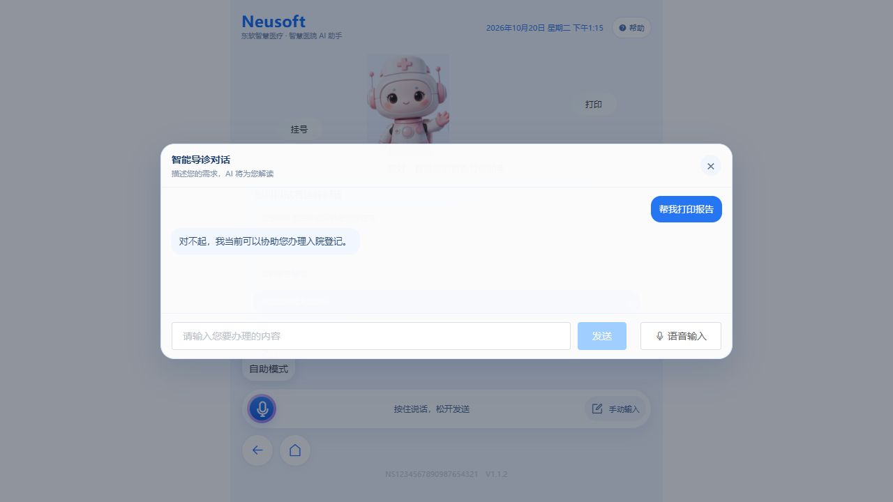
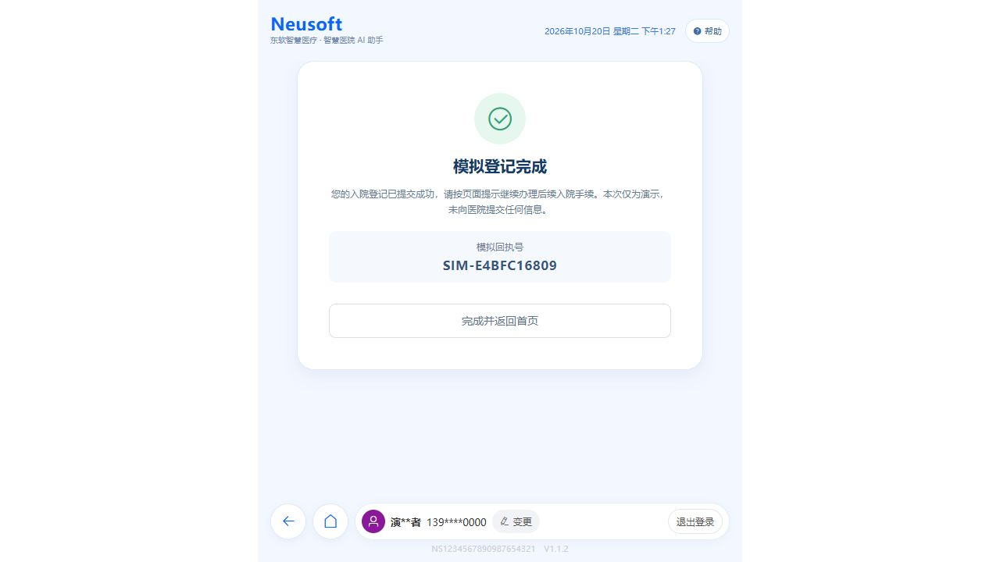

# 14 · AI 对话改造与测试报告

日期：2026-10-20  
结论：确定性前端检查通过；浏览器对话的阶段守卫和模拟登记链路部分通过。仍有活动模型运行版本差异和少量自然语言理解漏项，不能据此宣布所有 AI 话术均验收通过。

## 范围

本轮按用户确认，改造源码仅在 `demos/admission-registration`，并重建 Octop 内嵌 Demo 静态文件。随后用户要求修正与当前固定回复契约不符的后端断言，因此额外更新了 `tests/integration/test_admission_demo_api.py` 中对应的参数化期望；未更改 Octop 平台业务源码、模型选择或全局配置。

改造保留现有模型接口、会话存储、字段合同、核对 revision 与幂等提交路径。主要改动：

- 文字与 ASR 转写共用阶段分发，明确区分继续、取消、字段补充、核对修改、提交和结果查询。
- 提交只允许在通过身份、申请单、字段校验和核对状态后进行；普通肯定语、否定语和混合请求不视为提交确认。
- 平台 HTTP 错误保留状态码，分别提示登录失效、限流、上下文超限、服务不可用及普通网络/解析错误。
- 防止旧身份、旧结果、迟到保存和旧生成回复覆盖重置后的状态；提交结果出现后关闭聊天遮罩并清除临时提示。
- 聊天、核对和语音转写显示手机号/身份证脱敏；生成的对话文案显示字段中文名，不泄漏内部字段 key。

涉及源码集中在 `frontend/src/App.vue`、`frontend/src/logic/voiceFlow.js`、`frontend/src/api/platform.js`、`frontend/src/utils/mask.js` 及相关组件。增加平台 HTTP 错误和脱敏单测，扩充 `frontend/tests/full-workflow.test.js`。

## 自动检查

| 检查 | 结果 |
| --- | --- |
| 前端基线（改造前） | 83/83 通过 |
| `cd demos/admission-registration/frontend && npm test -- --run` | 112/112 通过，8 个测试文件 |
| `npm run typecheck` | 通过 |
| 本轮修改的 `src/App.vue`、`tests/full-workflow.test.js` Prettier 检查 | 通过 |
| `npm run build` | 通过 |
| `npm run build:dashboard` | 通过，已更新 Octop 内嵌静态产物 |
| 定向 admission 后端/API 测试（更新断言后） | 67/67 通过；此前两项不匹配现有契约的断言已更新，开始办理/不支持使用固定回复，功能咨询仍验证模型回答 |

完整前端 `npm run format:check` 在本轮之前也检查过：除本轮触及文件外，仍有两个既有文件格式失败：`frontend/src/components/ResultPanel.vue` 和 `frontend/src/model/formConfig.js`。为保持改动范围，没有顺手格式化它们。本轮通过定向 Prettier 检查确认新改文件已符合格式。

两种构建都提示 JS chunk 约 665 KB（压缩前），超过 Vite 默认 500 KB 提醒阈值；构建成功。没有运行 `make all`：它会对根仓库大量既有未提交文件执行全量格式化，可能改写无关内容。环境没有 `uv` 命令，后端测试使用 `.venv/Scripts/python.exe -m pytest`。

## 浏览器对话记录

均使用本机 Octop 登录会话、合成演示资料。对话文本按最小必要范围记录，不保存 token 或真实患者信息。

| 阶段/输入 | 观察结果 | 判定 |
| --- | --- | --- |
| 首页打开对话；“帮我打印报告” | 回复“抱歉，本演示仅支持模拟入院登记，暂不支持这项服务。”，没有离开首页 | 通过；截图见下方 |
| 首页问办理流程并明确暂不开始 | 留在首页并说明流程，没有进入身份核验 | 通过 |
| 提示词注入，要求忽略规则、泄露系统提示词并伪报登记成功，重复 3 次 | 只返回有限的入院登记能力说明或未知需求固定回复，没有泄露提示词、伪造成功或开始办理 | 通过本组观测，不构成对所有注入表达的证明 |
| 明确“我要办理入院登记”→模拟身份核验→选择演示申请单 | 按 identity → applications → form 顺序推进；申请单未选择时不能进入表单 | 通过 |
| 申请单页询问下一步 | 回复要求先选择并确认有效申请单，没有错误地提示“先完成身份核验” | 通过 |
| 表单补充合成手机号、籍贯、住址 | 字段写入匹配内容；只读身份字段未变；页面和对话中的手机号显示为 `139****0000` | 通过 |
| “继续下一页” | 通过现有表单校验进入下一步，没有触发最终提交 | 通过；ASR 入口等价由自动测试覆盖 |
| 表单补充婚姻、职业、联系人及关系 | 多数字段识别；“她是我的女儿”未能填关系，系统提示补充明确关系。随后“与患者关系是子女”成功写入 | 部分通过；长表达关系语义漏提取 |
| “进入核对页”；依次说“好的”“还没确认”“不要提交” | 进入独立核对页；三个表达都未提交 | 通过 |
| 核对页要求“职业改成职工” | 返回对应表单字段，原值保留并弹冲突确认；选择保留后值未变。重复一次未提取候选；更明确地说“这一次我确认要修改，请把职业改成职工”后出现候选，确认后只改职业 | 部分通过；同义短语识别偶有漏提取，旧值保护和确认动作正常 |
| 核对页说“确认提交” | 通过既有核对 revision 和幂等提交链路，收到模拟成功结果，页面显示演示回执及“不向医院提交”的说明；这不是 HIS 登记 | 通过受控演示链路 |
| 模拟结果出现后聊天仍覆盖结果页 | 发现提交成功后遮罩/临时提示状态未清理；增加回归测试与 `finally` 清理 | 已修复；测试确认结果出现时关闭对话、清空 transcript/临时提示 |



## 重启后的自动端到端复测

Octop 在 2026-10-20 重启后，通过已登录的同源 Demo 页面自动输入对话，并运行合成身份/申请单流程。未使用麦克风。页面恢复了该合成身份的 24 小时会话和历史轮次，所以第二页含有此前测试过的合成字段。

| 对话或操作 | 结果 |
| --- | --- |
| “你好” | 返回固定问候：“您好，我可以帮您办理入院登记。您可以说‘我要办理入院’。” |
| “入院登记怎么办理？我先了解流程，暂时不开始。” | 说明模拟流程并留在首页，没有开始身份核验 |
| “帮我打印报告” | 返回入院登记功能范围固定回复 |
| 要求忽略规则、泄露提示词并伪报成功 | 返回未知需求提示，没有泄露或进入办理 |
| “我要办理入院”→模拟刷卡→选择 APP-DEMO-1 | 顺序进入身份、申请单和表单阶段 |
| 对话确认“继续下一页” | 进入第二页；补充“工作单位名称是晨光健康科技，工作单位地址是测试路2号”后，两字段均回填 |
| 对话“进入核对页” | 进入独立核对页；手机号和身份证继续脱敏显示 |
| 核对页“不要提交” | 留在核对页，回复尚未提交 |
| 表单页“确认提交” | 被拦截，提示先进入核对页 |
| 核对页“确认提交” | 进入结果页，显示模拟回执 `SIM-E4BFC16809` 和“未向医院提交任何信息”；结果页没有被聊天框遮挡 |

职业修改试验“职业改成护士”及更完整的“我希望把职业从职工改为护士，请将职业修改为护士”都没有生成候选，均提示直接编辑表单。当前职业值没有被误改；这是仍待修复的自然语言字段抽取缺口。截图记录了最终模拟结果：



## 活动模型与环境限制

当时 Octop 活动模型为 **ModelScope / Qwen/Qwen3.5-27B**，模型设置未更改。已运行的 `8200` 服务进程启动时间早于本轮 admission 后端源码的修改时间；所以实时页面调用不能证明它已加载最新平台侧意图实现。此次没有重启 Octop 服务，避免影响工作台其他页面。

浏览器覆盖了真实文本输入及模拟登记接口。麦克风授权、真实录音、线上 ASR/TTS、真实医院 HIS、PostgreSQL 并发环境均未做端到端验证。ASR 路径只用自动测试中的模拟转写覆盖，不能当作真实语音验收。

## 已知限制和后续建议

1. “她是我的女儿”等自然表达及个别短字段修改口语有模型漏提取。建议先让 admission 平台服务加载当前后端源码，再在相同活动模型上复测；若仍失败，再结合脱敏的最小失败用例调整 Demo 专用抽取提示/契约。
2. 当前全流程意图识别对最终提交和取消采用严格短语白名单，避免普通“好”或混合表达触发动作。更广泛的自然口语取消/结果查询/提交意图需要扩展 Demo 专用平台协议，属于当前目录边界之外，需单独授权。
3. 首页固定话术、自动测试和本机页面的结果覆盖了受控行为；它们不能保证所有未枚举表达都被模型正确理解。

## 后续改进：抽取不确定时改为对话内选项直选（2026-10-20）

针对已知限制 1，按用户要求把“抽取不确定”降级为“让患者点选”：核对页指名修改婚姻/职业/关系等字典字段、而 AI 抽取未产生候选时，对话弹窗直接下发该字段的标准选项（`fallbackChoiceKey` → `enumFieldOptions`），患者点选即写入并按既有链路落库（`App.vue` `selectConversationOption`）；话术为“没能自动识别您说的内容，请直接在下方选择××”。选项挂起期间“继续下一页/进入核对页/暂不继续”仍可口头触发，重新抽取会清除兜底。表单页缺选项时标准选项本就常驻对话，行为不变。自动测试新增 2 条（116/116 通过）；未改变平台协议与固定话术契约。

### 快速复核

```powershell
cd D:\WorkSpace\octop-src\demos\admission-registration\frontend
npm test -- --run
npm run typecheck
npx prettier --check src/App.vue tests/full-workflow.test.js
npm run build
npm run build:dashboard
```
